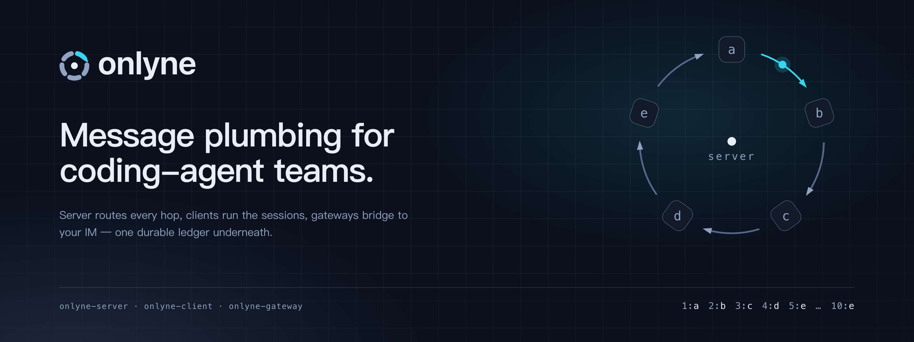
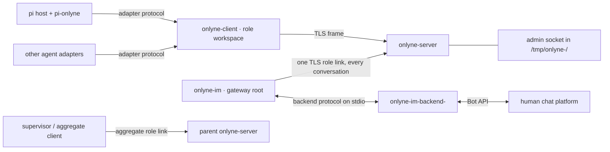

# Onlyne

**Message plumbing for coding-agent teams, running on your own machines.**

Onlyne ties a fleet of coding agents into a durable cluster. A **server** routes messages between roles and records every delivery in an append-only ledger. A **client** in each role workspace runs that role's coding-agent sessions. An optional **IM gateway** (`onlyne-im`) connects as one cluster role and routes every conversation in its registry by a first-line chat key, so a person in a chat talks to the same cluster the agents do. Agents keep their own runtimes and make the decisions; Onlyne provides routing, queueing, session transport, receipts, and an auditable record.

[中文文档](README.zh-CN.md) · English is the default reading copy.

Clients can run on different machines over TLS. Generated workspaces are relocatable, and a supervisor client can expose a child cluster to a parent server as one aggregate role.

  


## Choose a starting path

| Path | Use it when | Extra requirements |
|---|---|---|
| **Installed binaries** | You are integrating Onlyne with an existing agent, host, or service manager. | A matching Onlyne build and your own agent adapter or ACP command. |
| **Source checkout: fake quickstart** | You want the shortest local end-to-end task without a model or terminal host. | Rust 1.85+, a POSIX shell, and the source checkout. `onlyne-agent-fake` is built from `onlyne-testkit`; it is not installed with the release binaries. |
| **Source checkout: pi + Orca demo** | You want real pi sessions visible as Orca tabs. | The fake-path prerequisites plus Python 3, pi, model credentials, the Orca app, and the `orca` CLI. Run it from an Orca tab for the visible path. |

The fake and Orca examples below intentionally use `target/debug/...`; the launcher checks those source-built binaries directly.

## Install

### Prerequisites

- **Registry install:** Cargo and Rust 1.85 or newer.
- **Platform SDKs:** optional, and never in the core. `onlyne-server` and `onlyne-client` compile no IM SDK at all; the shipped backends (Telegram, Feishu, QQ, Slack, Linear) each live in their own crate and talk to their platform over HTTPS or a websocket. The gateway itself (`onlyne-im`) is an independent module with its own CLI, not a `onlyne` verb.
- **Runtime:** an address and port reachable by every role client. The local admin and adapter sockets require a writable owner tree.
- **Agent host:** a supported backend and an adapter. The real pi path needs the [pi coding agent](https://github.com/badlogic/pi-mono); use pi 0.85.1 for the path documented here.
- **Services:** installation does not register a service, and there is no `start`/`stop`. Both daemons run in the foreground; a terminal host, `launchd`, or `systemd` keeps one resident.

### Registry packages

Install the core from the current published packages. Keep the package set together so the sibling binaries share one build:

```bash
cargo install \
  onlyne-cli onlyne-server onlyne-client
```

That produces the operator entry point and its two daemons:

| Command | Role |
|---|---|
| `onlyne` | Operator entry point. Every verb is implemented in this process: the queries, the admin operations, `init`/`generate`, the built-in TUI, and the MCP tool bridge. The two daemons forward nothing back. |
| `onlyne-server` | One cluster's router, delivery queue, durable ledger, fault record, and admin socket. Subcommands: `init`, `run`, `status`, `generate`. |
| `onlyne-client` | One role workspace's server link, session lifecycle, backend host, adapter socket, and durable outbound intents. |

The observation board is the `onlyne tui` verb, not a separate binary. `onlyne-agent-fake` is an
additional source/testkit-only command. It is absent from the registry-installed binaries and is
built by the fake quickstart below.

### IM gateway (optional)

The IM gateway is its own module with its own binary, the way `onlyne-web` is: `onlyne` has no
`im` verb, and the core build pulls in no chat SDK. Install it only if you want a chat platform
to reach a cluster, and install the backend for the platform you use
(`onlyne-im-backend-telegram`, `-feishu`, `-qqbot`, `-slack`, or `-linear`):

```bash
cargo install onlyne-im onlyne-im-backend-telegram
# Replace the backend package with -qqbot, -slack, -linear, or -feishu as needed.
```

| Command | Role |
|---|---|
| `onlyne-im` | One gateway root: `init`, `generate`, `login`, `setup`, `run`, `check`. It hosts every conversation under `conversations/` in one process and runs the operator's trigger scripts. |
| `onlyne-im-backend-telegram` | A Telegram bot backend: one process, spawned by the gateway, speaking the standard backend protocol on stdio. |
| `onlyne-im-backend-qqbot` | A QQ Open Platform backend: the websocket event gateway inbound, per-scene sends outbound (a group send quotes `msg_id` while the passive-message window is open, and is a proactive message after it). Credentials are an app id and secret, stored as `app_id:app_secret`. Reactions are channel-only on QQ; a group reaction is refused by the platform, not by this backend. |
| `onlyne-im-backend-slack` | A Slack backend: Socket Mode inbound (needs an `xapp-` app token and an `xoxb-` bot token, stored as `xapp-…:xoxb-…`), Web API outbound. Replies thread under `thread_ts`. |
| `onlyne-im-backend-linear` | A Linear backend: inbound is a poll of the workspace's comments (default every 10 s, `ONLYNE_LINEAR_POLL_SECS`), outbound is `commentCreate`. A conversation is one issue; a reply sets the comment's `parentId`. Authenticates with one API key. |
| `onlyne-im-backend-feishu` | A Feishu backend: events over the long connection, groups listed from the real chat list, bot-added events adopted without a restart, and interactive cards whose buttons return a toast and an `action` event. The agent's answer arrives as a threaded follow-up message. |

`onlyne-im-backend` — the protocol types a backend implements — arrives as a dependency of
either binary. A new platform is a new `onlyne-im-backend-<platform>` crate; none of them is
linked into `onlyne`, `onlyne-server`, or `onlyne-client`. `init`, `generate`, and `login` are
covered in [Operate an IM gateway](#operate-an-im-gateway) below.

### Prebuilt binaries

A release tag carries five platform archives, their `.sha256` files, and a combined
`SHA256SUMS`. The installer picks the archive for this machine and verifies it against that
list before it writes a binary:

```bash
curl -fsSL https://raw.githubusercontent.com/dbydd/onlyne/main/packaging/install.sh | sh
# PREFIX=~/.local sh packaging/install.sh <tag>   # one tag, another prefix
```

The same archives are what Homebrew installs. The release pipeline renders
[`Formula/onlyne.rb`](Formula/onlyne.rb) from the release's own checksums and commits it here,
so this repository is the tap:

```bash
brew tap dbydd/onlyne https://github.com/dbydd/onlyne.git
brew install dbydd/onlyne/onlyne
```

The clone URL belongs in the tap command: Homebrew reads the short name `dbydd/onlyne` as a
repository called `homebrew-onlyne`, and that is not this one.

The binaries land in Homebrew's prefix, so no Rust toolchain is needed on the installing machine.

### Agent handbooks

The installed `onlyne` binary carries handbooks matching its own version:

```bash
onlyne skill export                         # all sets under .agents/skills
onlyne skill export --set role              # role workspace handbooks
onlyne skill export --set supervisor        # supervisor handbook
onlyne skill export --dest /path/to/skills
```

`skill export` writes every handbook as an ordinary regular file, and the bytes it writes are the ones compiled into the binary (`include_str!` over the three manuals under `crates/onlyne-cli/skills/`), so an installed binary answers with its own version's text. Matching files are left unchanged. A differing file stops the export; pass `--force` to replace it. `npx skills add dbydd/onlyne` and `npx skills add ./` install the same repository documents through the skills CLI.

## Shortest local task: fake backend

Run this block from the repository root. It builds only the packages needed for the local fake path, creates a temporary cluster, and uses the checked-in scripted agent. The fake completes the task from its assignment text; it calls no model.

```bash
cargo build -p onlyne-cli -p onlyne-server -p onlyne-client -p onlyne-testkit

tmp=$(mktemp -d)
server_pid=
client_pid=
fake_pid=

target/debug/onlyne-server init \
  --root "$tmp/server" --listen 127.0.0.1:17899
target/debug/onlyne-server run --root "$tmp/server" >"$tmp/server.log" 2>&1 &
server_pid=$!
target/debug/onlyne --server-root "$tmp/server" wait-ready

target/debug/onlyne-client init \
  --workspace "$tmp/planner" \
  --role planner \
  --server-root "$tmp/server" \
  --prose "v1 smoke prose" \
  --register >/dev/null

ONLYNE_BACKEND=fake target/debug/onlyne-client run \
  --workspace "$tmp/planner" >"$tmp/client-process.log" 2>&1 &
client_pid=$!
target/debug/onlyne-agent-fake \
  --workspace "$tmp/planner" \
  --script crates/onlyne-testkit/scripts/echo-complete.json \
  >"$tmp/fake.log" 2>&1 &
fake_pid=$!

until target/debug/onlyne --server-root "$tmp/server" roles --json \
  | grep -q '"state":"online"'; do
  sleep 0.2
done

send=$(
  target/debug/onlyne --server-root "$tmp/server" send \
    --from planner --to planner --text "hello v1" \
    --force --yes-i-am-supervisor-not-other-role
)
printf '%s\n' "$send"
task=$(printf '%s\n' "$send" | sed -n 's/.*"task":"\([^"]*\)".*/\1/p')

until target/debug/onlyne --server-root "$tmp/server" ledger \
  --task "$task" --json | grep -q '"state":"acked"'; do
  sleep 0.2
done

target/debug/onlyne --server-root "$tmp/server" ledger --task "$task" --json
target/debug/onlyne --server-root "$tmp/server" sessions --task "$task" --json
```

The task row settles to `acked` with `hello v1` in `out_head`. Its session projects to `exited` with outcome `done`. When finished:

Change `17899` in the init command if that port is already occupied.

```bash
kill "$fake_pid" "$client_pid" "$server_pid" 2>/dev/null || true
wait "$fake_pid" "$client_pid" "$server_pid" 2>/dev/null || true
rm -rf "$tmp"
```

### Use a real agent headlessly

The same server/client topology works without a terminal host. Install a working pi setup and the adapter. At the point where the fake block starts the client and fake agent, run only the client command below and omit the fake agent:

```bash
pi install npm:pi-onlyne
ONLYNE_BACKEND=headless target/debug/onlyne-client run --workspace "$tmp/planner"
```

The role's `[client.runtime] command` already names pi. The client starts one pi process per task, holds its stdin open, and captures stdout/stderr in `<workspace>/.onlyne/logs/session-<task>.log`. The send, ledger, and session commands stay the same. This path needs working model/provider credentials.

For a generated workspace, `onlyne server generate` can vendor the repository's `plugins/onlyne-agent-pi` package and write the project-scoped `.pi/settings.json` entry. A user-wide npm install remains inert in ordinary pi sessions because the extension activates only when Onlyne injects `ONLYNE_ROLE`, `ONLYNE_SESSION_ID`, and `ONLYNE_TASK_ID`.

## Real pi + Orca demo

The repository includes a five-role running-lights demo. It generates a cluster, starts five real pi workers, opens a supervisor pi session, and shows each worker in an Orca tab. Tabs retire when their tasks finish.

From an Orca tab in the repository:

```bash
cargo build -p onlyne-cli -p onlyne-server -p onlyne-client
python3 examples/supervisor/run.py up
python3 examples/supervisor/run.py status
python3 examples/supervisor/run.py stop
```

The Orca path requires:

- the Orca desktop app running and its `orca` CLI on `PATH`;
- a shell inside an Orca tab, so `ORCA_WORKTREE_ID` selects the host worktree;
- pi on `PATH` and configured model/provider credentials;
- Python 3; the launcher uses only its standard library.

The launcher uses the repository's local pi adapter package and the binaries under `target/debug`. To run the same real-agent demo headlessly outside Orca:

```bash
ONLYNE_BACKEND=headless python3 examples/supervisor/run.py up
```

The supervisor output is then written under the demo root instead of opening a visible supervisor tab. In another terminal, inspect the demo with:

```bash
target/debug/onlyne --server-root /tmp/onlyne-sup tui
```

The full walkthrough is [`examples/supervisor/README.md`](examples/supervisor/README.md). The [research-flywheel](https://github.com/dbydd/research-flywheel) project is a larger agent-ring example built on Onlyne.

## Follow one task end to end

```mermaid
sequenceDiagram
  participant O as Operator / supervisor
  participant S as onlyne-server
  participant C as Role client
  participant A as Agent adapter
  participant R as Origin client

  O->>S: send task (ACL + op_id)
  S->>S: append ledger row: queued or in_flight
  C->>S: pull delivery
  S-->>C: envelope; mark in_flight
  C->>A: ready, then assign task
  A-->>C: assign_ack + progress
  A-->>C: complete(outcome, head)
  C->>C: settle local task; enqueue delivery ack + receipt
  C->>S: ack original delivery
  S-->>C: accepted receipt
  C->>S: completion to task origin
  R->>S: pull completion
  S-->>R: receipt envelope
  R->>S: ack receipt
```

1. **Send.** The gated `send` verb opens the server's local admin socket, names the sender and target, and carries an `op_id` idempotency key. A repeat of the same operation returns the durable receipt; a different body under the same key is a conflict.
2. **Accept and record.** The server validates the envelope, sender, target, and ACL before touching the ledger. An accepted send appends one row and publishes its receipt. The row is `in_flight` when immediately deliverable and `queued` while the role is offline or at capacity.
3. **Pull and assign.** The role client pulls the oldest eligible task, so the server marks it `in_flight` and binds a delivery ticket. The client accepts capacity, starts the session its drive and placement select, and waits for the session's `ready` barrier before sending `assign`. The task text travels in the assignment frame; `{task}` in the role's `[client.runtime] command` renders the task id, not the message body.
4. **Complete.** An adapter reports a terminal outcome and summary. The pi plugin's `onlyne_complete` tool supplies both. The client records the local task verdict, queues an acknowledgement of the original delivery, releases the session slot, and builds a separate completion envelope for the task's recorded origin.
5. **Receipt.** Durable client intents flush over TLS in order. The original task row becomes `acked`; the completion receipt is `queued` until the origin client pulls it, then acked without starting another session.

At family start, the gated `send` form accepts `--hop-budget <n>`, `--deadline <rfc3339>`, and repeatable `--label <key=value>` for up to eight labels. The server records the minted family and root task id, hop budget, origin, RFC3339 deadline, and labels. A role can continue that family with `onlyne_handoff`; the server mints a child task under the parent, and every handoff inherits the complete family metadata. Completion receipts always return to the task origin even when ordinary role-to-role ACL has no return edge.

Onlyne's four core message kinds are:

| Kind | Purpose | Delivery |
|---|---|---|
| `task` | Hands work to a role and creates one session. | At least once; queued while offline. |
| `completion` | Carries the terminal result for a task. | At least once; queued at the origin. |
| `note` | Carries free text between humans, agents, and gateways. | Best effort by default; `note_queue` can hold one while a role session is absent. |
| `control` | Applies `recycle`, `probe`, `snapshot`, `cancel`, or `focus` to a task. | Owner or admin only. |

## Configuration and stored data

### Server root

`<server-root>/.onlyne/spec.toml` is the protocol source of truth: server endpoint and certificate pin, registered role keys, ACL edges (`allowed_senders` and `allowed_targets`), route obligations (`owes_targets`), prose, concurrency, timeouts, each role's `[client.runtime]` drive and command, event hooks (`[[hook]]`), routes, and gateways. Register roles with `onlyne-client init --register` or `onlyne server generate`, then run `onlyne reload`.

The automatic requeue age gate is `[server].requeue_ttl_secs`. It defaults to `0`, which leaves the gate off, and measures queued-row age from `enqueued_at`. When an automatic requeue would happen after that age, the row settles as `expired` with reason `requeue_ttl`; operator-led `repair retry` bypasses the age gate.

```text
<server-root>/.onlyne/
  spec.toml                 protocol and role truth
  state.db                  ledger, faults, events, ghost-sweep audit
  run/                      owner-only runtime directory; v2 creates nothing here
  keys/server.key           TLS and server identity key
  templates/                role content used by generate
  ws/                       default generated workspaces
  cache/                    gateway scratch state
  logs/server.log           detached server log
```

### Role workspace

`<workspace>/.onlyne/config.toml` is the role-local configuration: identity, server endpoint, certificate pin, key path, placement, Orca policy, ACP options, and reconnect/stall timers. `cert_pin`, `key_path`, and `server.host` may contain `$NAME` environment references resolved at startup.

```text
<workspace>/.onlyne/
  config.toml                 role, placement, and ACP configuration
  client.db                   task/session state and durable intents
  run/                        owner-only runtime directory; holds nothing bound
  keys/role.key               role identity key
  agent/                      workspace-scoped agent packages
  logs/client.log             client process log
  logs/session-<task>.log     rendered exec/ACP session output
  logs/session-<task>.events.jsonl
  logs/content.index.jsonl    durable content offsets
```

`onlyne server generate` writes relocatable workspaces: move the directory, then run `onlyne client run --workspace <new-path>`. Server and role clients must run the same Onlyne build. Older schemas and legacy layouts are refused at the door; Onlyne does not migrate them in place.

### Gateway root

An IM gateway root is its own tree, separate from the server root and from any role workspace,
and it holds one directory per conversation. See
[Operate an IM gateway](#operate-an-im-gateway) for the layout and the verbs.

```text
<gateway-root>/.onlyne/
  config.toml                 [server], [[im.backend]], [[im.push]]
  keys/role.key               the gateway role's key, mode 0600
  credentials/<gateway>.token platform credentials, mode 0600
  logs/gateway.log            gateway process log

<gateway-root>/conversations/<slug>/
  .onlyne/config.toml         this conversation's platform coordinates
  .onlyne/chat.key            this conversation's identity on the wire
  chat.jsonl                  inbound events and outbound payloads, one per line
  media/                      attachments, both directions
```

The gateway root and the server root may sit on different machines: `init` takes the endpoint and
certificate pin from `--server-root` when it can read one, and both flags when it cannot.

Print the compiled configuration schemas with:

```bash
onlyne schema spec --pretty
onlyne schema client --pretty
```

### Socket discovery

Every local socket lives in one machine-level runtime directory, never inside a workspace tree. On macOS and Linux that is `/tmp/onlyne-<uid>/`, created `0700`, and `$ONLYNE_RUNTIME_DIR` replaces the whole directory when it is set and non-empty.

One owner tree owns two files there, both named by `<digest>` — the first 16 hex characters of `sha256` over the tree's canonical absolute root:

```text
<runtime-dir>/<digest>.sock    the bound socket, mode 0600
<runtime-dir>/<digest>.json    the registration: kind, role, root, pid, version, runtime
```

The registration is how a reader learns who serves a tree without walking one: `kind` says whether a server root or a role workspace's client serves it, and `role` names the role. An operator lists every registration on the machine with `onlyne ls`, and Rust callers read them through `onlyne_wire::socket::list_registrations` and `onlyne_wire::socket::read_registration`.

There is no path length rule any more. A deeply nested workspace and a shallow one resolve to the same short runtime path, and nothing is created under `.onlyne/run/` — `<owner>/.onlyne/run/s` survives only as the spelling operators print. On Windows the same two files hold a marker and a registration; the socket itself is an NPFS pipe named inside the marker.

The client injects the actual served path as `ONLYNE_SOCKET` into every session. Socket selection is:

```text
--socket → ONLYNE_SOCKET → --server-root → --workspace or current-directory walk
```

## Operate a cluster

### Lifecycle and observation

```bash
# One-shot cluster bootstrap and foreground launcher:
# `--roles` seeds `<server-root>/<role>` workspaces and registers them in spec.toml;
# `onlyne up` starts `onlyne-server`, all discovered role clients, and optional `onlyne-im`
# in the foreground with prefixed output (`[server]`, `[client:<role>]`, `[im]`) and drains on Ctrl-C.
onlyne server init --root <server-root> --roles planner,coder
onlyne up          --server-root <server-root>

# Individual daemons: run in the foreground; `shutdown` drains and stops a live server
# over the admin socket.
onlyne server init     --root <server-root>                  # defaults --listen to 127.0.0.1:7811
onlyne server run      --root <server-root>
onlyne server shutdown --server-root <server-root> --drain-secs 5

# Client: foreground; `--register` hot-applies to a running server via SpecApply
# (or appends to spec.toml when the server is offline).
onlyne client init   --workspace <workspace> --role <role> --server-root <server-root> --register
onlyne client run    --workspace <workspace>
onlyne client status --workspace <workspace>
onlyne-client doctor                         # host detection JSON; always exits 0

# Admin reads
onlyne --server-root <root> status
onlyne --server-root <root> roles
onlyne --server-root <root> sessions --task <task-id>
onlyne --server-root <root> sessions --fresh --task <task-id>
onlyne --server-root <root> ledger --task <task-id>
onlyne --server-root <root> faults --open-only
onlyne --server-root <root> watch --follow --tier durable
onlyne --server-root <root> history
onlyne --server-root <root> spec_diff
onlyne --server-root <root> reload

# TUI: interactive board, or one plain-text frame
onlyne tui --server-root <root>
onlyne tui --server-root <root> --once
```

`--once` is the only flag the board takes: it renders the live cluster page as one plain-text frame and exits. Page 1 is the role network and live sessions. Page 2 is the task/session graph with faults, history, ledger rows, and task detail. Pages and filters are chosen with the `1`/`2`/`3` keys inside the board, not with flags; on page 2 the settled view is where a row's `reason=<text>` shows. The TUI observes the admin socket and does not carry messages.

### Supervisor gate

The shell forms of `send`, `reply`, `handoff`, `complete`, `ack`, `reject`, and `control` require both flags:

```text
--force --yes-i-am-supervisor-not-other-role
```

The pair declares that the command is operating a role from outside its plugin session. A missing flag exits 2 before socket resolution. Inside a pi session, the plugin mapping is `send` → `onlyne_send`, `handoff` → `onlyne_handoff`, and `complete` → `onlyne_complete`; those tools keep the session's own record authoritative.

`ack` and `reject` require `--msg-id` and `--reason`; `control recycle` and `control cancel` require `--reason`, while `probe`, `snapshot`, and `focus` reject it.

`repair` is the operator recovery surface. It records operator decisions without silently changing delivery policy:

```bash
onlyne --server-root <root> repair inspect --task <task-id>
onlyne --server-root <root> repair retry  --task <task-id> --reason <text>
onlyne --server-root <root> repair fail   --task <task-id> --reason <text>
onlyne --server-root <root> repair close  --task <task-id> --reason <text>
onlyne --server-root <root> repair adopt  --task <task-id> --backend <name> --reason <text>
onlyne --server-root <root> repair rebind --task <task-id> --session-id <id> --backend <name> --reason <text>
onlyne --server-root <root> repair ack    --fault-id <id> --reason <text>
```

`onlyne --help` lists the socket backends and exit codes. In short: `0` success, `1` runtime/daemon failure, `2` local validation, `3` no socket, `4` operator-input refusal, `5` no supported session host, `6` database or workspace from another revision (`EXIT_NEEDS_MIGRATION`), and `127` a missing sibling binary.

### Operate an IM gateway

One gateway root is one **role** in the cluster, and it serves every conversation in its
registry over that single role link. A conversation's identity is an application-layer **chat
key**: the gateway puts it on the first line of the delivery text as `<chat:KEY>`, and an agent
that answers brings it back verbatim so the reply lands in the same chat. The core never parses
it — a conversation is not an address, so adding one costs a registry row rather than a key, an
ACL pair and a link. The gateway carries no routing policy and knows no platform UI; the backend
process owns the platform, and your scripts own what happens to a message.

`onlyne-im` is its own binary, not a `onlyne` verb. A gateway root is a directory, not a template
tree: `init` writes its document, `generate` mints one conversation, `login` stores the bot
credential, `setup` walks the whole path interactively, and `run` serves every conversation under
the root from one process.

```bash
# 1. The gateway root: which cluster, and which backend processes to spawn.
onlyne-im init --root ./im --server-root <server-root>

# 2. One conversation. `--conversation` is the platform's own id, so a Telegram
#    group id keeps its leading `-`. `--slug` (alias `--role`) is the directory
#    slug under `conversations/`, an operator label with no protocol meaning; it
#    defaults to one derived from the two ids. `--peer` is a role the gateway
#    may reach and be reached by; it defaults to `_supervisor`, the cluster's
#    operator agent. The first `generate` also registers the gateway role in the
#    cluster's spec.toml through the server's admin socket, writing both sides
#    of the ACL.
onlyne-im generate --root ./im --gateway telegram --conversation -1007788 \
                   --slug tg-main \
                   --server-root <server-root> --peer _supervisor

# 3. The bot credential, stored under the gateway root at `0600`. Prefer
#    `--token-file` over `--token`: an argument is visible in the process table.
#    `--interactive` asks the backend for the credential and verifies it
#    against the platform before swapping it in, so a bad token fails here
#    rather than as a backend that polls nothing.
onlyne-im login --root ./im --gateway telegram --token-file ~/.secrets/tg.token
# onlyne-im setup --root ./im --server-root <server-root>   # the same, guided

# 4. Serve. Foreground only, like the daemons; the terminal host or launchd owns
#    staying resident.
onlyne-im run --root ./im

# Parse and print the root, with the coordinates it would serve. Needs
# no server.
onlyne-im check --root ./im
```

The root's layout:

```text
<gateway-root>/
  .onlyne/
    config.toml            # [server], [[im.backend]], [[im.push]]
    credentials/           # one file per backend gateway id, 0600
  conversations/
    <slug>/                # an operator label; the identity is the key beside it
      .onlyne/config.toml  # [chat] gateway + conversation; the key sits beside it
      .onlyne/chat.key     # the conversation's identity on the wire
      chat.jsonl           # one JSON object per line, both directions
      media/               # inbound downloads and outbound attachments
```

`[[im.backend]]` names a backend process and the `gateway` id its events carry. One process serves
every conversation it is in, so a single Telegram bot covers all the groups it was added to; a
conversation joins one of them through its `[chat].gateway`. A gateway id no backend answers, a
platform chat two conversations claim, and a conversation with no key are each refused at load,
by name.

`[[im.push]]` is what runs when a message or a beat arrives. The script gets `argv[1]` as the mode
(`trigger` or `heartbeat`), one JSON object on stdin, and three environment variables:
`ONLYNE_SOCKET` (so it can call `onlyne send` without finding the socket), `ONLYNE_IM_WORKSPACE`
(the conversation's directory), and `ONLYNE_IM_MEDIA` (its attachment directory). A failing
script is retried, and the event's `id` is what a script dedups on.

The input's `role` is the gateway's own role, `chat` is the conversation's chat key, and
`conversation` is the platform's id for it. One `[[im.push]]` script serves every conversation
under the root, so the script reads `chat` and sends it back: a delivery whose text begins with
`<chat:KEY>` is a reply into that conversation, and the same key passed as `--family` keeps a
`task`-scope session serving one conversation instead of opening one per message.

```toml
[[im.push]]
mode = "trigger"
run = ["/abs/path/im-in.sh"]
timeout = "10s"
```

```sh
#!/bin/sh
# Forward a chat message to the cluster's operator agent, as the gateway role,
# and bring the chat key back so the agent's answer lands in the same chat.
set -eu
msg=$(cat)
role=$(printf '%s' "$msg" | jq -r '.role')
chat=$(printf '%s' "$msg" | jq -r '.chat')
text=$(printf '%s' "$msg" | jq -r '.event.text')
onlyne send --from "$role" --to _supervisor --family "$chat" --text "<chat:$chat>

$text"
```

### Bridge mounts

`onlyne gateway status` reports the mounts the server knows about — a read-only view. The
`[[gateway]]` entry loads and is listed; the v1 `auth` verb and the per-platform `run` process
no longer exist.

The IM gateway does not use this mount. Its gateway root is **one ordinary role** spoken for over
one ordinary role link, its conversations are chat keys inside the delivery text, and its platform
backend is a separate process on its own stdio protocol — so there is no `gateway`/`bridge` adapter
mount to register, and `onlyne gateway status` stays quiet for it. The `bridge` mount kind remains
a wire spelling the protocol keeps for the v1 plugin shape; nothing on this branch drives it.

## Architecture

### Process and protocol map



The server enforces ACL before ledger writes and owns cross-machine routing. Each client owns its role's session execution and writes outbound messages to a durable intent queue before transmission. If the TLS link drops, running sessions keep their local state; queued intents flush in order after reconnection. The admin and adapter sockets bind in the machine-level runtime directory `/tmp/onlyne-<uid>/`, beside a `<digest>.json` registration that names the surface serving them; nothing binds inside a workspace tree.

### Session drives and placements

What a role's runtime is and where it runs are two separate answers.

The **drive** is a property of the runtime and lives in that role's spec:

```toml
[client.runtime]
drive = "plugin"        # plugin | acp | exec
command = ["pi", "--session-id", "{session}", "--session-dir", ".pi/sessions", "-ns"]
resume = ["pi", "--session", "{session}", "--session-dir", ".pi/sessions", "-ns"]
```

The **placement** is a property of the machine and lives in the role workspace's
`config.toml`: `orca`, `zellij`, `tern`, `headless`, or `external`.

Placement selection, highest first:

```text
nonempty ONLYNE_BACKEND → workspace config.toml placement → probe tern, orca, zellij → headless
```

| Placement | Host behavior |
|---|---|
| `orca` | Runs the role command in an Orca terminal/tab and retires the tab when the task ends. |
| `zellij` | Runs sessions in zellij panes. |
| `tern` | Runs each session as a block in the role's tab — one Tern session per cluster, one tab per role — and retires the block when the session ends. |
| `headless` | Runs the role's `[client.runtime] command` as a child process, holds stdin open, and captures output in the task log. |
| `external` | Starts nothing: the runtime is already resident and mounts on the session's own socket. |

`fake` is the in-process test runtime, and `exec` is the v1 spelling of `headless`; both
are reachable through `ONLYNE_BACKEND` alone. An explicit value that names nothing is
refused by name rather than falling back to the probe, and `onlyne-client run` exits 5.

The validator's drive × placement matrix is the one checkpoint: `acp` pairs only with
`headless`, because stdio carries the ACP channel and cannot also be a pane's terminal.

ACP roles read their local `[acp]` table: `mode`, `model`, `reasoning_effort`, and
`permission = "deny" | "allow"` (deny by default). Their conversation lands in the task log
and events journal, and the session reports through the three tools the client mounts over
`onlyne mcp` — `onlyne_send`, `onlyne_handoff`, and `onlyne_complete` — which are the same
three a pi session reaches through its plugin.

### Adapter protocol

Agent adapters and gateways use one length-prefixed JSON protocol: a four-byte big-endian body length followed by one UTF-8 JSON object. The first frame is `hello`; the host answers `welcome`. Capabilities govern registration, lifecycle reports, assignment injection, recycling, and probes; a live agent connection can also hand work to another role.

The normal pi assignment is:

```text
hello → welcome → report.ready → assign → assign_ack
      → heartbeat/progress → report.complete → detach
```

External adapters implement [`crates/onlyne-adapter/PROTOCOL.md`](crates/onlyne-adapter/PROTOCOL.md). The shipped TypeScript implementation is [`plugins/onlyne-agent-pi`](plugins/onlyne-agent-pi/README.md).

### Delivery and trust

- Tasks, completions, and control operations carry idempotency keys and are delivered at least once. Observation events use cursor resync and never slow a worker.
- Each registered role owns an ed25519 identity. Clients pin the server certificate and authenticate over TLS 1.3.
- A denied message writes no ledger row. A completion has one built-in return path to the task's durable origin.
- How many deliveries one client session serves is governed by `[client.session] scope`: `oneshot` (the default) serves one delivery and closes when that delivery settles, `task` reuses the session across every delivery in the same task family, and `role` keeps a standing pool of up to `max_sessions` sessions for the role. Once a delivery settles, the slot stops consuming active capacity; an unsettled task-bound session is retired when its transport disconnects past `reconnect_grace_secs` or remains silent for three heartbeat intervals, settling the task `failed` with reason `session_dead`.
- Aggregate roles expose a child cluster to a parent without adding child role names or federation operations to the wire protocol.

The v2 crate map, lifecycle model, and formal design rationale live in [`AGENTS.md`](AGENTS.md) and [`docs/v2-PLAN.md`](docs/v2-PLAN.md). [`docs/v1-ARCHITECTURE.md`](docs/v1-ARCHITECTURE.md) is the archived v1 map, kept as a record of how v1 was shaped; [`proofs/BRIEF.md`](proofs/BRIEF.md) carries the v1 design rationale.

## Further reading

### User and operator guides

- [`AGENTS.md`](AGENTS.md) and [`docs/v2-PLAN.md`](docs/v2-PLAN.md) — the v2 execution contract and authoritative architecture design.
- [`docs/v2.7-OVERHAUL-PLAN.md`](docs/v2.7-OVERHAUL-PLAN.md) — document hierarchy and v2.7 overhaul specification.
- [`docs/operations.md`](docs/operations.md) — socket paths, configuration, fault inspection, recovery, requeue policy, exec/ACP sessions, and session ownership.
- [`crates/onlyne-adapter/PROTOCOL.md`](crates/onlyne-adapter/PROTOCOL.md) — the external agent/gateway wire contract.
- [`examples/supervisor/README.md`](examples/supervisor/README.md) — the real pi/Orca running-lights demo.
- [`skills/onlyne-supervisor/SKILL.md`](skills/onlyne-supervisor/SKILL.md) — the operating handbook for a cluster supervisor agent.
- [`skills/onlyne-role/SKILL.md`](skills/onlyne-role/SKILL.md) — the role-side task and completion handbook.
- [`.agents/skills/onlyne/SKILL.md`](.agents/skills/onlyne/SKILL.md) — development guidance for this repository.

### Project records

README stays on deployment and operation. Release history, development status, live acceptance evidence, and chronological development notes live here:

- [`CHANGELOG.md`](CHANGELOG.md) — release-by-release product changes.
- [`docs/STATUS.md`](docs/STATUS.md) — current implementation and verification status.
- `docs/` — recorded live acceptance evidence.
- [`Devlogs.md`](Devlogs.md) — chronological development log.

MIT © dbydd
