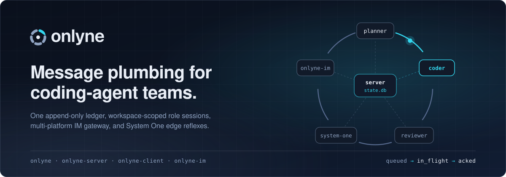
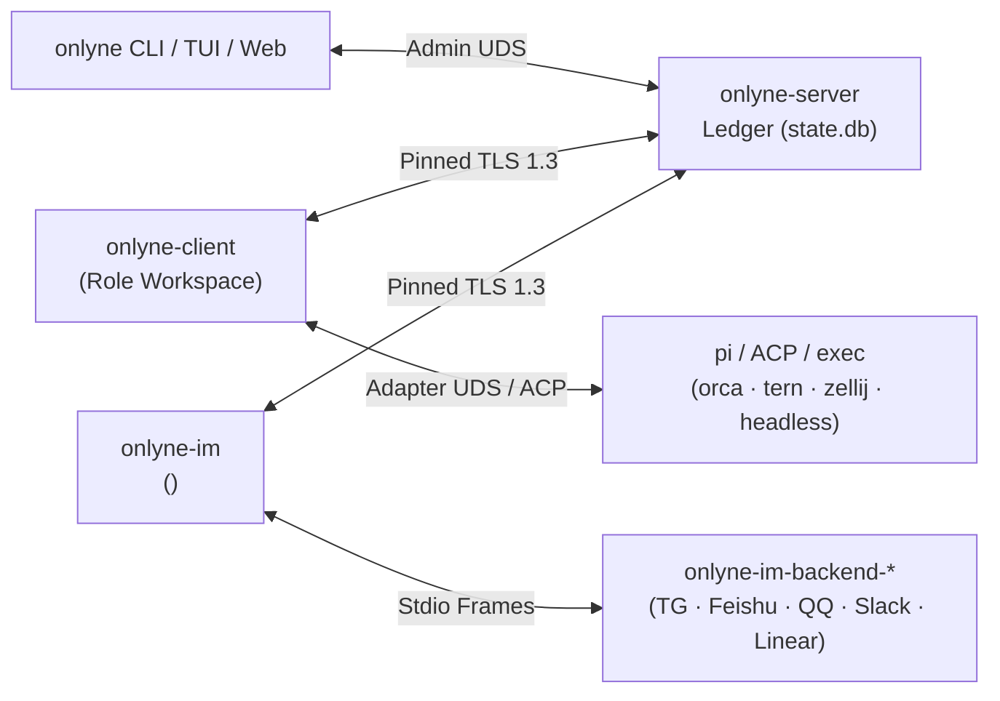

# Onlyne



[](LICENSE)
[](Cargo.toml)
[](#install)

**[中文文档](README.zh-CN.md)** · **[Wiki](docs/wiki/Home.md)** · **[Quickstart](docs/wiki/Quickstart.md)** · **[CLI Reference](docs/wiki/CLI-Reference.md)** · **[IM Gateway](docs/wiki/IM-Gateway.md)** · **[System One Decider](docs/wiki/System-One-Decider.md)**

Onlyne is a local-first channel and routing layer for coding-agent teams:

- **One durable ledger (`onlyne-server`)** routes envelopes between roles, enforces declarative ACLs (`allowed_targets`) and relay obligations (`owes_targets`), and records every delivery in an append-only SQLite ledger (`state.db`).
- **Workspace-scoped role sessions (`onlyne-client`)** drive coding agents (`pi`, ACP agents, Hosting Runtimes, or commands) across terminal hosts (`orca`, `tern`, `zellij`, `headless`, `external`) with `oneshot`, `task`, and `role` session scopes.
- **Multi-platform IM gateway (`onlyne-im`)** connects Telegram, Feishu/Lark, QQ, Slack, and Linear as a single cluster role, addressing conversations by a first-line `<chat:KEY>` token and threading replies via `<msg:PREFIX>`.
- **Meta-programmable System One reflexes** evaluate structured `noul`, `choice`, and `score` questions (`POST /v1/systemone`) at edge checkpoints for inbound chat routing, pre-flight completion checks, adaptive turn-end nudges, thrash detection, and autonomic fault triage (`onlyne triage`).

---

## Quickstart

Initialize a two-role cluster and bring the server plus both role clients up in one foreground terminal:

```bash
# 1. Create ./cluster/.onlyne/spec.toml and seed ./cluster/planner + ./cluster/coder workspaces
onlyne server init --root ./cluster --roles planner,coder

# 2. Start onlyne-server and all discovered role clients in the foreground (Ctrl-C drains cleanly)
onlyne up --server-root ./cluster
```

In a second terminal, dispatch work, open the live terminal board, or hot-register another role without restarting:

```bash
# Dispatch a task from the operator surface
onlyne --server-root ./cluster send \
  --from planner --to coder \
  --text "Inspect src/lib.rs and summarize the public API" \
  --force --yes-i-am-supervisor-not-other-role

# Open the 3-page terminal observation board (or pass --once for a single frame)
onlyne --server-root ./cluster tui

# Hot-register a new role against the running server via SpecApply (no manual reload needed)
onlyne-client init \
  --workspace ./cluster/reviewer \
  --role reviewer \
  --server-root ./cluster \
  --register

# Request an ordered shutdown over the admin socket
onlyne --server-root ./cluster shutdown --drain-secs 5
```

> Want to run a scripted end-to-end task from a source checkout with zero model credentials? See the **[Fake Backend Quickstart](docs/wiki/Quickstart.md#5-zero-model-scripted-quickstart-fake-backend--免模型脚本化自测)**, or run `python3 examples/supervisor/run.py up` for the 5-role Orca + `pi` demo.

---

## Install

### Prebuilt Binaries (macOS & Linux)

```bash
# Homebrew
brew tap dbydd/onlyne https://github.com/dbydd/onlyne.git
brew install dbydd/onlyne/onlyne

# Or verified release archive installer
curl -fsSL https://raw.githubusercontent.com/dbydd/onlyne/main/packaging/install.sh | sh
```

### Cargo (Rust 1.85+)

```bash
# Core cluster binaries
cargo install onlyne-cli onlyne-server onlyne-client

# Optional IM gateway + platform backend (-telegram, -feishu, -qqbot, -slack, or -linear)
cargo install onlyne-im onlyne-im-backend-telegram
```

Export the version-matched agent handbooks (`onlyne`, `onlyne-role`, `onlyne-supervisor`) from the installed binary at any time:

```bash
onlyne skill export
```

---

## Architecture at a Glance



| Binary | Responsibility | Key Subcommands |
|---|---|---|
| `onlyne` | Operator CLI, cluster supervisor, TUI board, fault triage, MCP tool bridge | `up`, `shutdown`, `triage`, `send`, `handoff`, `complete`, `control`, `repair`, `status`, `roles`, `sessions`, `ledger`, `faults`, `watch`, `tui`, `mcp`, `schema`, `skill` |
| `onlyne-server` | Routing daemon, delivery queue, SQLite ledger, event hooks | `init`, `run`, `status`, `generate` |
| `onlyne-client` | Role workspace daemon, session table, placement host | `init`, `run`, `status`, `roles`, `agent`, `doctor` |
| `onlyne-im` | Optional IM gateway host process and trigger runner | `init`, `generate`, `login`, `setup`, `run`, `check` |

Inside an agent session (`pi` plugin or `onlyne mcp` for ACP), the model acts through three tools:
- `onlyne_send(to, text, kind?, image?)`
- `onlyne_handoff(to, text, image?)`
- `onlyne_complete(outcome, summary, details?, files?)`

---

## IM Gateway & Meta-Programmable System One Reflexes

### Connect a Chat Platform (`onlyne-im`)

```bash
# Interactive guided setup (backend -> credential -> conversation -> cluster ACL)
onlyne-im setup --root ./im --server-root ./cluster

# Or step-by-step
onlyne-im init     --root ./im --server-root ./cluster
onlyne-im login    --root ./im --gateway telegram --token "$TELEGRAM_TOKEN" --interactive
onlyne-im generate --root ./im --gateway telegram --conversation -100123456 --slug tg-dev --server-root ./cluster
onlyne-im run      --root ./im
```

### System One Edge Reflexes (`DeciderSpec`)

When `ONLYNE_DECIDER_URL` or `TYPESAFE_BASE_URL` (and optional `TYPESAFE_API_KEY` / `ONLYNE_DECIDER_MODEL`) points to a System One endpoint (`POST /v1/systemone`, default model `jev-latest`), Onlyne evaluates batched `noul`, `choice`, and `score` questions at five edge checkpoints:

1. **Inbound IM routing (`im_inbound`)**: filters human smalltalk, selects the target role, and links implicit reply threads.
2. **Completion contradiction guard (`complete_guard`)**: catches `outcome="done"` reports whose body actually states the work is blocked or failed.
3. **Adaptive turn-end nudge (`turn_end`)**: tailors the turn-end reminder based on why the agent stopped without calling `onlyne_complete`.
4. **Heartbeat thrashing & phase tag (`heartbeat`)**: detects repetitive error loops and projects live activity phases (`coding`, `debugging !thrash`) onto `onlyne tui`.
5. **Autonomic fault triage (`onlyne triage`)**: diagnoses open faults or `[[hook]]` events and optionally executes `retry`, `recycle`, or `fail`.

All instructions, rubrics, thresholds, and custom extra questions are meta-programmable via `.onlyne/decider.json` or `ONLYNE_DECIDER_SPEC` (with `{var}` state interpolation and deep JSON merge):

```bash
# Export the default DeciderSpec to customize prompts, rubrics, thresholds, or add custom questions
onlyne schema decider --pretty > ./cluster/.onlyne/decider.json

# Triage open faults (or wire into [[hook]] with --from-hook --apply)
onlyne --server-root ./cluster triage --apply --min-confidence 0.65
```

---

## Documentation & Further Reading

| Guide | Contents |
|---|---|
| **[Wiki Home](docs/wiki/Home.md)** | Full documentation index and system topology |
| **[Quickstart](docs/wiki/Quickstart.md)** | Two-command bootstrap, hot registration, and zero-model `fake` quickstart |
| **[Architecture & Concepts](docs/wiki/Architecture-and-Concepts.md)** | Vocabulary, fact ownership, session scopes (`oneshot`/`task`/`role`), and `drive × placement` matrix |
| **[CLI & Exit Codes](docs/wiki/CLI-Reference.md)** | All verbs, supervisor attestation gate, repair commands, and exit codes `0..127` |
| **[IM Gateway](docs/wiki/IM-Gateway.md)** | `<chat:KEY>` addressing, `<msg:PREFIX>` reply threads, and 5 platform backends |
| **[System One Decider](docs/wiki/System-One-Decider.md)** | The 5 edge reflexes, environment variables, and meta-programmable `.onlyne/decider.json` |
| **[Operations & Troubleshooting](docs/wiki/Operations-and-Troubleshooting.md)** | `systemd` / `launchd` units, runtime sockets under `/tmp/onlyne-<uid>/`, and recovery recipes |
| **[Execution Contract (`AGENTS.md`)](AGENTS.md)** | Core architectural invariants, crate boundaries, and verification gates |

## License

[MIT](LICENSE) © dbydd
