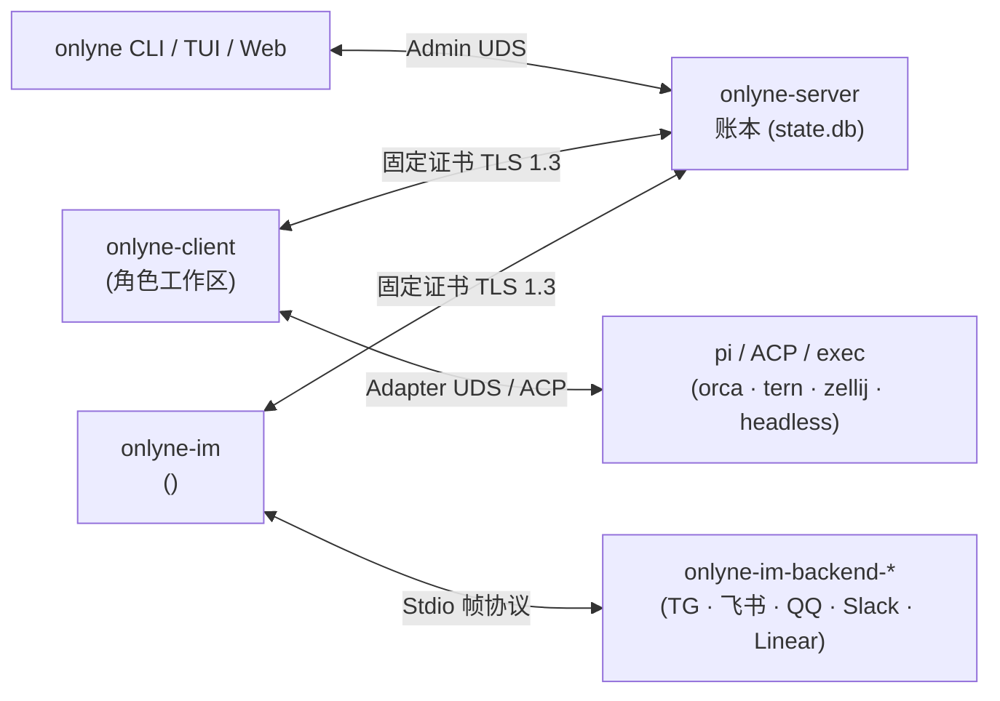

# Onlyne


[](LICENSE)
[](Cargo.toml)
[](#安装)

**[English README](README.md)** · **[Wiki 首页](docs/wiki/Home.md)** · **[快速上手](docs/wiki/Quickstart.md)** · **[CLI 速查](docs/wiki/CLI-Reference.md)** · **[IM 网关](docs/wiki/IM-Gateway.md)** · **[System One 决策反射弧](docs/wiki/System-One-Decider.md)**

Onlyne 是运行在你自己机器上的 Coding-Agent 团队消息路由与会话传输层：

- **单一追加式持久账本（`onlyne-server`）**：在角色之间路由信封，执行声明式路由权限（`allowed_targets`）与交接义务（`owes_targets`），并将每次投递记录在 SQLite 账本（`state.db`）中。
- **工作区级角色会话（`onlyne-client`）**：在各类终端宿主（`orca`、`tern`、`zellij`、`headless`、`external`）上驱动智能体（`pi`、ACP 智能体、外部驻留运行时或命令行脚本），支持 `oneshot`、`task`、`role` 三种会话作用域。
- **多平台 IM 聊天网关（`onlyne-im`）**：作为集群中的一条角色接入 Telegram、飞书、QQ、Slack 与 Linear，通过正文首行的 `<chat:KEY>` 寻址多条会话，并通过 `<msg:PREFIX>` 组织回复线程。
- **可元编程的 System One 边缘反射弧**：在边缘检查点通过单次打包的 `POST /v1/systemone` 请求评估结构化 `noul`、`choice`、`score` 问题，实现入站语义路由、结项自相矛盾拦截、回合结束自适应追问、活锁检测以及故障自动分诊（`onlyne triage`）。

---

## 快速开始

只需两条命令即可初始化双角色集群，并在当前前台终端一并拉起服务端与全部角色客户端：

```bash
# 1. 创建 ./cluster/.onlyne/spec.toml 并在 ./cluster/planner 与 ./cluster/coder 下生成角色密钥与工作区配置
onlyne server init --root ./cluster --roles planner,coder

# 2. 在前台启动 onlyne-server 与自动发现的角色客户端（按 Ctrl-C 自动排空停机）
onlyne up --server-root ./cluster
```

打开第二个终端，即可派发任务、查看终端看板或在线热注册新角色（无需重启服务端）：

```bash
# 从操作员面派发任务
onlyne --server-root ./cluster send \
  --from planner --to coder \
  --text "检查 src/lib.rs 并总结公开 API" \
  --force --yes-i-am-supervisor-not-other-role

# 打开三页式交互终端看板（传入 --once 可输出单帧纯文本快照）
onlyne --server-root ./cluster tui

# 在服务端运行时通过 SpecApply 在线热注册新角色（免手动 reload）
onlyne-client init \
  --workspace ./cluster/reviewer \
  --role reviewer \
  --server-root ./cluster \
  --register

# 通过管理 socket 请求排空并优雅停机
onlyne --server-root ./cluster shutdown --drain-secs 5
```

> 希望在源码仓库中不配置任何模型凭据、直接跑通端到端验证？请参考 **[免模型 Fake 快速自测](docs/wiki/Quickstart.md#5-zero-model-scripted-quickstart-fake-backend--免模型脚本化自测)**，或运行 `python3 examples/supervisor/run.py up` 体验五角色 Orca + `pi` 环形任务演示。

---

## 安装

### 预编译二进制（macOS 与 Linux）

```bash
# Homebrew
brew tap dbydd/onlyne https://github.com/dbydd/onlyne.git
brew install dbydd/onlyne/onlyne

# 或使用带 SHA-256 校验的安装脚本
curl -fsSL https://raw.githubusercontent.com/dbydd/onlyne/main/packaging/install.sh | sh
```

### Cargo 源码安装（Rust 1.85+）

```bash
# 核心集群二进制
cargo install onlyne-cli onlyne-server onlyne-client

# 可选 IM 网关与对应平台后端（-telegram、-feishu、-qqbot、-slack 或 -linear）
cargo install onlyne-im onlyne-im-backend-telegram
```

安装后可随时从 `onlyne` 二进制导出与当前版本匹配的内置操作手册（`onlyne`、`onlyne-role`、`onlyne-supervisor`）：

```bash
onlyne skill export
```

---

## 架构概览



| 二进制 | 职责 | 核心子命令 |
|---|---|---|
| `onlyne` | 操作员入口、集群前台看护、TUI 看板、故障分诊与 MCP 工具桥 | `up`、`shutdown`、`triage`、`send`、`handoff`、`complete`、`control`、`repair`、`status`、`roles`、`sessions`、`ledger`、`faults`、`watch`、`tui`、`mcp`、`schema`、`skill` |
| `onlyne-server` | 路由守护进程、投递队列、SQLite 账本与事件钩子 | `init`、`run`、`status`、`generate` |
| `onlyne-client` | 角色工作区守护进程、会话表与宿主放置管理 | `init`、`run`、`status`、`roles`、`agent`、`doctor` |
| `onlyne-im` | 可选 IM 聊天网关宿主进程与触发器执行器 | `init`、`generate`、`login`、`setup`、`run`、`check` |

在智能体会话内部（`pi` 插件或面向 ACP 的 `onlyne mcp`），模型直接调用三个工具完成通信与结项：
- `onlyne_send(to, text, kind?, image?)`
- `onlyne_handoff(to, text, image?)`
- `onlyne_complete(outcome, summary, details?, files?)`

---

## IM 聊天网关与可元编程 System One 反射弧

### 接入聊天平台（`onlyne-im`）

```bash
# 交互式引导配置（选择平台 -> 验证凭据 -> 选择会话 -> 绑定集群角色 ACL）
onlyne-im setup --root ./im --server-root ./cluster

# 或按步骤命令行配置
onlyne-im init     --root ./im --server-root ./cluster
onlyne-im login    --root ./im --gateway telegram --token "$TELEGRAM_TOKEN" --interactive
onlyne-im generate --root ./im --gateway telegram --conversation -100123456 --slug tg-dev --server-root ./cluster
onlyne-im run      --root ./im
```

### 可元编程 System One 边缘反射弧（`DeciderSpec`）

当通过 `ONLYNE_DECIDER_URL` 或 `TYPESAFE_BASE_URL`（以及可选的 `TYPESAFE_API_KEY` / `ONLYNE_DECIDER_MODEL`）配置了 System One 决策模型端点（`POST /v1/systemone`，默认模型标识 `jev-latest`）时，Onlyne 会在五个边缘检查点并行评估 `noul`、`choice`、`score` 问题：

1. **IM 入站语义路由（`im_inbound`）**：自动过滤群聊人类闲聊、选择目标角色，并在用户未点击原生引用时自动关联回复线程。
2. **结项自相矛盾守门员（`complete_guard`）**：当模型上报 `outcome="done"` 而正文声明被阻塞或失败时，自动修正为 `blocked` 或 `failed`。
3. **回合结束自适应追问（`turn_end`）**：根据未调 `onlyne_complete` 就结束回合的具体原因，追加针对性的工具调用提示。
4. **心跳活锁检测与阶段标签（`heartbeat`）**：检测重复报错死循环，并在 `onlyne tui` 第 1 页实时展示 `busy · coding` 或 `busy · debugging !thrash`。
5. **故障自动分诊（`onlyne triage`）**：对打开的故障或 `[[hook]]` 事件自动判定 `retry`、`recycle`、`fail` 或 `escalate`。

所有指令（`instructions`）、选项判据（`criteria`）、阈值（`thresholds`）与自定义附加问题均可通过 `.onlyne/decider.json` 或 `ONLYNE_DECIDER_SPEC` 元编程定制（支持 `{var}` 状态变量插值与局部 JSON 深度合并）：

```bash
# 导出内置默认 DeciderSpec 模板以按需定制指令、判据、阈值或新增自定义问题
onlyne schema decider --pretty > ./cluster/.onlyne/decider.json

# 对当前集群故障执行 System One 分诊（或挂入 spec.toml [[hook]] 自动执行）
onlyne --server-root ./cluster triage --apply --min-confidence 0.65
```

---

## 文档与扩展阅读

| 文档 | 内容说明 |
|---|---|
| **[Wiki 首页](docs/wiki/Home.md)** | 完整文档导航与系统拓扑总览 |
| **[快速上手](docs/wiki/Quickstart.md)** | 两条命令建集群、在线热注册与免模型 `fake` 自测脚本 |
| **[架构与核心概念](docs/wiki/Architecture-and-Concepts.md)** | 核心术语表、数据所有权、`oneshot`/`task`/`role` 会话作用域与 `drive × placement` 矩阵 |
| **[命令与退出码速查](docs/wiki/CLI-Reference.md)** | 全部子命令、Supervisor 双旗标门禁、`repair` 恢复指令与 `0..127` 退出码 |
| **[IM 网关指南](docs/wiki/IM-Gateway.md)** | `<chat:KEY>` 寻址协议、`<msg:PREFIX>` 回复线程与五大平台后端凭据格式 |
| **[System One 决策反射弧](docs/wiki/System-One-Decider.md)** | 五大边缘反射弧详解、环境变量与 `.onlyne/decider.json` 元编程配置示例 |
| **[运维与故障排查](docs/wiki/Operations-and-Troubleshooting.md)** | `/tmp/onlyne-<uid>/` 运行时目录、`systemd` / `launchd` 服务单元与常见故障修复 |
| **[工程执行契约 (`AGENTS.md`)](AGENTS.md)** | 核心设计不变量、crate 依赖边界与测试门禁规范 |

## 许可证

[MIT](LICENSE) © dbydd
