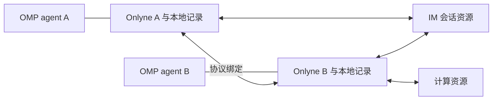

# Onlyne v3：消息、资源与动态接管

状态：历史讨论稿。当前规范位于根目录的 `docs/rfcs/`。本稿保留当时讨论，不作为当前实现契约。

## 1. 已定基调

- 使用 TypeScript，以 lib + package 交付，运行时直接调用库。
- agent 使用单一入口 `msg({ delivery_kind, msg, meta })`。`delivery_kind` 是供 SystemOne 判断的意图文本。
- agent 无需先区分 task/note，或自行组合 block/fork。
- 去中心化，移除 Onlyne server。每个 agent 保存自己经手的消息、决定、回执与回复。
- 首个集成以 OMP 可用为标准。库的语义独立于 OMP 插件接口的能力限制。
- 复用 A2A 等协议的对外通信抽象，并接入 IM 网关、计算服务器等资源。
- 资源与 agent 的路由关系可以动态改变，例如把一个 IM 会话交给另一个 agent 接手。
- 消息不投影任务状态。需要任务化时，接入层把消息写进运行时的 todo 原语，提醒也由运行时发出。
- 每个 agent 持有多个 thread。thread 是库唯一投影的事物：一张消息列表加一份成员表。

TS 的选择优先考虑集成灵活性。agent 已有 TS/Python 等运行时，Onlyne 复用其会话、工具和异步执行能力。

## 2. 三层各负责什么

| 层 | 负责 | 不替哪一层作决定 |
|---|---|---|
| Onlyne 库 | 意图解释、消息关联、本地记录、等待与回复、资源绑定和交接规则 | 不实现模型循环或全局会话管理 |
| 协议绑定 | 把库操作映射到 A2A、MCP 或资源 API，声明支持的能力与保证 | 不把 HTTP 成功伪装成工作完成 |
| 运行时接入 | 把投递计划落到 OMP 的工具、上下文、子任务与唤醒机制 | 不用插件接口限制重定义库语义 |

部署中可以存在 A2A endpoint、IM 网关进程、计算服务。这些 endpoint 各自负责自己的资源。系统无需集中式 Onlyne 路由 server，也无需全局消息账本。



库接口、网络协议与模型工具分别设计。模型工具只有一个消息入口，库内部提供等待、接收、资源调用和交接等类型化操作。这些内部操作不要求模型选择第二套工具。

## 3. 地址、身份与资源

通信目标统一抽象为 Endpoint。它可以是 agent，也可以是资源。

```ts
type EndpointRef = {
  id: string;                       // 稳定身份，绑定到已认证 endpoint
  resource?: string;                // endpoint 内的资源标识
};

interface EndpointDescriptor {
  ref: EndpointRef;
  interfaces: InterfaceDescriptor[];
  capabilities: string[];
}
```

这段类型只规定边界，具体身份与接口格式由所选绑定确定。显示名、访问地址、逻辑身份分别保存。端口变化不会改变 agent 身份，同名也不意味着同一身份。

资源举例：一个 IM 网关下的会话、一个计算服务下的作业、一个可订阅的数据流。资源有自己的身份、支持的操作与授权要求，无需假装成会调用模型的 agent。

逻辑会话标识与执行上下文分开。IM conversation、A2A context、OMP session 可以建立本地映射，不能仅凭字符串相同认为它们是同一对象。

主会话、子会话与恢复会话由宿主显式绑定身份及权限。库不从 cwd、环境变量或“当前唯一忙碌的会话”推断发送者。

## 4. 单一消息入口

```ts
interface MessageInput {
  delivery_kind: string;
  msg: string;
  meta?: {
    inReplyTo?: string;
    thread?: string;
    conversation?: string;
    parts?: Part[];
    data?: Record<string, JsonValue>;
  };
}

interface Peer {
  msg(input: MessageInput): Promise<MessageResult>;
}
```

目标由 Peer 绑定，例如 `peers.reviewer.msg(...)`。OMP 的单一工具可额外暴露目标选择，这只是调用表面，不能省略实际通信中的目标身份。

发送者来自当前库实例。`inReplyTo` 是库提供的来信引用，由本地记录解析出原消息与发送者。`conversation` 只提供上下文关联，不能授予资源操作权限。应用数据放在 `meta.data`。

`inReplyTo` 是本地句柄。库在发送前把它翻译为原消息 ID、原发送者和关系类型，协议绑定只传这些可验证的关联。对端不需要解析另一端的本地句柄。

| 意图文本示例 | 希望表达的事情 |
|---|---|
| “同步一下进展，不用回复” | 投递到现有上下文，无需回答 |
| “独立查一下，查完告诉我，我先做别的” | 独立执行，异步回报 |
| “这一步依赖你的结论，等你回答再继续” | 发送方等待答复 |
| “补充到这条请求里” | 继续明确关联的上下文 |
| “把这个群的后续消息交给 reviewer 接手” | 请求变更指定会话的接管关系 |

这些都是意图示例。agent 不需要背诵固定词表。

## 5. SystemOne 产生计划，确定逻辑执行计划

SystemOne 解释“怎么发”。库将输出限制在当前 endpoint 和运行时允许的操作中。首稿提出以下内部计划：

```ts
interface DeliveryPlan {
  response: "none" | "async" | "await";
  execution: "existing" | "new";
}
```

- `none`：不期待业务答复，仍需如实报告接纳结果。
- `async`：接纳后返回，后续答复作为事件交给发送方运行时。
- `await`：发送方调用等待关联答复或期限到达，网络与其他接收处理继续运行。
- `existing`：进入明确绑定的接收上下文。
- `new`：接收方建立新的工作上下文。是否带历史、使用何种模型与工具由接收方策略规定。

回复模式与执行上下文相互独立。没有现成上下文时，`existing` 必须消歧或拒绝。`new` 不默认复制发送方历史。

判定有两处本地责任：发送方解释自身等待意图；接收方决定自身执行安排。发送方不能强制对方创建子会话，接收方也不能强制发送方进入等待。两端通过绑定交换所需参数，在记录中保存最终计划。

发送方的回复预期随消息发送，接收方在接纳时确认能否履行。接收方不支持预期时，返回能力不足或明确提出改选方案。资源操作只能从资源已声明的操作中选择，不能把普通聊天请求自动升级为交接授权。

判定输入包括意图、消息、显式关联、可用能力和必要的本地上下文。回复与补充的语义也可以由 SystemOne 判断，关联到哪条消息则必须由明确引用决定。

SystemOne 不决定身份认证、权限、去重、回执事实或交接生效。资源与接手者都从宿主提供的明确引用中选择，零个或多个匹配均需消歧。预期版本由库从资源绑定记录带入，模型不生成或复述版本。

判定失败返回可查错误。已接纳消息的重投复用原决定，不能重新判断并另开工作。能力不足时返回 `unsupported_delivery`；实际集成若支持协商改选，须在接纳前明确呈现改选后的计划。

## 6. 消息、接纳与答复

**消息就是消息，不是任务。** 库不保存任何任务状态。没有 task 表、没有 task 状态机、没有 completed、failed、blocked、cancelled 这类终态，也没有“这条消息对应哪个 task”的投影。

v2 的教训：服务端为客户端会话维护镜像行和五维生命周期，把“消息到了没有”拆成一张需要同步的状态表。每次故障都靠加一条守卫，守卫之间再互相踩。v3 砍掉这张表。库记录的事实只有消息、关系、回执、等待和本地决定。

库不回答“这个 agent 在做什么”。需要这个答案的地方读运行时自己的 todo，不读 Onlyne。

库内部的消息关系至少区分 `receipt`、`reply` 与 `followup`。这些字段由库生成，不要求 agent 手工选择消息 kind。

库生成的回执和控制操作结果走确定路径，不再交给 SystemOne 判断如何执行。agent 主动发出的业务补充仍可解释意图，已确定的来源关联不能被判定覆盖。

| 关系 | 含义 | 是否完成一次业务等待 |
|---|---|---|
| `receipt` | 对方接纳或拒绝这次交换的证据 | 否 |
| `reply` | 对方对指定消息的业务答复 | 是 |
| `followup` | 对指定消息的补充或进度 | 否 |

首稿把 `await` 的结束定义为第一条有效关联答复。它可以包含成功结论、无法完成或拒答。传输层不判断业务是否成功。后续答复仍保留为事件，避免丢掉修订信息。

`await` 是发送方这一次调用的等待，不是一条任务记录。它等待答复，等待超时只结束这次等待。库不因为它超时就把任何一端标成失败，也不要求对方写终态。

等待者只匹配预期对端、原消息 ID 和合法关系。回执不能被当成答案，其他 agent 不能仅凭知道 ID 就解除等待。

```ts
type Admission =
  | {
      state: "accepted";
      by: EndpointRef;
      guarantee: "durable" | "binding-defined";
      plan: DeliveryPlan;            // 对方确认的计划
    }
  | { state: "pending" }            // 仅存本地，尚未确认对方收到
  | { state: "unknown" };           // 发送结果不明

type MessageResult = {
  messageId: string;
  admission: Admission;
  proposedPlan: DeliveryPlan;        // 发送方提案，不等于对方确认
  answer?: ReceivedMessage;          // await 路径可以返回答复
  operation?: ResourceOperationResult;
};

interface ResourceOperationResult {
  id: string;
  resource: EndpointRef;
  state: "pending" | "committed" | "aborted" | "conflict";
  binding?: ResourceBinding;
  data?: JsonValue;
}
```

这是返回语义示意。若接收方拒绝，请求返回结构化错误及已知消息身份。`await` 超时需保留已收到的接纳证据。等待超时只结束本地等待，不撤销对方已经接纳的工作。

`proposedPlan` 是发送方提案。`admission.plan` 只在 accepted 时存在，表示对方确认。pending 或 unknown 不能被误读为双方已达成一致。

资源操作的结果通过 `operation` 返回，或以同一操作 ID 的后续事件到达。接纳交接请求只能呈现为“交接待决”，`committed` 才能呈现为“已接手”。计算提交的结果数据可带作业引用，作业完成和产物随后另行到达。查询操作结果也通过同一消息入口表达，由库调用资源查询接口。

`durable` 表示接收方先保存消息和待处理记录，再确认接纳。`binding-defined` 表示只能保证绑定明确说明的事实。原始 A2A endpoint 未声明 Onlyne 的持久接纳扩展时，库不能凭返回 Task 或 HTTP 200 声称持久接纳。

处理和业务副作用可能在崩溃恢复后重复。库向处理上下文提供消息 ID 和来源引用，业务侧据此做幂等。Onlyne 不承诺任意外部副作用恰好一次。

### 需要任务化时，转换发生在运行时

一条消息要求持续工作时，运行时把它写进自己的 todo 原语。这条转换是运行时动作，不是协议动作。

OMP 的首版做法：接入层把来信连同来源引用、消息 ID 和本地上下文映射写进运行时的 todo，再唤醒或安排上下文。模型看到的是自己环境里的待办项，完成它用的是运行时自己的完成动作。

选这个位置的理由来自现场：agent 不被提醒就几乎不会主动 complete task。任务挂在 Onlyne 的投影里，模型看不见，也不会被催；写进 runtime todo，模型在自己的待办清单里看见它，运行时按自己的节奏提醒。

任务数据归运行时所有。Onlyne 不读写它，不投影它，也不在交接时同步它。A 把会话交给 B 时，B 是否建立待办由 B 的策略决定。Onlyne 交接未解决的事件引用，不交接 A 的 todo。

库仍然可以提醒。未答复的消息、等待超时、交接待决都是库的事实，运行时可以选择把这些事实呈现给模型。库不代替模型决定一件事完成没有。

回复继续使用 `msg`，并绑定原来信：

```ts
await incoming.peer.msg({
  delivery_kind: "答复这条请求，结论如下",
  msg: "已核对，结论是……",
  meta: { inReplyTo: incoming.replyRef },
});
```

`meta.thread` 指定消息写入哪个 thread。缺省时库按顺序判断：`inReplyTo` 指向的条目所在 thread，其次默认 thread。回复必须落在原消息的 thread 里，不能把一条回复投到另一张列表。

接入层对线程提供类型化操作：`open`、`close`、`addMember`、`removeMember`、`read`。它们不是模型的第二个消息入口，模型仍只看到 `msg`，threadRef 通过本地上下文映射得到。

`read` 支持按 `threadId`、来源、`sinceSeq`、回复链读取。分页返回条目，不一次性倾倒长列表。模型按索引取正文，库把索引解析为消息 id。

运行时切换上下文或同时处理两个请求时，来信引用依旧明确归属。库不使用全局 `currentTask`，也不选择第一个连接作为回复出口。

## 7. Thread 是 agent 的消息列表

agent 持有一个 thread 集合。thread 是库投影出来的唯一事物：一张按序号排列的消息列表，外加一份谁能往里发消息的成员表。

库仍然不投影任务状态、不投影对端存活、不投影会话生命周期。v2 的教训是把“消息到了没有”拆成多维状态表并维护镜像；v3 只保留消息列表这一种投影。

### Thread 对象

```ts
interface Thread {
  id: string;               // agent 本地 durable 稳定 id
  title?: string;
  closedAt?: string;        // 销毁后不再接收新消息
  members: ThreadMember[];
  nextSeq: number;
}

interface ThreadMember {
  peer: EndpointRef;
  access: "post" | "read";  // post 可发送并收到回复，read 只读
  since: string;
}
```

- thread 由 agent 注册，id 在重启后保持稳定，成员按 id 引用它。
- 一个 agent 可持有多个 thread。一个 thread 只被一个 agent 拥有，不共享所有权。
- 成员表是 owner 的本地状态。其他来源保存“我在 A 的 thread T 里”这一条记录，不持有 T 的完整列表。

### 加入与退出

- 加入是一条控制操作：来源向 thread 发加入请求，或 owner 直接添加。结果由 owner 的成员策略决定。
- 退出可以是来源主动离开，也可以是 owner 移除。退出后该来源再往此 thread 投递会被拒。
- 加入只授予向此 thread 投递和接收回复的许可，不授予任何资源凭据。

投递到 thread 时，owner 校验来源是 `post` 成员。非成员的投递被拒并保留记录。`read` 成员只能读，不能往里发消息。

### 默认 thread

- 每个 agent 有一个始终存在的默认 thread。不知道 thread id 的来源、用户输入、外部会话落在默认 thread。
- 消息不带 threadRef 时进入默认 thread，不因缺少 thread 上下文被丢弃。

### 消息条目

```ts
interface MessageEntry {
  seq: number;              // thread 内单调递增，owner 分配
  threadId: string;
  id: string;               // 消息自身 id，跨端稳定
  direction: "in" | "out";
  peer: EndpointRef;
  at: string;
  deliveryKind: string;
  body: string;
  meta: MessageMeta;
  relation?: { type: "reply" | "followup" | "receipt"; messageId: string };
  status: "pending" | "sent" | "unknown" | "admitted" | "refused" | "answered" | "declined";
}
```

- `seq` 是 owner 本地的接收序号，不是全局时钟。多个来源之间没有可靠的总先后，不能按发送时间排序后假装存在顺序。
- `id` 跨端稳定，用于回复与去重；`seq` 只是本地可视索引。两者不混用。
- 一条来信成为 `in` 条目。回复它时新增 `out` 条目，`relation` 指向来信的 `id`。同一来源的多条答复各占一个条目，后到不覆盖先到。
- 去重、交接、积压都以 `id` 为键，`seq` 只用于展示和本地读取。

### 多行消息与索引

索引在信封上，不在正文里。渲染给模型时，每条消息一个头部行带索引、thread、来源和关系，正文逐行缩进，避免正文中出现看似索引的行被误认为新消息：

```text
[101] T1 dpdp 12:03
  > 请核对这次实验的结论。
[102] T1 feishu:海冰研究群 12:04 ↪101
  > 用户：图里的单位是什么？
  > 第二行仍属于 102
```

- 长正文只渲染头部与首行，附 `[+N 行，读 102 取全文]`，模型按索引取全文。
- 模型回复时只写索引，库负责解析到 `id`。模型不从正文里认 id。
- 多个 thread 同时出现在一个上下文时，头部带 threadId，`(threadId, seq)` 才唯一。

### received 与 replied

- `received` 表示 owner 的 thread 里有这条 `in` 条目。不推断模型已经看到。
- `replied` 表示存在指向原消息 `id` 的 `out` 条目。不推断事情已经完成。
- 上下文注入游标是本地状态，只标记哪些条目注入过。它不对外宣布已读，也不产生任务状态。

### thread 不是 task

关闭 thread 不结算任何工作，只停止接收新消息，条目保留可读。一条来信要不要进运行时 todo，仍由接入层按第 6 节决定。

### 与交接的关系

thread 是 owner 的投影，不随资源交接转移。A 把 IM 会话交给 B 时，B 为自己的 thread 添加该来源，未解决的事件引用带入 B 的 thread；A 的 thread 保留原历史。

会话正文归运行时。库保存消息条目与关系，不保存模型对话。

这些是各端掌握的证据，允许暂时不同。没有一份必须实时同步的全局投影。

- 消息 ID 在重投时保持不变，接收方按认证发送者与 ID 去重。
- 相同 ID 内容不同返回 `id_conflict`。内容相同重放原接纳决定。
- 持久接纳要求消息和待处理项在同一可靠提交中保存。崩溃后重新安排已有项，不能因为丢失模型内存就丢失消息。
- 重投去重保证同一消息只有一份接纳记录。崩溃后恢复这份记录时，运行时可能重复执行；建立子上下文须用消息 ID 关联并复用已创建的上下文，外部副作用按其实际接口处理。
- 去重覆盖发送方声明的自动重投窗口。窗口由库配置注入，agent 无需填写。跨端期限必须是可比较的时间或协商时长，不能直接比较两台机器的单调时钟。
- 回执丢失产生未知状态，发送方重投同一消息。回执本身不再要求回执。
- 拒绝与已收到的错误都保留本地记录，不能删除 intent 后仅留一句日志。
- 业务答复先于接纳回执到达时也要保留并匹配，不能按预期到达顺序丢弃。
- 迟到答复保留并标明迟到。是否唤醒由发送方运行时策略决定，库不静默丢弃。
- 连接关闭只代表链路事实。会话内容、进程资源和 agent 存活由各自运行时管理。

协议认证、资源凭据和回复引用是不同权限。默认不把 IM 平台 token 或计算服务密钥交给 agent，也不通过普通元数据扩大权限。

## 8. A2A 等协议如何映射

A2A 1.0 将数据模型、抽象操作和协议绑定分层，包含 AgentCard、Message、Task、Part、Artifact 与 Extension。Send Message 可返回 Task 或直接 Message，异步更新可通过订阅和 push 提供。这些抽象用于 Onlyne 的对外绑定。[规范来源](https://a2a-protocol.org/v1.0.0/specification/)

| Onlyne 语义 | A2A 绑定方式 | 必须保留的区别 |
|---|---|---|
| endpoint 描述与能力 | AgentCard、接口与能力声明 | 描述不能替代调用权限 |
| 消息与关联 | Message、messageId、contextId、taskId | context 不自动等于 OMP session |
| 文本、数据、资源引用 | Part | 资源 URI 不自动授予读取权限 |
| 计算结果或产物 | Task、Artifact 及更新事件 | 远端作业状态由远端负责 |
| 异步答复 | 流式更新、订阅或 push | 保留来源与对应的本地消息引用 |
| 持久接纳、执行意图 | 协商的 Extension 或绑定契约 | 不支持时明确标明保证范围 |
| 资源接管变更 | 资源服务声明的操作或 Extension | A2A 基础规范没有定义 IM 会话所有权转移 |

A2A Task 是对端的工作对象，库保存关联和对端报告。库不把远端 Task 复制成本地任务，也不在本地维护一套与它同步的状态机。本地待办由运行时 todo 承载（见第 6 节）。

MCP 可以承载计算服务或资源控制的工具调用与订阅；IM 可由平台后端提供事件和发送操作。每个绑定都声明消息、关联、等待、订阅、接纳保证和交接操作的支持范围。不能映射的能力显式报错。

A2A 等协议提供通信和任务交互。资源“当前交给谁处理”、谁可回复、交接何时生效，是必须额外定义的应用关系。Onlyne 管理自己经手的这层关系，不重建全网寻路或统一拓扑。

## 9. 资源是可操作 endpoint

资源描述至少需要稳定引用、支持的操作、事件入口与授权要求。具体请求和结果使用结构化数据，SystemOne 不凭一段自然语言生成可执行 shell 命令。

| 资源 | 操作示例 | endpoint 自己持有的记录 |
|---|---|---|
| IM 会话 | 订阅来信、发送回复、读取或变更接管者 | 平台事件 ID、会话绑定、发送结果 |
| 计算服务 | 提交、查询、取消作业、取回产物、变更订阅或控制者 | 作业 ID、提交者、状态、产物引用 |
| 数据流 | 订阅、退订、设置事件接收者 | 订阅 ID、事件游标、接收关系 |

agent 可以保留该资源的本地引用与已见版本。资源 endpoint 验证实际操作时读取自己的当前关系，不能信任 agent 缓存的旧权限。

版本是并发控制条件，不是访问凭据。资源操作同时验证当前调用者身份、操作权限与预期版本。获得 B 的名字或读到新 revision，不会让 A 取得 B 的平台回复权限。

计算服务接收“提交”不代表作业运行成功。提交回执、作业事件和最终产物分别记录。把作业交给另一个 agent 关注时，需要明确变更的是观察订阅、结果接收者还是控制权限；它们不必一起迁移。

转交排队中或执行中的作业时，未指定的权限保持原样，提交者、计费及配额归属保持原记录。计算服务继续持有作业。新增结果接收者不会重新提交作业，删除 A 的订阅也不会自动取消作业。若 A 同时交出自己的结果等待，由库明确返回 `transferred` 及交接引用；只增加 B 的观察订阅不改变 A 的等待。

## 10. 动态接管：把 IM 会话从 A 交给 B

路由关系属于被路由资源的所有者。一个 IM 网关负责自己会话的接管表，一个计算服务负责自己作业的控制关系。局部关系表不会成为全网 Onlyne server。

首稿用有版本的绑定表达：

```ts
interface ResourceBinding {
  resource: EndpointRef;            // 某网关下的一个 IM 会话
  assignee: EndpointRef;            // 当前接手 agent
  revision: string;                 // 资源所有者生成的版本
}
```

交接必须说明变更范围。首稿的 `handover` 同时切换指定会话的后续入站处理者与平台回复权限，平台凭据留在网关。只转观察订阅需要使用不同的资源操作。

### 交接生效点

1. 发起者通过同一个消息入口表达交接意图。它可以是 A，也可以是资源明确授权的 supervisor。SystemOne 只能从发起者可引用的资源中解析目标，零个或多个匹配返回 unknown 或 ambiguous，不能挑一个相似群名。
2. 库调用资源声明的交接操作，携带操作 ID、当前预期 revision、目标 B 与有效期限。网关核实发起者的交接权限，以及 B 是否获准接手该资源。
3. 网关把接手邀请作为关联该操作 ID 的消息发给 B。B 通过同一 `msg` 入口回复接受或拒绝，本地来信句柄翻译为操作 ID、资源及预期 revision。网关核验回复来自 B，并记录有期限的接受，尚未切换。接受不表示 B 永久在线。
4. 网关在期限内重查发起者和目标权限，比较预期 revision，并原子写入新 assignee、新 revision 及交接结果。这个提交是生效点。
5. 网关向 A、B 返回或发布提交结果。通知丢失后，两者按操作 ID 查回结果。

B 接受后网关在提交前崩溃，恢复时仍是原 revision。B 的接受不代表交接完成。两个并发交接只有一个能基于同一预期 revision 成功，另一个得到冲突及当前版本。

相同操作 ID 重投返回原结果，修改资源、目标或预期版本返回 `op_conflict`。发起者读取当前版本后，可以用新操作 ID 发起新的授权请求。失败、超时或冲突的接手准备记为 aborted，B 可按操作 ID 查回 committed 或 aborted，不能永久停留在“已接受、结果不明”。

### 入站与在途消息

每条平台事件首次持久接收时，网关按 `(resource, platformEventId)` 去重，并记录自己的事件引用、当时绑定 revision 和接收 agent。平台消息 ID 可能只在一个会话内唯一，不能拿它跨会话去重。交接与事件接收在网关内按确定顺序提交：提交前的事件属于 A，提交后的新事件属于 B。积压重放沿用首次记录的归属。

首稿选择“旧消息留给原处理者”。转移积压是另一个显式操作，不能由切换 revision 隐式改写已交付消息。网关通知 B 交接后可能存在旧事件由 A 处理，双方按事件引用去重协作。

接手材料至少包含网关自己记录中的未解决事件引用与交接截点。B 可以按授权读取这些事件，明确哪些仍由 A 处理、哪些需要另行转交。提供历史材料不等于重新派发全部历史，不能因此重复回复用户。

接手者不可达时，网关在本资源的队列中保留事件并暴露未送达记录。该资源的积压不阻塞其他资源，重新改派须经过授权交接。

### 旧 agent 的回复

平台发送操作携带资源及绑定版本。网关同时检查当前 assignee、已认证调用者和 revision，交接后的 A 无法凭旧版本或 B 的新版本继续向平台发言。

版本检查也防止 A → B → A 后，第一轮 A 遗留的发送请求在第二轮 A 任期内误执行。当前接手者持有旧版本时得到 `stale_binding` 和当前绑定，明确刷新后才能再次发送；库不把它当作 agent 离线。新入站事件附带已提交版本，通知丢失时也可查询当前绑定。

刷新绑定不改写已有出站请求的 revision。旧请求保留原版本与拒绝记录，重新发送该内容需要当前接手者明确创建带当前版本的新操作 ID。

A 可以完成旧工作的分析，把结果发送给 B，B 再决定如何回复平台。若产品希望 A 仍能回复某条历史消息，应由网关提供有明确范围的历史回复授权，不能默认保留整个会话的控制权。

平台发送与交接并发时，网关必须为发送接受和交接提交排出先后顺序。交接前已获接受的平台发送可能在交接后才被平台确认，不能许诺交接生效后旧内容绝不出现。回执应记录该发送使用的 revision 与平台结果。

交接不自动复制 OMP 全部历史。A 可以交付摘要、待处理引用和资源访问引用；这些是交接内容，B 自己决定加载哪些材料。

## 11. 库的等待语义与 OMP 接入

库支持真正的 `await`：等待者先注册，答复由消息接收路径直接匹配并解除 Promise。其他接收、资源事件和回执路径继续运行。不能先把答复塞入被阻塞的模型队列，再等模型处理它解除自己。

“继续运行”指库继续接收、记录与匹配。发送方模型的当前工具调用可以停在等待中，其他消息何时进入模型由宿主决定。

库提供取消与有限期限。停止等待、发送取消请求、对端确认停止是三个不同事实。同一上下文直接等待自己必须处理的消息会被拒绝，循环依赖不因换成 Promise 就消失。

OMP 接入需要分别验证：

| 接入能力 | 需要证明的事情 |
|---|---|
| 工具调用 | 能调用库并呈现实际计划、已知接纳证据与答复 |
| 等待及中断 | 阻塞工具期间网络答复仍能解除等待，用户中止能释放本地等待 |
| 入站注入 | 忙时按宿主规则安排，闲时能唤醒，plan 模式有明确队列状态 |
| 独立执行 | 新上下文具有自己的身份、权限与消息关联 |
| 恢复 | 从本地记录恢复未决消息与上下文映射 |
| todo 写入 | 来信可写进运行时待办，完成与提醒由运行时负责，库不投影任务状态 |

源码调查在 OMP 18.10.4 找到 `createAgentSession`、`deliverIrcMessage`、上下文创建与异步任务相关接口。内置 `wait` 的适用范围、扩展工具中断能力，以及 IRC 的忙闲处理具有实现限制。这些发现属于接入评估，尚无 Onlyne v3 的运行证据。

某个 OMP 插件 API 不能表达 `await` 时，接入可以选择 SDK 接线或补宿主能力。若只能异步返回，必须声明该限制并明确返回 pending handle。它不能把库的 `await` 悄悄改成“模型自己结束回合等消息”。

首版 OMP 的等待验收需要真实阻塞路径通过。异步 handle 可以用来验证其他部分，不能据此宣称等待答复验收已通过。

既有 IRC 总线是否适合作为进程内绑定需要单独验证。跨进程的完整消息、meta 与资源操作通过协议绑定传递。OMP 展示层可以只显示正文并持有库的本地句柄，不能因此丢掉协议元数据。

库对外不要求 OMP 细节，也不规定必须使用其插件机制。首版可以有薄的注册入口，消息语义和状态全部保留在库中。

## 12. 首轮验收与待定点

原型需要验证：

1. 仅通过单一意图入口完成告知、异步协作和等待答复。
2. SystemOne 输出实际影响执行方式，判定结果与失败原因可查。
3. 两个并行请求、同名 agent 及上下文切换均能正确回复来源。
4. 回执丢失重投不产生第二次接纳或重复新建上下文；崩溃恢复的业务副作用边界明确。
5. A2A 直返 Message、返回 Task、流式产物和错误都保留原保证范围。
6. 计算资源提交后异步回报作业结果，产物可按资源引用获取。
7. IM 会话 A → B 交接后，新事件进入 B，旧版 A 的平台发送被拒绝。
8. 并发交接、响应丢失、积压与平台发送并发都能查回各自生效事实。
9. OMP 上的等待不会卡住消息接收路径，取消后仍能记录迟到答复。
10. 全程无需集中式 Onlyne server，也不维护全局会话镜像。
11. agent 可注册、关闭多个 thread；来源可加入、退出，投递时按成员表校验，非成员投递被拒。
12. 多行消息按信封索引渲染，正文逐行缩进，模型只按索引引用消息，不从正文识别 id。
13. 任何一端都查不到 Onlyne 自己维护的任务状态。需要持续工作时，消息进入运行时 todo，完成与提醒都由运行时负责。
14. 模型侧只看到一个 `msg` 入口。thread 的打开、关闭、成员变更和读取是库的类型化操作，不作为第二套模型工具。
15. 一条往来在两端各占自己 thread 的条目，`received` 与 `replied` 由条目位置与关系决定，没有第三份状态表。

另需核对：提案与确认计划不一致时的显式结果、OMP plan 模式的排队状态，以及从同一消息入口发起交接、接受接手、查回交接结果的全过程。

继续讨论的重点是：SystemOne 两端判定如何协商、最小资源操作描述、交接时是否额外提供历史回复授权，以及 OMP 首版选择 SDK 接线还是现有扩展入口。

协议字段、签名方式、去重期限和包名将在这些语义确定后细化。本文的 A2A 对照依据官方 1.0 规范，动态资源接管为 Onlyne 本稿提出的应用契约。
