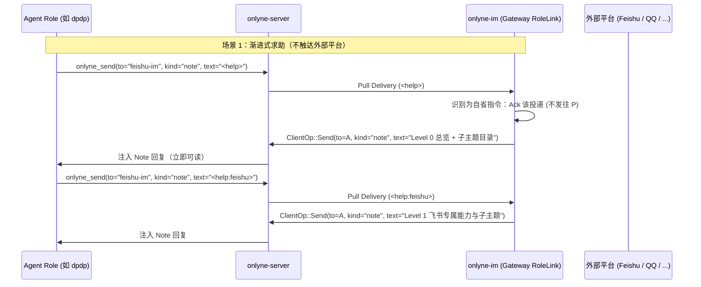

# v2.10 — IM 网关渐进式自省帮助协议（Progressive In-Band Help）与智能纠错

状态：**设计定稿 & 落地中**

## 0. 背景与痛点

在实际集群运行中，Agent 角色（如 `dpdp` 或业务 role）在向 `onlyne-im` 网关发送跨平台消息时，常常出现两类退化行为：
1. **放弃已有工具、转头裸调平台 API**：因为不知道 `onlyne_send` 发往网关时支持 `<format:markdown>`、`<action:ID|LABEL|STYLE>`、`<file:/abs/path>`、`<image:/abs/path>`、`<chat:GATEWAY:CONVERSATION_ID>` 等应用层头标记，误以为网关只能发纯文本，转而去翻找 `curl`、SDK 或裸调飞书/QQ HTTP 接口。
2. **盲猜头格式导致被拒**：忘记在第一行写 `<chat:KEY>`，或者不知道当前网关有哪些已注册会话与后端能力。

如果把整本 IM 网关说明书塞进每个角色的常驻 System Prompt 或工具描述里，会造成严重的上下文膨胀；但如果完全不给入口，Agent 在遇到陌生场景时就会抓瞎。

因此，v2.10 引入 **命令行 `--help` 风格的渐进式自省帮助协议（Progressive In-Band Help）** 与 **可操作拒信（Actionable Refusal Hint）**。

---

## 1. 核心设计：把 IM 网关变成可交互查询的「说明书」

### 1.1 触发语法（第一行匹配）

当任意角色通过 `onlyne_send`（推荐 `kind = "note"`）向 IM 网关角色发送消息，且**第一行**（去除首尾空白后）为以下任一形式时，网关将其识别为 **自省求助请求（Help Query）**，**绝不向外部聊天平台发送任何内容**：

1. **标准尖括号指令（推荐）**：
   - `<help>` 或 `<help:all>` — Level 0：总览卡片（基础 `<chat:KEY>` 投递模板、全部可选头标记速查表、当前网关实例在线的后端与会话概览、以及下一级 `<help:TOPIC>` 索引）。
   - `<help:TOPIC>` — Level 1：按主题展开详细参数格式与可直接复制的示例。
   - `<help:TOPIC:SUBTOPIC>` — Level 2：深入某个具体子特性的边界规则、字段说明与正反例。
2. **CLI 风格别名（容错兼容）**：
   - 第一行为 `--help`、`-h`、`help`、`/help`，或 `--help <topic>`、`help <topic>`。
3. **在特定会话内求助**：
   - 第一行为合法 `<chat:KEY>`，且第二行为 `<help>` 或 `<help:TOPIC>`：网关除返回对应主题帮助外，还会附带该 `<chat:KEY>` 所属会话的实时元数据（所属 `gateway`、原始平台 `conversation` ID、最近一条入站消息 `<msg:...>` ID）。

---

## 2. 渐进式展开树（Progressive Disclosure Tree）

| 层级 | 请求第一行 | 返回内容摘要 | 引导展开的下一级入口 |
| :--- | :--- | :--- | :--- |
| **L0 总览** | `<help>` | 1. 黄金法则（用 `onlyne_send` 投递网关，勿裸调平台发信 API） 2. 最小必填模板（首行 `<chat:KEY>` + 空行 + 正文） 3. 头标记速查表（6 种标记一行一个） 4. 当前网关实例在线状态（网关 role 名、已挂载后端列表、已登记会话数） | `<help:markers>` `<help:chats>` `<help:feishu>` `<help:qqbot>` `<help:mcp>` `<help:examples>` |
| **L1 标记详解** | `<help:markers>` | 全部 6 类头标记的精确语法、字符限制、顺序规则（`<chat:...>` 必须在第 1 行，其余标记紧随其后、顺序任意，首个非标记行开始为正文） | `<help:markers:format>` `<help:markers:action>` `<help:markers:media>` `<help:markers:reply>` |
| **L1 会话目录** | `<help:chats>` | 当前网关内存中已登记的全部会话列表（`chat_key`、`gateway`、平台原始 `conversation` ID、`slug`）以及主动首次触达语法 `<chat:GATEWAY:CONVERSATION_ID>` | `<help:chats:adopt>` |
| **L1 飞书专题** | `<help:feishu>` | 飞书后端已支持的入站/出站能力（Markdown 蓝底卡片、表格、按钮回调、图片/文件自动上传与落盘）及与 `lark-cli`/MCP 的分工边界 | `<help:feishu:card>` `<help:feishu:media>` `<help:feishu:events>` |
| **L1 QQ 专题** | `<help:qqbot>` | QQ 机器人 `c2c:<openid>` / `group:<openid>` / `channel:<id>` 寻址、被动回复 `<msg:ID>` 与引用句柄规则 | `<help:examples>` |
| **L1 MCP 后端** | `<help:mcp>` | `onlyne-im-backend-mcp` 声明式 TOML 映射规则（`[mcp]`、`[[inbound.notification]]`、`[inbound.poll]`、`[outbound.send]`、`[conversations.list]`） | `<help:examples>` |
| **L1 实战范例** | `<help:examples>` | 4 个可直接复制替换的 `onlyne_send` 调用范例（普通回复、带按钮的飞书审批卡片、发送本地图片/文件、向未登记会话主动发首条消息） | — |
| **L2 子主题** | `<help:markers:action>` 等 | 针对单个标记或平台子特性的字段级约束、回调事件格式与排错提示 | 返回上级提示 |

> **未知主题兜底**：若 Agent 发送了未知的 `<help:foo>`，网关不会报错拒绝，而是返回未知主题提示 + L0 可用主题列表。

---

## 3. 网关应答机制与零副作用契约

当 `RoleLink::render`（`crates/onlyne-im/src/link.rs`）检测到入站 Delivery 是 Help Query 时：
1. **立即 Ack 原投递**：向 `onlyne-server` 发送 `ClientOp::Ack { accepted: true, reason: Some("im_help_answered") }`，不产生任何 `im_unplaced_delivery` 故障，也不向平台后端派发 `RenderJob`。
2. **构造无状态 `Note` 回信**：以网关自身 role 为 `from`，原投递的发送方 `delivery.envelope.from` 为 `to`，构造一条 `MsgKind::Note` 信封，正文为渲染好的渐进式帮助文档，通过同一条 `ClientConn` 发送 `ClientOp::Send` 回传给请求方 Agent。
3. **常驻/空闲会话零打扰唤醒**：因为回信是 `kind = "note"`，请求方 Agent 会直接收到该帮助文本注入，且不会开启新任务或触发 `onlyne_complete` 义务。

---

## 4. 畸形投递的智能自愈提示（Actionable Refusal Hint）

当 Agent 往网关发送了**非 `<help>`** 但格式错误的投递时，`RoleLink::refuse` 记录的拒绝原因（同步写入 ledger `reason` 与 `im_unplaced_delivery` 故障）直接附带一行可执行的自救指引：
- 缺少或错位 `<chat:KEY>`：
  `this delivery names no chat key; start line 1 with <chat:KEY> (or send <help> to this gateway role for full syntax and active chat keys)`
- 未知 `<chat:KEY>`：
  `no conversation in this gateway carries chat key <KEY>; send <help:chats> to this gateway role to list registered keys or use <chat:GATEWAY:CONVERSATION_ID> for first contact`
- 无法解析的 `<msg:PREFIX>`：
  在原候选列表后追加 `(send <help:markers:reply> for reply thread rules)`。

---

## 5. 附带修复：`[[im.push]]` 触发脚本的解释器参数顺序（`trigger.rs`）

在 `crates/onlyne-im/src/trigger.rs` 中，`run_script` 此前固定将模式词（`trigger` 或 `heartbeat`）插在 `script.run[0]` 之后、`script.run[1..]` 之前（即 `python3 trigger im/hooks/im-in.py`），导致当操作者在 `config.toml` 中写 `run = ["python3", "im/hooks/im-in.py"]` 时，Python 把 `"trigger"` 当作脚本文件路径而报错 `can't open file '.../trigger'`。

**兼容规则**：
- 若 `script.run` 仅含 1 个元素（如 `["./im/hooks/im-in.py"]`），保持 `command.arg(mode_word)` 作为 `argv[1]`。
- 若 `script.run` 含多个元素且 `script.run[0]` 是解释器或运行器（或通用规则：将 `script.run[1..]` 先原样作为参数，再把 `mode_word` 追加在末尾作为脚本自身の第一个位置参数），则 `["python3", "im/hooks/im-in.py"]` 执行为 `python3 im/hooks/im-in.py trigger`，同时脚本内的 `sys.argv[1]` 依然严格拿到 `"trigger"`，两种写法完全兼容。
