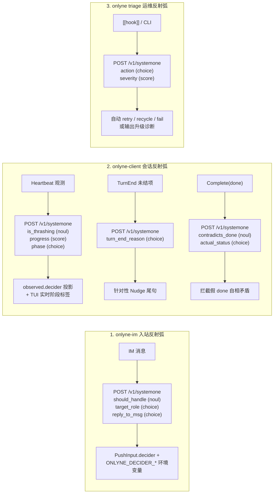

# v2.9 — System One 边缘决策反射弧与 GitHub Wiki 设计规格

本文档定义 Onlyne v2.9 将 System One 决策模型（遵循 TypeSafe System One `POST /v1/systemone` 协议，如 `jev-latest`）集成进 Onlyne 边缘检查点的架构设计、可元编程规格（`DeciderSpec`）与四阶段验收标准。

## 1. 背景与核心原则

### 1.1 `oh-my-pi` (`omp`) 与 `pi` 的边界区分

`oh-my-pi` (`@oh-my-pi/pi-coding-agent`) 与 `pi` (`@mariozechner/pi-coding-agent`) 已正式分叉并拥有各自独立的核心包体系。Onlyne 的核心二进制（Rust）与 `plugins/onlyne-agent-pi`（面向 `pi` 运行时的扩展）不依赖任何 `@oh-my-pi/*` 私有包，直接遵循 **TypeSafe System One 公开 HTTP 协议**（`POST /v1/systemone`）。

### 1.2 System One 协议各语言 SDK 现状与 Onlyne 选型

TypeSafe System One 协议（评估输入 `state`，对命名的 `noul` / `choice` / `score` 问题并行返回校准概率与置信度，不生成自由文本）目前已具备多语言 SDK：

| 语言 | 现有 SDK 包名 | 核心接口 |
|---|---|---|
| **Python** | 官方 `typesafe-sdk` | `TypeSafeClient`、`AsyncTypeSafeClient`、`Choice`、`Noul`、`Score` |
| **JavaScript / TypeScript** | 官方 `@typesafe-ai/sdk` | `TypeSafeClient`、`choice()`、`noul()`、`score()`、`box()` |
| **Rust（社区 crates.io）** | `typesafe-systemone` (`0.2.0`)、`typesafeai-sdk` (`0.4.1`) | `Client::system_one().noul(...).choice(...).score(...).send()` |

**Onlyne 核心仓库的二进制防火墙约束（`AGENTS.md` §16）**：
`onlyne-server` 与 `onlyne-client` 严禁引入 `reqwest`（`cargo tree -p onlyne-server -e normal` 与 `cargo tree -p onlyne-client -e normal` 对 `reqwest` 必须保持零命中），而 crates.io 上的两个 Rust SDK 均强依赖 `reqwest`。因此，我们在 `onlyne-net` 中基于已有的 `tokio::net::TcpStream` 与 `tokio-rustls` 实现原生的零额外依赖客户端模块 **`onlyne_net::systemone`**，保持与 `typesafe-systemone` 完全一致的 `Noul` / `Choice` / `Score` 协议语义，同时确保二进制防火墙 100% 纯净。

### 1.3 三条架构铁律

1. **只用结构化判别原语（`noul`、`choice`、`score`），不假设自由文本生成**：System One 模型（如 `jev-latest`、`clef`）输出的是校准概率与置信度分布。一切动作均由代码读取概率与 `confidence` 后按确定性阈值拍板。
2. **并行问题打包（Speculative Fan-Out）**：同一次检查点上的多个独立问题打包进单个 `POST /v1/systemone` 请求，一次往返完成全部判断。
3. **环境变量配置 + 故障静默降级**：
   - 网关地址：`ONLYNE_DECIDER_URL` → `TYPESAFE_BASE_URL` → `http://127.0.0.1:8080`
   - 模型标识：`ONLYNE_DECIDER_MODEL` → `TYPESAFE_DEFAULT_MODEL` → `jev-latest`
   - 认证密钥：`ONLYNE_DECIDER_API_KEY` → `TYPESAFE_API_KEY`（本地网关可免密钥）
   - 开关控制：`ONLYNE_DECIDER=0|false|off` 显式关闭；当 `ONLYNE_BACKEND=fake` 且未显式设置 `ONLYNE_DECIDER=1|true|on` 时自动跳过外部网络调用，保证离线测试套件零网络依赖；当网关不可达或超时（默认 1500 ms）时静默回退到原有确定性逻辑，绝不阻塞主流程。

---

## 2. 五大 System-1 能力设计规格

### 2.1 核心模块：`crates/onlyne-net/src/systemone.rs`

- 导出类型：
  - `SystemOneClient`：支持 `from_env()`、`new(base_url, model)`、`with_api_key(...)`、`with_timeout(...)`。
  - `DeciderSpec` 与 `ReflexSpec`：声明式、可元编程的 System-1 问题与阈值规格，默认配置内嵌于 `crates/onlyne-net/src/decider_defaults.json`（可通过 `onlyne schema decider` 导出），支持在 `<root>/.onlyne/decider.json` 或 `ONLYNE_DECIDER_SPEC` 中按需做局部 JSON 深度覆盖、支持 `{var}` 状态变量插值与追加自定义 `questions`。
  - `Question`：`Question::noul(instructions)`、`Question::noul_with_criteria(instructions, yes, no)`、`Question::choice(instructions, criteria)`、`Question::score(instructions, levels)`。
  - `Answer`、`NoulAnswer` (`pub noul: f64`)、`ChoiceAnswer` (`pub choice: String, pub probabilities: BTreeMap<String, f64>, pub confidence: f64`)、`ScoreAnswer` (`pub score: f64, pub probabilities: BTreeMap<String, f64>, pub confidence: f64`)。
  - `SystemOneResponse`：提供 `.noul(id) -> Option<f64>`、`.choice(id) -> Option<&ChoiceAnswer>`、`.score(id) -> Option<&ScoreAnswer>`。
- 传输实现：使用 `crate::conn::connect_tcp`（自动享受 v2.8 双栈顺序回退）与 `tokio_rustls`（当 URL 为 `https://` 时），发送最小 HTTP/1.1 `POST <path>/v1/systemone` 请求并解析 JSON 响应（支持 `Content-Length` 与 `Transfer-Encoding: chunked`）。

### 2.5 可元编程指令与判据引擎（Meta-Programmable `DeciderSpec`）

为避免将提示词（`instructions`）、选项判据（`criteria`）、置信度阈值（`thresholds`）与追问文案（`templates`）硬编码在 Rust 源码中，全部五个边缘反射弧统一由数据驱动的 **`DeciderSpec`** 驱动：

1. **单一声明式真源（`crates/onlyne-net/src/decider_defaults.json`）**：
   - 包含五个命名反射弧配置块：`im_inbound`、`complete_guard`、`turn_end`、`heartbeat`、`triage`。
   - 每个 `ReflexSpec` 包含：
     - `enabled: bool`：是否启用该反射弧；
     - `questions: BTreeMap<String, Question>`：发往 `POST /v1/systemone` 的问题表（`instructions` 与 `criteria` 支持直接写字符串或任意结构化 JSON 对象/数组，完全对齐 TypeSafe System One 的 Advanced Structure 能力）；
     - `thresholds: BTreeMap<String, f64>`：置信度与概率门限（如 `contradiction_floor`、`status_floor`、`diagnosis_floor`、`thrashing_mark`、`min_report_bytes`）；
     - `templates: BTreeMap<String, String>`：动态文案模板（如 `turn_end` 各分支追加的 Nudge 后缀、`im_inbound` 中动态注入的 `ignore` / `none` 选项判据）。
2. **三层深度合并覆盖（Deep Merge Override）**：
   - 加载优先级：`DeciderSpec::defaults()`（编译内嵌 JSON） ← `<workspace-or-root>/.onlyne/decider.json`（工作区或集群根覆盖文件） ← `ONLYNE_DECIDER_SPEC`（指向自定义 JSON 文件路径或直接传入内联 JSON 字符串）。
   - 采用递归 JSON Object Merge：用户只需覆写想改的某一条 `instructions`、某一个选项 `criteria` 或某一个 `threshold`，其余字段自动继承默认值。
3. **状态变量插值（State Variable Interpolation）与自定义问题扩展（Custom Question Fan-Out）**：
   - `ReflexSpec::render_questions(&state, dynamic_choices)` 会递归扫描所有 `instructions` 与 `criteria` 中的 `{key}` 占位符，并用当前 `state` JSON 顶层字段的值自动替换（例如在自定义指令中直接写 `"Verify whether coder report for {task_id} matches {head}"`）。
   - 用户可在任意反射弧的 `questions` 表中自由新增自定义问题（例如在 `im_inbound` 新增 `"is_urgent"` 或 `"topic"`，或在 `triage` 新增 `"needs_pager"`）：它们会随同一次 `POST /v1/systemone` 请求一并打包评估，返回的答案保存在 `extra: BTreeMap<String, Answer>` 中，并在 `onlyne-im` 中自动映射为 `ONLYNE_DECIDER_EXTRA_<KEY>` 环境变量，在 `onlyne triage` 与 `onlyne-client` 中自动写入输出 JSON 的 `extra` 字段。
4. **CLI Schema 导出（`onlyne schema decider`）**：
   - 执行 `onlyne schema decider [--pretty]` 即可将当前版本完整的默认 `decider_defaults.json` 打印到标准输出，操作员直接重定向到 `.onlyne/decider.json` 即可开始按需元编程定制。

### 2.2 能力一：`onlyne-im` 零配置语义路由器与线程关联（`crates/onlyne-im/src/decider.rs`）

- 在 `handle_backend_op` 处理入站 `BackendOp::Event(inbound)` 时，调用 `decider::evaluate_inbound`：
  - 构造 `state`：`{ "platform": inbound.platform, "conversation": inbound.conversation, "sender": inbound.sender.id, "text": inbound.text, "recent_messages": [...] }`。
  - 打包 3 个问题：
    1. `should_handle` (`noul`)：该消息是否在向集群请求工作、提问或提供任务上下文（而非无关的人类日常闲聊）？
    2. `target_role` (`choice`)：候选项为会话工作区配置的交互对端角色列表（默认含 `_supervisor`）外加 `"ignore"`。
    3. `reply_to_msg` (`choice`)：当 `inbound.reply` 为空且历史窗口 `window` 含最近消息时，候选项为最近消息的短 ID 前缀（最多 8 条）外加 `"none"`。
- 落地动作：
  - 当 `inbound.reply` 为空且 `reply_to_msg` 选中的消息前缀非 `"none"` 且 `confidence >= 0.70` 时，自动将该前缀作为父消息锚点传入 `chain::record_inbound`，补齐隐式回复线程链。
  - 在 `PushInput::Trigger` 上新增可选字段 `decider: Option<DeciderRouting>`，并在 `run_one_push` 中向触发脚本注入环境变量 `ONLYNE_DECIDER_SHOULD_HANDLE`、`ONLYNE_DECIDER_TARGET`、`ONLYNE_DECIDER_CONFIDENCE` 与 `ONLYNE_DECIDER_REPLY_TO`，使操作员脚本无需编写复杂正则即可直接按 `$ONLYNE_DECIDER_TARGET` 分流。

### 2.3 能力二与能力四：`onlyne-client` 结项质检守门员、自适应 Nudge 与活锁裁判（`crates/onlyne-client/src/session/dispatch/decider.rs`）

1. **结项语义质检守门员（Pre-flight `complete` Guard）**：
   - 在 `on_plugin_report` 收到 `Report::Complete { outcome: Outcome::Done, head, details, .. }`（以及 MCP `tools` 挂载收到 `complete`）时，若 `details` 或 `head` 文本长度 ≥ 24 字节且 decider 启用，发起单次 `POST /v1/systemone`：
     - `contradicts_done` (`noul`)：提交的 `summary`/`details` 是否明确声称任务因外部阻塞、报错或缺失前置条件而未能完成？
     - `actual_status` (`choice`：`completed`、`blocked`、`failed`)。
   - 若 `contradicts_done >= 0.85` 且 `actual_status != "completed"` 且 `confidence >= 0.65`，`completion_refusal_async` 返回 `ErrorCode::Invalid` 拒收该次假 `done`，并在错误消息中指明检测到的矛盾及应改用的 `outcome`（`blocked` 或 `failed`）。
2. **回合结束自适应 Nudge（Adaptive Turn-End Nudge）**：
   - 在 `turn_end.rs` 的 `on_turn_end` 发送单次提醒前，若存在会话尾部文本，通过 `decider::diagnose_turn_end` 判定 `turn_end_reason`（`finished_forgot_complete`、`blocked_on_external`、`encountered_error`、`still_working`），在保留标准 `NUDGE_TEXT` 前缀的基础上追加一行针对性的工具调用提示。
3. **活锁/打转检测与实时阶段标签（Thrashing Detector & Live Phase Tag）**：
   - 在 `reports.rs` 处理 `Report::Heartbeat` 时，若 `observed` 携带文本或工具活动摘要，通过 `decider::analyze_heartbeat` 一次请求同时评估：
     - `is_thrashing` (`noul`)：会话是否陷入重复同一失败操作的活锁？
     - `progress` (`score`：0～3 四档进展评分）
     - `phase` (`choice`：`reading`、`planning`、`coding`、`testing`、`debugging`、`waiting`、`wrapping_up`)
   - 将评估结果写入 `observed["decider"]`，当 `is_thrashing >= 0.88` 时自动记录一条 `kind = "thrashing"` 的本地与上送告警。

### 2.4 能力三与能力五：`onlyne triage` 故障自动分诊动词与 TUI 实时语义态势（`crates/onlyne-cli/src/triage.rs`、`tui/cluster.rs`）

1. **`onlyne triage`（及 `onlyne server triage`）**：
   - 用法：`onlyne triage [--task <ID>] [--from-hook] [--apply] [--min-confidence <0.0..1.0>]`
   - 支持两种输入源：
     - `--from-hook`：从 `stdin` 读取 `[[hook]]` 传入的事件 JSON（如 `delivery_blocked`、`turn_end_without_complete`、`fault`）。
     - 默认模式：通过管理 socket 拉取当前未结清的 `faults` 与 `sessions` / `ledger` 状态。
   - 调用 `SystemOneClient` 对每个异常任务并行评估：
     - `action` (`choice`：`retry`、`recycle`、`fail`、`escalate`)
     - `severity` (`score`：`["low: transient blip", "medium: session stuck", "high: unrecoverable or needs human"]`)
   - 输出一行结构化 JSON 诊断结果；当传入 `--apply` 且 `confidence >= min_confidence`（默认 `0.60`）时，自动通过管理 socket 执行对应的恢复命令（`repair retry`、`control recycle` 或 `repair fail`）。
2. **TUI 实时阶段标签展示（`crates/onlyne-cli/src/tui/cluster.rs`）**：
   - 在 `session_cell` 渲染卡片的 `session` 列时，读取 `session.observed` 中的 `decider.phase` 与 `decider.thrashing`：若有值则显示为 `busy · coding`（若 `thrashing >= 0.88` 则显示 `busy · coding !thrash`）；若无 `decider` 字段则保持原有的 `busy` / `idle` 渲染，100% 兼容既有 TUI 快照测试。

---

## 3. GitHub Wiki 页面规划（`docs/wiki/` + 同步脚本）

在 `docs/wiki/` 下构建完整的中英双语/导航清晰的技术 Wiki 页面集，并提供 `scripts/publish-wiki.sh` 一键同步至 `https://github.com/dbydd/onlyne.wiki.git`：

| 页面文件 | 内容定位 |
|---|---|
| `Home.md` | Onlyne 架构全景图、核心概念速查、快速跳转目录 |
| `_Sidebar.md` / `_Footer.md` | GitHub Wiki 全局侧边栏导航与页脚版本标识 |
| `Quickstart.md` | 两条命令初始化并拉起多角色集群（`server init --roles` + `onlyne up`）、在线热注册、任务投递与看板观测 |
| `Architecture-and-Concepts.md` | Role / Client / Runtime / Session Scope (`oneshot`/`task`/`role`) / Drive × Placement 矩阵与双轴状态机 |
| `CLI-Reference.md` | `onlyne`、`onlyne-server`、`onlyne-client`、`onlyne-im` 全命令速查表与退出码表 |
| `IM-Gateway.md` | v2.3 `<chat:KEY>` 协议、v2.4 `<msg:PREFIX>` 回复线程、五大平台后端（Telegram/飞书/QQ/Slack/Linear）配置指南 |
| `System-One-Decider.md` | System One 五大边缘反射弧原理、可元编程 `DeciderSpec` 配置与 `[[hook]]` 自动分诊配方 |
| `Operations-and-Troubleshooting.md` | 生产部署（`launchd`/`systemd`）、优雅停机（`shutdown`）、常见故障码与 `repair` / `triage` 恢复手册 |
