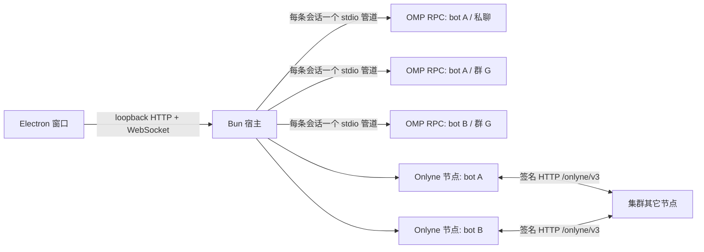

# Onlyne 桌面 bot 设计

`packages/desktop-bot` 把 Onlyne 的 bot 团队做成一个原生桌面应用。模型、工具和插件由 OMP RPC 子进程执行；Onlyne 节点、消息路由和配对由宿主进程持有，用户不需要另装 Onlyne 插件。每个 bot 拥有自己的一份 `.omp` 目录，OMP 生态里的插件、MCP、技能和记忆配置因此按 bot 生效。

本文描述已经实现的形态和边界。协议语义在 RFC 里，OMP 接入契约在 [OMP 接入契约](../../contracts/omp.md)，OMP 的 RPC 帧格式在 OMP 自带文档中。

## 1. 进程与职责



| 进程 | 持有 | 不持有 |
|---|---|---|
| Electron 主进程 | 窗口、菜单、外部链接策略、单实例锁 | 模型、存储、网络协议 |
| Bun 宿主 | 应用状态、bot 名册、每个 bot 的 Onlyne 节点、每条会话的 RPC 子进程、宿主工具、渲染器插件 | 模型推理 |
| OMP RPC 子进程 | 一条会话的模型上下文、内置工具、bot 的 `.omp` 插件与技能 | Onlyne 身份、密钥、节点状态 |
| 渲染器 | 对话界面、widget、面板、主题 | Node 权限、文件系统、凭据 |

窗口只加载宿主在 `127.0.0.1` 上的一次性启动地址。启动令牌只能使用一次，随后由 `HttpOnly`、`SameSite=Strict` 的会话 cookie 认证。渲染器关闭 `nodeIntegration`，打开 `sandbox` 与 `contextIsolation`，非本窗口来源的导航和弹窗一律拒绝。

## 2. 每个 bot 一份 `.omp`

团队数据目录（默认 `~/Library/Application Support/Onlyne Desktop/node`）下的布局：

```text
team/
  state.json                         应用状态：名册、会话成员、界面消息、能力库
  bots/<bot-id>/.omp/                该 bot 的 OMP 配置根，也是一切扩展的入口
    bot.json                         桌面 bot 配置正本
    config.yml                       OMP 会话设置
    mcp.json                         MCP 服务器
    extensions/                      OMP 原生扩展
    hooks/pre/  hooks/post/          原生钩子
    plugins/                         该 bot 私有的插件根
    plugin-overrides.json            插件禁用与覆盖
    skills/                          OMP 技能；桌面能力以符号链接加入
    memory/MEMORY.md                 bot 个人记忆
    APPEND_SYSTEM.md                 追加提示词
    omp-hindsight.json               可选的知识库配置
    onlyne/                          Onlyne 节点的 store、日志与密钥
  sessions/<bot-id>/<conversation-id>/  每条会话的 OMP 会话文件与运行时提示词
  runtimes/<bot-id>/<conversation-id>/workspace/  子进程工作目录；.omp 软链到 bot 配置根
```

`bot.json` 保存名字、说明、指令、工作目录、模型与思考档位、选中的能力、运行时选项、宿主与渲染器插件路径、Onlyne 身份。它是配置正本；应用状态里的 bot 记录是它的投影。保存 bot 时先写配置文件，再更新状态并广播快照。

同一条 bot 在不同会话里使用同一个配置根，但各有自己的 OMP 会话目录。`sessions/` 与 `runtimes/` 按 bot 和会话分开，所以群聊与私聊的上下文不会混在一起。

### 2.1 与 OMP 原生发现的衔接

子进程以 `runtimes/<bot>/<conversation>/workspace` 为当前目录，该目录下的 `.omp` 是指向 bot 配置根的符号链接。OMP 的原生项目发现读取 `<当前目录>/.omp`，因此 bot 的扩展、MCP、技能和知识库配置都会被读到。使用符号链接而不是另建一份配置，避免两处配置漂移。

启动参数保留 OMP 的自动发现，只对选中的能力追加 `-e`。宿主启动前合并 `plugin-overrides.json`，把 `omp-onlyne` 加入 `disabled`：桌面宿主自己持有 Onlyne 节点，若再加载 OMP 的 Onlyne 扩展，两边会争同一个 `msg` 工具名，并向同一份配置再开一个节点。其余已安装插件照常加载，实测当前环境中 Hindsight 的原生工具会出现在 bot 的工具列表里。

`--skills` 的允许列表由选中的技能、bot 自己 `.omp/skills` 下的技能、显式扩展附带的技能组成，防止一个 bot 的技能意外出现在另一个 bot 的提示里。

## 3. 身份与路由

每个 bot 一个稳定的 Onlyne 节点，节点 id 与密钥保存在 `bots/<bot-id>/.omp/onlyne/`。私聊和群聊共用这个身份，会话隔离依靠 thread 与执行上下文别名。这样对端看到的是 bot 本身，不会每开一个群就变成另一个身份。

宿主按 `conversationId` 发布执行上下文别名，入站消息落在发送方指定的别名；未指定时落在该 bot 的第一个会话。模型侧只有两个通信入口：`msg` 负责网络消息，`desktop_team` 负责团队名册与会话。`msg` 对外仍是一个工具，参数保持 `{ delivery_kind, msg, meta }`。

投递判定由一个独立的 OMP RPC 解释进程完成，它不带工具，逐条返回一个动作对象。只有 `meta.to`、`meta.response`、`meta.execution` 同时给定时才完全跳过判定；只给了收件人时仍然交给判定，由它补齐关系与执行方式，不能把“指定了收件人”当成“整条计划已确定”。

## 4. 三层记忆

| 层 | 存放位置 | 写入方式 | 用途 |
|---|---|---|---|
| 会话 | `sessions/<bot>/<conversation>/` | OMP 会话自动保存；RPC 的 `get_entries`、`branch`、`fork` 操作 | 继续上一轮工作、查看历史、分支试验 |
| 个人与群记忆 | `bots/<bot>/.omp/memory/MEMORY.md`，群记忆在应用状态 | `memory.save` 追加或替换；`remember`、`recall` 工具 | 长期偏好、结论、群内约定 |
| 知识库 | 可选的原生 Hindsight 配置 `.omp/omp-hindsight.json` | Hindsight 工具经判定写入；模板只由用户显式创建 | 跨会话检索的长期知识 |

知识库不做桌面侧的自动写入。插件在 bot 启动时对齐服务端 bank，模板里尚未存在的 bank 会由插件创建，面板在生成模板时明确标注这一点。全局 Hindsight 配置仍参与合并，所以模板把继承来的 bank 逐个写成 `{ id, enabled: false }`，只保留该 bot 自己的 bank。配置文件只在会话启动时读取，改动后下一次重建运行时尚生效。

## 5. 界面协议

### 5.1 OMP 原有的串行界面方法

驱动以 `omp --mode rpc-ui` 启动，协商传输版本 2，打开合并问答，并订阅子代理事件。渲染器处理当前协议里的全部方法：

| 方法 | 行为 |
|---|---|
| `select` | 选项与描述，回传选项原文 |
| `confirm` | 明确的确认或取消 |
| `input` | 输入框，支持隐藏输入的提示 |
| `editor` | 多行编辑，带初始内容 |
| `ask` | 一次问答的全部问题、推荐项、多选、自由输入与超时 |
| `cancel` | 关闭对应的等待请求 |
| `notify` | 通知 |
| `setStatus` | 按 key 更新或移除状态 |
| `setWidget` | 按 key 更新或移除编辑框上下的文本行 |
| `setTitle` | 设置标题位置 |
| `set_editor_text` | 更新当前会话草稿 |
| `open_url` | 显示可点击的授权链接与复制入口 |

响应绑定到发起请求的 bot、会话和请求 id。OMP 的扩展启动阶段可以早于普通命令处理，因此请求连接完成前，宿主已经能把这期间的界面响应直接写回子进程，启动对话框不会把整个 bot 卡住。

OMP 的终端组件工厂没有对应的串行表示，本应用不声称通过 RPC 传输它们。扩展需要富界面时改走下一节的声明式协议。

### 5.2 声明式富界面

`show_view` 宿主工具把视图作为 JSON 发出，协议名 `onlyne.view/v1`。内置卡片：

| 卡片 | 内容 |
|---|---|
| `text` / `markdown` | 文本；Markdown 由本地解析器渲染，不注入 HTML |
| `metrics` | 指标列表 |
| `table` | 列定义与行数据 |
| `chart` | 柱状图或折线图，手绘 SVG，带坐标与图例 |
| `progress` | 进度 |
| `choices` | 单选或多选，返回选项值 |
| `confirm` | 确认，返回布尔值 |
| `form` | 命名字段表单，返回按字段名组织的对象 |
| `html` | 沙箱 iframe，只能通过 `onlyneWidget.submit` 或 `onlyneWidget.cancel` 回答 |
| `stack` | 组合多张卡片 |

未知协议显示原始载荷和可操作的错误，不伪造成功。注册返回 disposer，卸载后恢复上一个渲染器。

## 6. 可定制范围

从下到上，每一层都有替换点，也有明确的默认实现：

| 层 | 扩展方式 | 生效范围 |
|---|---|---|
| 传输与协议 | `RuntimeDriver`：`connect` 返回 `request`、`send`、`close` | bot；在 `bot.json` 的 `runtime` 与 `runtimeOptions` 选择 |
| 插件与技能 | bot 的 `.omp`：原生扩展、钩子、MCP、技能、插件根 | bot |
| 知识库 | `.omp/omp-hindsight.json` | bot |
| 宿主工具与虚拟文件 | `DesktopPlugin` 工厂；`registerTool`、`registerUri` | bot |
| 消息渲染、面板、widget、主题 | 渲染器插件：`window.onlyne` 的注册接口 | bot |
| 整体界面 | 全局渲染器插件与自定义 CSS | 应用 |

宿主插件由工厂创建，每个 bot 一个实例，模块缓存只保存工厂。同一路径的插件被两个 bot 选中时不会共享可变状态。插件配置切换时，仍在运行的会话继续使用旧实例，直到该会话结束，避免工具执行到一半失去处理器。

界面上内置的面板覆盖 OMP 自身的工作流：会话树与分支、子代理、目标、消息队列，以及每个 bot 的 `.omp` 配置编辑器。原始 RPC 命令入口保留给扩展和调试，不替代这些常用控件。

## 7. 需要人对面的步骤

以下操作不自动完成，界面只提供入口和证据：

- 与对端交换密钥时核对指纹。批准必须重复界面上已经显示过的指纹。
- 为真实 IM 平台提供凭据。
- 决定 MCP 服务器的 controller 与资源的接手方。
- 是否把全局知识库配置里的 bank 关掉。
- 是否把某个插件或扩展放进某个 bot。

## 8. 角色与场景编排

bot 的目录就是它的完整身份：`bots/<bot-id>/` 可以整体复制或备份，`.omp` 里放着配置、插件、记忆与 Onlyne 密钥。应用状态只记录名册和会话，bot 的个人资料不依赖数据库。

角色扮演沿用 SillyTavern 的工作方式，但落在 OMP 的会话上。角色卡、世界书和场景设置都是普通数据，面板和工具读同一份。

| 部分 | 字段 | 行为 |
|---|---|---|
| 角色卡 | 描述、性格、场景、角色系统提示、示例对话、首条问候、备选问候、作者备注、标签 | 保存进 `bot.json`；导入支持 SillyTavern V1/V2/V3 JSON 与 PNG 内嵌的 `chara`/`ccv3` 块 |
| 世界书 | 关键词、次关键词、内容、启用、常驻、顺序、深度、角色 | 每轮按最近消息扫描；常驻条目始终加入；预算按字符上限裁剪并报告丢弃数量 |
| 场景 | 用户人设、作者注、注记深度、扫描深度、预算、历史条数、群聊轮流模式 | 存在会话上；作者注按深度插入转录，不占固定系统提示 |
| 提示编排 | `harness.ts` 把角色、世界书、人设、作者注、示例、后历史指令编译成一轮提示 | 每个块有位置、顺序、深度和启用状态；`harness.preview` 返回实际提示、命中条目与 token 估算 |

问候在角色卡导入或保存时写入私聊，作为已显示的助手消息；第一次发送会把它作为场景开场交给模型，之后不再重复。群聊按 `@` 或轮流向模式选下一个发言者；逐个 bot 的会话仍然隔离。`message.regenerate` 删除该 bot 最后一条回复并带“换一种写法”的指令重新生成。

### 媒体

图片、视频、音频、SVG 与贴纸走同一份媒体存储：文件在 `<数据目录>/media/`，元数据在应用状态里，读取走带会话 cookie 的 `/api/media/<id>`，支持 Range，视频可以拖动进度。

角色卡头像使用导入 PNG 的原始图片，保存为媒体并记在 `character.avatar`；bot 栏、会话标题和消息作者位置显示它。用户可以在输入框附加文件、粘贴图片或拖入文件，消息可以只有媒体没有文字。bot 用 `show_media` 显示本地文件、内联 SVG、远程 URL 或 `.omp/stickers` 里的贴纸；生成的图片先由 OMP 的 MCP 工具写入工作目录，再用 `show_media` 送进对话。文件超过 25 MB 拒绝。

媒体标识、bot 标识与 Onlyne 节点标识都用短后缀（如 `m-3k9x2f`、`c-8f1a`、`urn:onlyne:agent:desktop:mira-z1uww3ag`）。模型要复述这些值，长 UUID 是已经证实的错误来源。

世界书与角色卡不进入系统提示文件，而是每轮随消息注入，所以修改不需要重启运行时；角色卡的静态部分同时写进运行时的追加提示，第一轮之前就已生效。这些数据都没有自动写回 SillyTavern 的服务端。

## 9. 验证

本次实现观察到的运行结果：

- 桌面包 `tsc --noEmit` 通过。
- 真实 OMP RPC 会话完成一次模型回答：`runtime.models` 返回 338 个模型，`message.send` 收到 `READY`，用量记录写回消息。
- 首轮运行生成了 `bots/chief/.omp/{bot.json,desktop-runtime.json,memory/MEMORY.md,plugin-overrides.json,onlyne/...}`，`plugin-overrides.json` 内容为禁用 `omp-onlyne`。
- bot 会话的工具列表包含原生 `hindsight`，不含外部 `omp-onlyne` 的 `msg`，说明 `plugin-overrides` 生效且宿主工具没有命名冲突。
- 配置接口在临时目录验证：路径越界被拒绝，`onlyne` 状态目录被引导到节点面板，Hindsight 模板只返回全局 bank 的 id，不返回密钥或描述。
- 原生窗口实际启动，渲染出 bot 栏、会话、转录、成员/运行时/用量、视图列表与每 bot 的配置根。界面里实际点击发送后，转录显示流式工具帧、宿主工具挂载和模型回复；`show_view` 渲染出 `Probe` 指标卡片。
- 角色扮演链路实测：导入含世界书的 SillyTavern 卡片（JSON 与 PNG 的 `chara` 块各一次），私聊自动写入问候；发送后模型按角色设定与命中的灯室世界书回答，`greeted` 变为 true。
- 全仓 `bun run check` 与 `bun run test` 通过。

尚未完成的验收：两个不同 bot 之间的真实 Onlyne 配对与消息尚未在桌面上走一遍；OMP 菜单滚动条修复没有在真实 Tern 会话里逐项截图；`@onlyne/node-host` 的新子路径发布前需要提升依赖版本范围。
