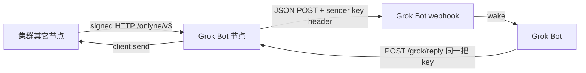

# Grok Bot 通信节点

本文记录把 Grok Bot 接进 Onlyne 集群的宿主选择。协议语义仍是 RFC 0003 的入站接纳与 RFC 0017 的节点认证；webhook 是本节点在接纳之后的投递动作，不是第二条协议。

## 方向

入站：消息被本节点 `admit`（或经 grant 注入 inbox）之后立刻 POST 到配置的 webhook，把 Grok Bot 唤醒。出站：Grok Bot 用同一把 sender key 打本进程的 `/grok/reply`，由本节点身份发出 Onlyne 消息。更完整的读/发表面是旁边的 `@onlyne/mcp-server`。

URL 与密钥只来自配置里的 `$VARIABLE` 引用和 `ONLYNE_GROK_*` 环境变量，不进仓库。默认头是 `Authorization: Bearer <key>`。

失败处理：先写 owed 行再 POST；超时、网络错误、408/429/5xx 按指数退避重试，次数有上限；其它非 2xx 记为 failed 留在 store。每条消息独立 in-flight，互不阻塞。

实现在 `packages/grok-bot`。
