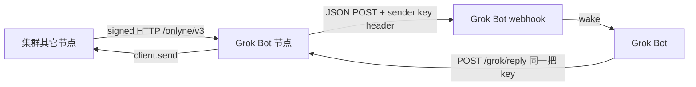
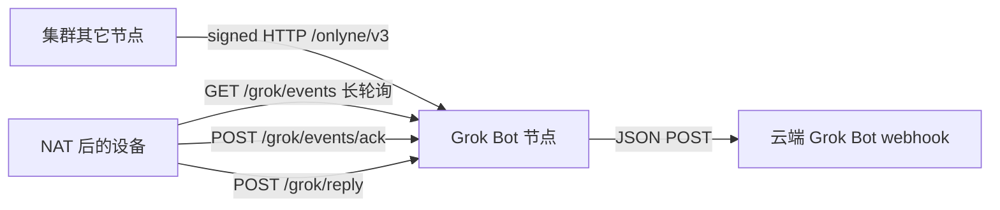

# Grok Bot 通信节点

本文记录把 Grok Bot 接进 Onlyne 集群的宿主选择。协议语义仍是 RFC 0003 的入站接纳与 RFC 0017 的节点认证；webhook 是本节点在接纳之后的投递动作，不是第二条协议。

## 方向



入站：消息被本节点 `admit`（或经 grant 注入 inbox）之后立刻 POST 到配置的 webhook，把 Grok Bot 唤醒。出站：Grok Bot 用同一把 sender key 打本进程的 `/grok/reply`，由本节点身份发出 Onlyne 消息。更完整的读/发表面是旁边的 `@onlyne/mcp-server`。

URL 与密钥只来自配置里的 `$VARIABLE` 引用和 `ONLYNE_GROK_*` 环境变量，不进仓库。默认头是 `Authorization: Bearer <key>`。

失败处理：先写 owed 行再 POST；超时、网络错误、408/429/5xx 按指数退避重试，次数有上限；其它非 2xx 记为 failed 留在 store。每条消息独立 in-flight，互不阻塞。

实现在 `packages/grok-bot`。

## 身份：一账户一把钥，多 thread 隔离

Grok Bot 的密钥按 **账户 / 运营方** 发放，**不要**给每个 assistant 单独做一对密钥或单独起一个 grok-bot 进程。默认节点 id 是 `urn:onlyne:gateway:grok-bot`：一个节点、一把身份钥、一个 webhook，覆盖该账户下所有 assistant 与群。配对、发现、信任表都停在这个节点；多 bot 之间只靠 thread id 和 `meta.grokbot` 分开。

## Thread 方案

每个 Grok Bot assistant（单聊）和每个 Grok Bot 群各占一条 Onlyne thread，互不混写。thread 的 owner 永远是 grok-bot 节点，id 稳定、可文档化：

| 会话 | thread id |
|---|---|
| 单聊 | `grokbot:dm:<agent_id>` |
| 群 | `grokbot:group:<group_id>` |

`<agent_id>` / `<group_id>` 原样拼进 id（Onlyne 节点 id 里的冒号保留）。例：与 `urn:onlyne:agent:alice` 的单聊是

```
{ "owner": "urn:onlyne:gateway:grok-bot", "id": "grokbot:dm:urn:onlyne:agent:alice" }
```

入站时 **必须** 落到这条稳定 id 上，而不是每次 first-contact 新开一个随机 UUID：

1. 消息已经带了本节点拥有的 `grokbot:dm:…` / `grokbot:group:…`，沿用。
2. 否则读 `meta.data.grokbot`（HTTP 允许的 `data` 袋）或 `meta.grokbot`：`chat_kind` 为 `dm`（默认）或 `group`，`chat_id` 为助手或群 id（`agent_id` / `group_id` 是别名）。
3. 再否则按发送方做单聊：`grokbot:dm:<sender>`。

`group` 缺少 `chat_id` 会 `invalid_request`。节点在 `admit` 之前 create 该 thread、写入发送方 membership。本节点 **关掉** 随机 first-contact（无 default thread）。

旧部署里已经落到随机 UUID 上的会话：对端如果仍带那个 `thread` 会继续写那条；新的、没带 thread 的入站一律改走稳定方案。不做自动迁移。

Webhook JSON 的 `meta.grokbot` 固定带 `chat_kind` 与 `chat_id`，方便同一账户下多 bot 路由。稳定 id 与 thread 一致；遗留随机 UUID 回退为 `{ chat_kind: "dm", chat_id: "<sender>" }`。

## 无公网 IP：设备主动拉取

Webhook POST 要求 Grok Bot 侧有可达 URL。NAT 后的 OMP / Cursor CLI 没有入站监听，改为 **本节点出站**：用同一把账户 sender key 访问 grok-bot 的 host 表面。



`GET /grok/events` 返回与 webhook 相同的 JSON payload（含稳定 `thread` 与 `meta.grokbot`）。未 ack 的行保持 owed；lease 过期后同一 `id` 再投一次（at-least-once）。设备离线期间入站照样入队，重连后拉到。Webhook 队列与 pull 队列独立：云端推送失败不影响 NAT 拉取。

实现：`PullInbox` + `GrokBotPullClient`（`packages/grok-bot`）。设备不需要 Onlyne 身份钥，只需要账户 sender key。

长轮询默认 25s、上限 30s。Bun.serve 默认 `idleTimeout` 是 10 秒，安静的 GET 在写出响应之前会被掐断，所以监听器把 idleTimeout 设到上限以上。本节点自己的 `/grok/reply` **不会**再进 webhook / pull 队列，避免消费方对每条 wake 再回复形成自环。

第一条落到新 `grokbot:dm:` / `grokbot:group:` 的消息回执里 `thread_created` 为 true（节点会先 create 稳定 thread 再 admit，库本身会记 false；宿主把 seq 1 的 grokbot thread 视为新会话）。

## 无 TUI 配对

`ONLYNE_NO_TUI=1` 或非 TTY 时信任终端不能按 `[a]`。配置 `trust_seeds`（或环境变量 `ONLYNE_GROK_TRUST_SEEDS`）钉扎 **具体** 对端：`node_id` + 该对端当前公钥的 16 位 hex fingerprint。指纹一致才本地批准；不一致拒绝；名单外的对端仍保持 invited，需要人在 TTY 上确认。没有“全接受”。指纹要在带外核对后再写入；钉扎强度等于复制指纹的那条通道。

## `/grok/reply` 如何继续同一会话

支持的做法是把 webhook 里的 `thread` 和 `in_reply_to` 原样带回。`to` 填本节点 id（webhook 的 `node_id`），因为 thread 由 grok-bot 拥有、由本节点接纳。

| 请求体 | 行为 |
|---|---|
| webhook 里的 `thread` + `in_reply_to` | 落到同一 `thread_ref`（推荐） |
| 只有 `thread` | 仍落在该 thread，作为会话里一条新根 |
| 只有 `in_reply_to` | 若原消息是本节点接纳的，按库的 reply 链找回落地 thread |
| 两者都没有 | 拒绝 `not_found`：没有 default thread，也不再新开随机 thread |

## 与 `@onlyne/mcp-server` 的边界

MCP 可以继续作为 **另一个进程、另一个节点 id、另一份 store**。同一账户上多 bot 的隔离边界是 grok-bot 的 thread，不是 MCP。MCP 工具读的是 MCP 节点自己 store 里的 inbox / thread；在两套身份合并之前，它看不到 grok-bot 那些 `grokbot:dm:` / `grokbot:group:` 会话。
