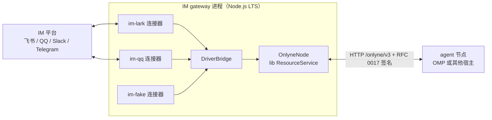

# Onlyne v3 IM 网关设计

本文记录 IM 独立节点（IM gateway）的部署形态、包结构、连接器契约与库接缝。它记录的是实现选择：进程怎么分、包怎么切、驱动桥怎么写。会话语义、状态归属与验收口径在 [RFC 0012](../../rfcs/0012-im-resource-node.md)；通用资源与交接规则在 [RFC 0006](../../rfcs/0006-resources-and-handover.md)。设计改变不需要改协议；改变可观察行为的实现调整仍需回到 RFC 与宿主契约检查。

上游调研记录：v2 资产清点 `local://legacy_im_inventory.md`（file:line 引用，未运行代码）；社区方案对比 `local://community_im_frameworks.md`（npm 版本 2026-10-26 实测）。两份是本设计的输入，不是规范。

## 1. 部署形态：独立进程，网络交互

IM gateway 是一个独立的 Onlyne 节点进程，运行 `@onlyne/lib` 的完整服务面，与 agent 侧（OMP 插件或任何宿主）只经网络交互。



这个形态的依据：

| 边界 | 谁负责 | 依据 |
|---|---|---|
| 协议状态机（去重、event_id、绑定表、交接、日志读取） | lib `ResourceService`，gateway 进程内 | RFC 0012 §4-§6；`packages/lib/src/resources.ts` 已实现 |
| 平台连接与翻译 | 平台连接器包，gateway 进程内 | RFC 0012 §4 入站路径；连接器是进程内模块，不是 v2 的必需子进程 |
| 进程间交互 | 只有 HTTP `/onlyne/v3`，经 RFC 0017 签名 | RFC 0000 分层；agent 侧零平台耦合 |
| 平台凭据 | gateway 宿主的凭据目录，agent 不接触 | RFC 0012 §8 |
| 会话 thread 及其生命周期 | gateway，它是 chat bot service 界面的主体 | 本节 §4.1；协议层不规定 |

一个连接器是一条连接，不是一条会话。gateway 同时服务该连接器上的全部平台会话，一条会话一个资源（RFC 0012 §2）。会话集合在运行时增减：机器人被拉进新群、有人私聊它，都由 adopt 建资源，不需要重启，也不需要预先写进配置。交接以会话为最小单位。

选择独立进程而不是嵌进 omp 插件，理由有三：

1. **运行时解耦。** 平台 SDK（`@larksuiteoapi/node-sdk`、`@tencent-connect/qqbot-nodejs`、`@slack/bolt`）面向 Node LTS，omp 插件跑 Bun。嵌入意味着每个宿主都要验证全部平台的运行时兼容；独立进程后，Bun 还是 Node 的分歧在进程边界上消失（2026-10-26 调研报告 §2.2 的开放项就此关闭）。
2. **部署位置自由。** IM 节点可以放在靠近平台出口的位置（QQ webhook 需要固定出口 IP 的场景），agent 集群在别处；网络发现（RFC 0011）本来就支持跨主机。
3. **状态单一持有。** 去重、游标、绑定都在 gateway 的事务里，agent 侧没有第二份状态机可撞（调研报告对 Vercel Chat SDK 的否决理由，厂商自证：Lark vendor adapter 必须禁用 SDK 内置去重避免双份状态处理）。

代价：多一个常驻进程要运维，凭据目录与发现记录跟着 gateway 走。换来上面三条，值得。

### 1.1 网络发现与身份

网关和 OMP 共用 `@onlyne/node-host` 的 DNS-SD 发布、浏览与密钥文件实现。文件访问留在宿主包，协议库接收密钥钩子。CLI 在 HTTP 服务就绪后发布实际端口，持续观察候选，每 30 秒刷新已知地址。进程退出时撤销发布并停止浏览。

CLI 首次启动自动生成身份密钥，保存在用户的 Onlyne 密钥目录，重启沿用。网关的 HTTP 请求使用 RFC 0017 签名。发现只增加候选，用户在 OMP 指纹卡片和网关终端确认信任。网关终端是一张全屏信任界面：节点列表带交换阶段，选中项显示完整 id、端点与指纹，`t`/`a` 先展示指纹再等 `y`，`r` 撤销，`c` 输入地址。日志进界面底部的环形缓冲，同时写 `<storage 目录>/gateway.log`。用户无需编辑指纹或端口配置。

节点行同时显示交换阶段与「投送」标记：前者是密钥配对，后者表示当前有资源绑定指向该节点。两者独立推导，界面不把任何一个当作另一个的证据。跨网络连接通过 OMP 的地址输入或网关界面里的 `c` 联系节点。启动种子与交互添加的地址使用同一发现路径。资源的 handler 权限继续由资源绑定判定。

## 2. 包结构

```
packages/im-core      连接器契约：ImEvent、ImReply、SendOutcome、Connector 接口、凭据链
packages/im-lark      飞书连接器（打样）
packages/im-fake      脚本化假连接器（验收夹具，继承 v2 fake 后端语义）
packages/im-gateway   进程组装：配置、存储、节点、连接器装载、事件推送环
```

依赖方向单向：`im-gateway` → `im-lark`/`im-fake` → `im-core` → `@onlyne/lib`。平台 SDK 只出现在 `im-<platform>` 包的依赖里；`im-core` 与 `im-gateway` 不 import 任何平台 SDK。QQ、Slack 等后续平台各起 `im-<platform>` 包，不共用统一抽象之外的任何东西——分平台找完整能力是既定决策（用户 2026-10-26 指示），`im-core` 只抽「平台无关的那一半」（v2 清单 §1.3 的 payload/事件/回复坐标语义平移）。

## 3. 连接器契约（im-core）

契约的语义底稿是 v2 的标准 payload 层（`archive/crates/onlyne-im-backend/src/payload.rs`），这是全部平台翻译层共享的沉淀，TS 化时原样平移：

```typescript
/** 入站：一条平台事件，已经剥离平台 envelope。 */
export interface ImEvent {
  platform: string;            // 'lark' | 'qq' | 'slack' | 'telegram' | 'fake'
  source_id: string;           // 平台事件 id，receive 的去重键
  conversation: string;        // 平台会话坐标（飞书 chat_id、QQ group:/c2c:）
  kind: 'message' | 'action' | 'event';
  from: string | undefined;    // 平台发送者标识
  text: string;
  attachments: ImAttachment[]; // { kind, path | platform_handle, alt }
  reply: ImReply | undefined;
  action: { id: string; value?: Json } | undefined;  // kind === 'action'
  event: { type: string; data?: Json } | undefined;  // kind === 'event'：撤回、反应、入群
  message_handle: string | undefined;  // 本事件的平台消息句柄，后续回复引用它
  ref_handle: string | undefined;      // 平台双 id 时的引用句柄（QQ）
  at: string;                  // 平台时间戳
  raw: Json | undefined;       // 平台原文，诊断用
}

/** 平台怎么表达回复：三分坐标（v2 payload.rs:145-216 语义平移）。 */
export interface ImReply {
  parent: string | undefined;  // 回答谁
  root: string | undefined;    // 讨论锚点
  thread: string | undefined;  // 平台独立 thread
  quoted_text: string | undefined;
}

export interface SendRequest {
  conversation: string;
  text: string;
  format: 'plain' | 'markdown';
  attachments: Array<{ kind: ImAttachment['kind']; path: string; alt?: string }>;
  reply_to: string | undefined;       // 已翻译的平台消息句柄
  reply_in_thread: boolean | undefined;
  card: Json | undefined;             // 平台卡片；有它时 text 可为空
  request_id: string | undefined;     // 操作 id：平台支持时的幂等键
}

export interface Connector {
  readonly platform: string;
  /** 启动连接；未认证是状态不是错误（v2 credential.rs:31-46 语义）。 */
  start(): Promise<void>;
  /** 事件流。监听器可返回 Promise，连接器按会话串行，保证 receive 的落库顺序。 */
  onEvent(listener: (event: ImEvent) => void | Promise<void>): void;
  /** 出站发送。resolve 的 SendOutcome 携带平台三态与原文。 */
  send(request: SendRequest): Promise<SendOutcome>;
  /** send 之外的平台操作，名字由连接器声明，桥按清单校验。 */
  operations: readonly string[] | undefined;
  operate(operation: string, data: Json): Promise<SendOutcome>;
  stop(): Promise<void>;
}

export interface SendOutcome {
  state: 'committed' | 'unknown';
  message_id: string | undefined;   // 平台消息 id
  ref_handle: string | undefined;   // 被引用句柄（QQ REFIDX）
  error: string | undefined;        // 平台拒绝原文
}
```

设计规则：

- 连接器无状态。去重、游标推进、绑定判定都不在连接器里；它只做翻译（v2 `update.rs`/`render.rs` 的纯函数纪律）。一个连接器服务它这条连接上的全部平台会话：事件按 `conversation` 分流，发送按 `request.conversation` 寻址，连接器自己不记会话表。
- `SendOutcome` 无 `aborted`：驱动层把「平台明确拒绝」判定为 `aborted` 并保留原文（`error` 字段），「结果不明」交给 `unknown`——三态的裁决在 driver 桥，不在连接器。
- 生命周期事件（撤回、反应、入群）走 `kind: 'event'`，正文为空，载荷在 `event.data`；它们没有自己的消息句柄，不参与 `reply_to_event` 解析。
- 凭据经构造注入（路径或值对象），连接器不读 argv、不自己落盘。「登录先写后验」的清理责任在 gateway 的登录流程，RFC 0012 §8 要求先验后写。
- 连接器可以进程内（默认）也可以子进程（v2 兼容路径，帧协议照旧）；这是部署选择，契约不变。

## 4. Driver 桥（im-gateway）

`DriverBridge` 实现 lib 的 `ResourceDriver`（`packages/lib/src/types.ts:204-208`），把资源操作翻译成连接器调用：

| driver 方法 | 桥的行为 |
|---|---|
| `validate(resource, operation, data)` | `send` 校验 `text` 或 `card` 至少一项、`format`、`attachments`、`reply_to_event`；其余操作必须在连接器声明的 `operations` 里，并交给连接器的 `validate` 校验（`read`/`list_events` 是库内查询，不走驱动） |
| `execute(resource, request)` | `send` → 解析 `reply_to_event` 为平台句柄 → `connector.send` → 三态映射；连接器声明的其它操作 → `connector.operate`，同一套三态映射；`aborted` 只在平台明确拒绝时产生 |
| `query(resource, operation_id)` | 连接器无操作历史，返回 undefined；恢复路径由 lib `recover()` 的 `unknown` 处理兜底 |

桥接的库侧事实（钉住设计的三条）：

1. **操作幂等在 lib。** `claimOperation`（`resources.ts:201-223`）先落 intent 再产生外部效果；`execute` 超时返回 `unknown` 后外部调用继续，后续结果经 `report(ref, id, value, true)` 补记（`resources.ts:635-653`）。桥不需要自己的重试去重。
2. **事件接收在 lib。** 桥把 `ImEvent` 交给 `resources.receive(endpoint_auth, ref, { source_id, data })`，`receive` 在一个事务里完成去重、event_id 分配与日志追加。桥对 `receive` 返回的重复事件静默吞掉（平台重投是常态）。
3. **`reply_to_event` 翻译在桥。** 操作 `data.reply_to_event` 是应用层 event_id；桥从 gateway 的 `event_id → (平台 message_id, ref_handle)` 索引查出平台句柄再交给连接器。这个索引是 gateway 的本地状态，落在同一存储。

### 4.1 事件投影与回复回流

投影形状是插件行为，不是协议要求。RFC 0012 只规定 endpoint 交付资源操作与事件日志，把一条会话投影成 agent 侧的哪种形状由接入层自己定。

飞书这一侧的取舍是：thread 投影留在网关里，网关自行维护 thread 的生命周期。网关是 IM chat bot service 这个界面的主体，是会话 thread 的 owner，负责建 thread、分配 seq、把 agent 回复渲染回平台。协议层不持有这个决定，也不依赖它。

一条会话一个 thread。adopt 一条会话时建它的 thread，会话退役后 thread 保留为可读历史，id 不复用。

| 步骤 | 实现 | 落点 |
|---|---|---|
| 会话 thread | adopt 资源时建一次，id 取 `im-<资源 id>`，owner 是 gateway | `index.ts` 的 `ensureThread` |
| 事件投影 | `receive` 后向当前 handler 发一条 `delivery_kind: 'notify'` 消息，`meta.thread` 指向会话 thread，正文是平台正文，`meta.data` 带 `{ resource_ref, event_id, source_id, platform, conversation, from, reply, attachments?, action?, event? }` | `pusher.ts` |
| 投影索引 | 记 `im/notify/<owner>/<资源>/<message id> → event_id`，供回复引用时反查平台句柄 | `pusher.ts` |
| 回复回流 | 维护环按 `im/render/<owner>/<资源>` 游标读该 thread 的新条目，跳过 gateway 自己的投影，经连接器发回平台；条目若 `in_reply_to` 指向投影，则引用该事件对应的平台消息 | `render.ts` |
| 送达状态 | 发送前写 `rendering`，成功写 `rendered` 并推进游标；平台明确拒绝则删除标记、游标不动，下一轮重试 | `render.ts` |

游标与发送记录都按 `(资源, seq)` 存在 gateway 的同一份存储里。发送被中断（进程死在请求与应答之间）的条目停在 `rendering`：平台没有调用方可传的幂等键，重发可能产生重复消息，因此渲染环记录 `im.render.ambiguous` 并跳过，把选择权留给运维——这与「接受不等于送达」的取向一致：宁可留一条可查的歧义，也不制造用户可见的重复。

推送的 owed 记录（`im/push/...`）在送达后删除；未送达的每轮重试，记录本身就是「未送达」的暴露方式，不引入第二种状态。

### 4.2 agent 视角：收发的两种形状

handler 看到的入站是一条普通消息，`msg` 是平台正文，`meta.data` 带坐标与平台载荷：

```json
{
  "delivery_kind": "notify",
  "msg": "图里的单位是什么",
  "meta": {
    "thread": { "owner": "urn:onlyne:gateway:im", "id": "im-chat-01" },
    "data": {
      "resource_ref": { "owner": "urn:onlyne:gateway:im", "id": "chat-01" },
      "event_id": "7", "source_id": "om_x100", "platform": "lark",
      "conversation": "oc_6b14", "from": "ou_sender",
      "attachments": [{ "kind": "image", "path": "/var/im/media/oc_6b14/om_x100-0-chart.png", "platform_handle": "img_v3_..." }],
      "reply": { "parent": "om_x099" }
    }
  }
}
```

出站有两条路，形状不同：

| 路径 | 形状 | 结果 |
|---|---|---|
| 线程回复 | 向会话 thread 发一条消息，`meta.in_reply_to` 指向某条投影 | 渲染环以纯文本发回平台；`in_reply_to` 指向投影时，平台侧变成对该条消息的引用回复。agent 拿到的是 Onlyne receipt（thread + seq），没有平台消息 id |
| 资源操作 | `msg` 的 `meta` 带 `{ resource: { owner, id }, operation, data }`（decider 走 `operate_resource`） | 返回操作结果 `{ state, data: { message_id } }`，三态与平台原文都在里面 |

`send` 操作的 `data` 形状：

```json
{
  "text": "正文，可为空（有 card 时）",
  "card": { "schema": "2.0", "...": "飞书卡片 JSON" },
  "format": "plain | markdown",
  "attachments": [
    { "kind": "image", "path": "/host/path/chart.png" },
    { "kind": "file", "name": "report.pdf", "content": "base64…" }
  ],
  "reply_to_event": "7",
  "reply_in_thread": true
}
```

`data` 不带 `conversation`：一条会话一个资源，发送目标就是该资源自己的会话坐标。寻址另一条会话，就操作另一个资源。`reply_to_event` 只接受本资源内的 `event_id`，跨资源引用返回 `invalid_request`。

附件两条来源：`path` 是 endpoint 主机可读的路径（共享工作区）；`content` 是 base64 字节，由 gateway 落到 `media_dir/outbound/<资源>/<uuid>-<name>` 再交给连接器。二者只能给一个。请求体受 lib 的 `request_bytes`（默认 1 MiB）约束，base64 再膨胀三分之一，所以大文件走共享路径而不是内联。

查询操作 `read`（`data.event_id`）、`list_events`（`data.cursor` / `data.page_size`）、`describe` 由 endpoint 自己按授权过滤后回答，不产生操作记录（RFC 0006 §1），也不经过驱动。

## 5. 飞书连接器（im-lark）

飞书连接器覆盖开放平台的完整消息能力面。实现方式是复用官方 SDK 的能力、只自己持有连接，不重写平台逻辑。

### 5.1 连接

- 自建 `WSClient` + `EventDispatcher`（`src/port.ts`），连接所有权在连接器手里。飞书同一应用允许多条长连接，但事件随机投递给其中一条、不支持广播，所以一个进程内只允许一条连接。
- 不使用 SDK `LarkChannel` 的入站通道：它自带去重、按会话排队、批合并与过期丢弃（`SafetyPipeline`），会把多个平台事件合成一个或直接丢弃，违反 RFC 0012「连接层只翻译」的约束。
- `LarkChannel` 只用于出站（构造但不 `connect()`）：`send`、`updateCard`、`recallMessage`、`addReaction`、`downloadResource`。它的发送路径自带 markdown→富文本转换、长消息分片、本地文件上传、重试与 SSRF 守卫，这些不重写。
- 机器人身份经 `GET /open-apis/bot/v3/info` 取得，用于规范化时识别 @机器人 并剥离自身提及。

### 5.2 入站

复用 SDK 导出的规范化函数，不自己解析消息类型：

| 平台事件 | 规范化 | 产出 |
|---|---|---|
| `im.message.receive_v1` | SDK `normalize()` | `kind: 'message'`：正文、附件描述、@ 替换、回复坐标 |
| `card.action.trigger` | SDK `normalizeCardAction()` | `kind: 'action'`：按钮 id 与 value |
| `im.message.reaction.created_v1` / `deleted_v1` | SDK `normalizeReaction()` | `kind: 'event'`：`reaction.added` / `reaction.removed` |
| `im.message.recalled_v1` | 原始字段映射 | `kind: 'event'`：`message.recalled`，带 chat_id 与 message_id |
| `im.chat.member.bot.added_v1` / `deleted_v1` | SDK `normalizeBotAdded()` / 原始字段映射 | `kind: 'event'`：`bot.added` / `bot.removed` |

去重键：消息用平台 `message_id`（官方指定的去重键）；卡片动作用 `messageId:operator:tag|name|option|value`（与 SDK 的 action id 同形，同一按钮的重复点击与平台重投得到同一个键）；反应与撤回用平台 `event_id`。反应事件本身不带 `chat_id`，连接器按 `message_id` 查一次 `im.v1.message.get` 取得会话，查询失败则丢弃该事件。

附件：入站资源的 `file_key` 留在 `attachments[].platform_handle`；配置了 `mediaDir` 时连接器把文件下载到 `${mediaDir}/${chat_id}/` 并回填本地路径（RFC 0012 §9）。

### 5.3 出站

`send` 按内容分派：卡片 → 卡片消息；markdown → 富文本；纯文本 → 文本。附件逐个上传后作为独立消息发送，正文的 `message_id` 作为操作结果的 id，回复只挂在正文上——这是 v2 缺陷 1 的修正：多段发送不再让回复链指向最后一张图片。

额外操作由资源 `operations` 清单声明：`update_card`（按 `message_id` 更新卡片）、`recall`（撤回消息）、`react`（添加表情回应）。

### 5.4 已知缺口

- 平台侧发送幂等：`LarkChannel.send` 不暴露 `uuid`，发送没有平台级幂等键。重复发送由 endpoint 的 `operation_id` 认领阻断（`packages/lib/src/resources.ts:201-223`），平台侧不做二次去重。
- 卡片动作的 3 秒应答：连接器派发时立即返回静态 toast，业务处理走资源事件，不阻塞平台回包。
- 文档评论事件（`drive.notice.comment_add_v1`）不属于 IM 会话语义，不接。

## 6. 验收方法

- `im-fake` 连接器提供脚本化事件流与发送应答，验收不连任何平台（v2 fake 后端的用法，`archive/crates/onlyne-im-backend-fake/src/main.rs` 语义）。
- 冒烟场景：注册资源 → fake 注入两条同 `source_id` 事件 → 断言只产生一条 `event_id` → handler 确认消费推进游标 → `send` 操作三态 → 三段式交接（探测成功换 handler，探测失败回到原 handler）。逐条对应 RFC 0012 §10。
- 多会话场景：同一连接器注入两个不同 `conversation` 的事件 → 断言落进两个资源、两个 thread，各自分配事件 id → 交接其中一条，另一条的 handler 与游标不变。对应 RFC 0012 §10 的多会话条目。
- 全仓 `bun run check` 与 `bun run test` 保持绿。
- 真实平台冒烟：`bun tests/live.ts --env <env 文件>`（`packages/im-lark` 内执行）打印机器人身份、WS 状态与机器人可见会话；`--wait <ms>` 保持连接打印入站事件，`--send <chat_id>` 发一条测试消息。它缺凭据时自动跳过，不进默认 `bun run test`。平台侧前提：开发者后台把「事件与回调 → 订阅方式」设为长连接并订阅 `im.message.receive_v1`，且机器人已被拉进至少一个会话——否则连接成功但收不到事件、会话列表为空。

## 7. 开放项

- 事件推送与回复回流（已决，见 §4.1）：投影消息进会话 thread，渲染环按游标把 agent 回复送出去。这一节是飞书侧选择，换平台时替换。
- **意图判定（decider）属于 IM 节点的内部实现，不归 RFC。** 飞书暴露的能力面很宽（23 种消息类型、卡片、按钮、回应），把原始能力原样交给模型会造成很大的判断压力；节点需要时再引入自己的判定层（例如先收敛成少数几种动作），这与 v2 把 SystemOne 塞进网关的做法相反。目前不做，等实际遇到这种复杂度再加。
- `event_id → 平台句柄` 索引的保留期：与资源事件共享 `retention_ms`，超期清理的扫描挂在维护环上。
- QQ、Slack、Telegram 连接器未开工；每个接入前先核对社区调研报告对应小节的版本与平台事实。
