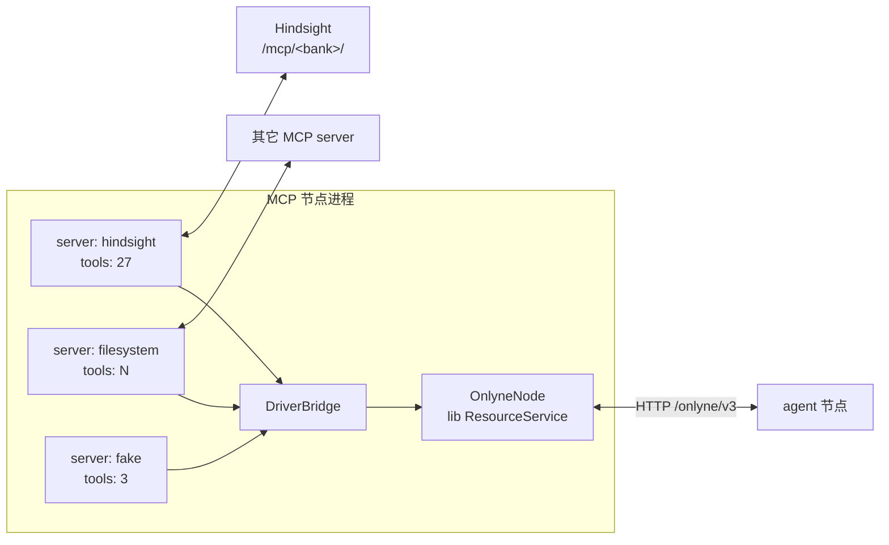

# Onlyne v3 MCP 节点设计

本文记录 MCP 节点的部署形态、包结构、会话管理与操作映射。协议语义在 [RFC 0015](../../rfcs/0015-mcp-resource-node.md)；通用资源与交接规则在 [RFC 0006](../../rfcs/0006-resources-and-handover.md)。本文记录实现选择，改变可观察行为的调整仍需回 RFC 与契约检查。

## 1. 部署形态：一个节点，多个 server

MCP server 太多，一个 server 一个节点不划算。MCP 节点是独立进程（与 IM gateway 同构：普通 `OnlyneNode`，经 HTTP `/onlyne/v3` 对外），托管多个 MCP server，每个 server 映射为一个 Onlyne 资源：



| 事实 | 持有者 |
|---|---|
| server 连接、MCP 会话、能力协商 | MCP 节点的连接层 |
| 工具清单与 `inputSchema` | MCP server（`tools/list` 拉取，节点缓存） |
| 操作幂等、三态、operation 记录 | lib `ResourceService`（与 IM 相同） |
| 平台凭据（MCP server 侧的 API key） | MCP server；节点只持 URL 与注入头 |

MCP 网关和 IM 网关共用 `@onlyne/node-host` 的发现、身份与终端信任界面。CLI 自动保存身份密钥，发布实际监听地址并持续发现 OMP 节点。用户在 `/onlyne` 和网关终端完成指纹确认：终端列出候选与交换阶段，`t`/`a` 先展示指纹再等确认，`c` 输入地址联系跨网络节点。信任状态写入网关存储。

与 IM 的关键差异：MCP 资源没有平台事件流（RFC 0015 §1：server 是无状态工具提供者），因此没有推送环、没有渲染环、没有事件日志；也没有 handler 绑定（RFC 0015 §6），所以没有交接，也没有日志读取接口。资源操作只有 `tools/call` 的映射。这使 MCP 节点比 IM gateway 简单一个量级。

## 2. 包结构

```
packages/mcp-core      会话层：HTTP streamable transport、initialize、tools/list、tools/call、错误分类
packages/mcp-gateway    进程组装：多 server 配置、每 server 一个资源、节点、CLI
```

`mcp-gateway` 复用 `im-gateway` 的组装形状（`FileStorage`、`nodeClock`、`ensureThread` 不需要——无 thread；配置加载同构）。MCP server 连接器不单独成包：与 IM 不同，MCP 的 server 是标准协议，不需要每家一个翻译层——会话层就是连接层，`mcp-core` 一份实现覆盖全部 server。特殊 server 的适配（如 Hindsight 的 per-bank URL）只是配置项。

## 3. 资源映射

一个 MCP server 一个 Onlyne 资源。资源的 `operations` 是该 server `tools/list` 的工具名清单（启动时拉取，`tools/list_changed` 通知后重拉；会话不可用时沿用上次清单）。

| Onlyne | MCP | 说明 |
|---|---|---|
| 资源 `id` | 配置里的 server 名 | 操作者起名，如 `hindsight` |
| `operations` | `tools/list` 的 `name` 清单 | 含 inputSchema 缓存 |
| 操作 `operation` | `tools/call` 的 `name` | 清单外返回 `unsupported_delivery`（RFC 0015 §2） |
| 操作 `data` | `tools/call` 的 `arguments` | 校验 inputSchema，不过不发送（RFC 0015 §2） |
| 资源 `data` | server 的 URL、协议版本、能力 | 诊断与路由用 |

## 4. 会话层（mcp-core）

HTTP streamable transport（MCP 2025-03-26）：

1. `POST <url>` `initialize` → 从响应头取 `mcp-session-id`。
2. 后续请求带 `mcp-session-id` 头。响应是 `text/event-stream`，取 `data:` 行的 JSON-RPC 结果。
3. 会话失效（404 `session not found`）时重连：重新 `initialize`，旧会话作废。
4. `notifications/initialized` 完成握手。

会话由连接器持有，断线重连的语义按 RFC 0015 §5：重连后重新 `initialize`；MCP 无事件重放，断开期间的 `tools/list_changed` 丢失，重连后重拉一次清单。工具调用超时（默认 30s，按 server 配置）后发 `notifications/cancelled`、停止等待，操作记 `unknown`（RFC 0015 §3：无法确证未发生副作用的失败必须是 `unknown`）。

错误映射（RFC 0015 §3）：

| MCP 侧 | Onlyne 三态 |
|---|---|
| 结果正常返回 | `committed`，`data` 带 `content`/`structuredContent` |
| `isError: true`（工具执行器报失败） | 按正文推断：只读工具（`readOnlyHint`）可判 `aborted`，有副作用的记 `unknown` + `details.source` 原文 |
| JSON-RPC 协议错误（`-32602` 参数等） | `invalid_request` 异常，操作不认领 |
| 传输失败、超时、5xx | `unknown` + 原文 |

## 5. Hindsight 打样

本地部署的 Hindsight 作为实测对象。它的 MCP 端点按库划分：`http://localhost:8888/mcp/{bank_id}/`，调用时需要会话头。

配置形状：

```json
{
  "node": { "id": "urn:onlyne:gateway:mcp" },
  "server": { "bind": "127.0.0.1", "port": 39874 },
  "storage": { "path": "<store.json>" },
  "servers": [
    {
      "name": "hindsight",
      "url": "http://localhost:8888/mcp/example-bank/",
      "timeout_ms": 60000
    }
  ]
}
```

实测使用独立临时库，覆盖 `tools/list` 映射到 operations、`retain`/`sync_retain`/`recall` 往返、`isError` 路径（如对不存在的 memory id 调 `get_memory`）和传输错误路径（断开 URL）。

## 6. 验收方法

- 离线：脚本化假 MCP server（一个 `Bun.serve` 回 JSON-RPC），断言清单映射、schema 拒绝、错误三态、超时 `unknown`、清单外拒绝、会话重连。
- 实测：真实 Hindsight 临时库，经节点 HTTP 走 `tools/call` 全链路。
- 全仓 `bun run check` 与 `bun run test` 保持绿。

## 7. 开放项

- `resources/list`/`resources/read`/`resources/subscribe`（MCP 的资源数据原语）：Hindsight 不用它们，先不接；RFC 0015 §2 的映射表在需要数据源型 server 时再落。
- stdio transport：本地 CLI 型 MCP server（如 filesystem）用 stdio；先只做 HTTP，stdio 增量加。
- 工具级授权策略（RFC 0015 §4 的本地策略）：目前节点级允许即全部工具可用，工具过滤是配置增量。
