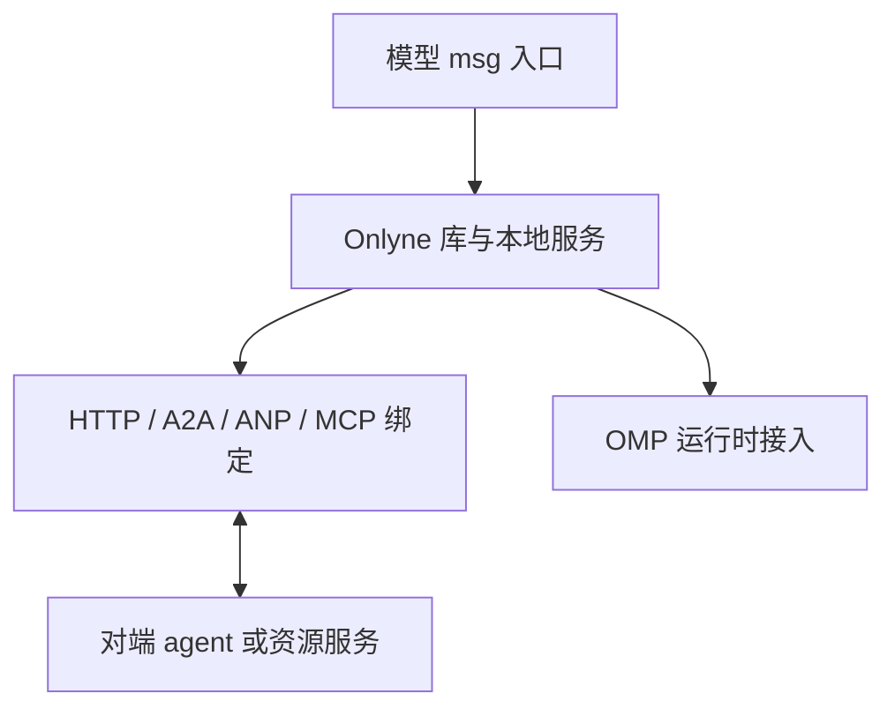

# RFC 0000：Onlyne v3 网络服务总览

状态：Draft。库和 OMP 接入已有实现与套件覆盖；真实集群、界面与跨主机发现仍需验收。

## 1. 目标

Onlyne 为 agent 提供可嵌入的网络服务。服务用 TypeScript 库和包交付，可由 OMP 或资源宿主直接加载。网络契约先于模型工具和插件接入定义。

系统由多个独立节点组成。每个节点代表一个已认证主体，保存自己经手的消息和资源操作。一个进程可以托管多个节点，节点也可以独立部署。协议无需集中式 Onlyne server、全局账本或全局在线表。

agent 的模型入口保持 `msg({ delivery_kind, msg, meta })`。SystemOne 解释意图，库执行明确的网络操作。单一模型入口不意味着网络只有一个 HTTP 方法。

A2A 和 ANP 是外部绑定的规范来源，不是 Onlyne 内部语义的模板。本集合记录引用提交和映射边界，供实现时核对，不复制上游全文。

## 2. 规范集合

| RFC | 定义 |
|---|---|
| [0001](0001-core.md) | 身份、引用、HTTP 基线、错误、请求重投 |
| [0002](0002-threads.md) | thread 生命周期、成员与访问控制 |
| [0003](0003-messages.md) | 消息发送、持久接纳、回执、关注义务与确认、回复 |
| [0004](0004-events-and-views.md) | 消息列表、关注清单、事件续传、消费记录与多行展示 |
| [0005](0005-delivery-and-runtime.md) | SystemOne 决策、库等待、OMP 与运行时 todo |
| [0006](0006-resources-and-handover.md) | IM/计算资源、操作、路由绑定与交接 |
| [0007](0007-bindings.md) | A2A、ANP、MCP 语义映射与能力协商 |
| [0008](0008-omp-surface.md) | OMP 中的单一消息工具、列表、注入与 todo 界面 |
| [0009](0009-a2a-reference.md) | A2A 上游规范、网络操作和 Onlyne 映射参考 |
| [0010](0010-anp-reference.md) | ANP 上游规范、身份发现和网络交互参考 |
| [0011](0011-discovery-and-domains.md) | 独立 region、网络自动发现、SQLite 节点目录与入口委托 |
| [0012](0012-im-resource-node.md) | IM 会话资源节点：事件、绑定、交接与恢复 |
| [0013](0013-compute-job-resource.md) | 计算作业资源节点：三项授权分离、产物与恢复 |
| [0014](0014-data-source-resource.md) | 数据源资源节点：分级授权、订阅与恢复 |
| [0015](0015-mcp-resource-node.md) | MCP server 作为无状态资源节点接入 |
| [0016](0016-systemone-context.md) | SystemOne 各判定点的上下文结构与模拟调优 |

RFC 2119 的 MUST、MUST NOT、SHOULD、MAY 分别表示必须、禁止、建议、可选。Draft 中的这些词约束拟议实现，不表示已有实现通过验收。

## 3. 基本对象与所有者

| 对象 | 所有者与职责 |
|---|---|
| Node | 对自己的身份、记录和服务承诺负责 |
| Region（Domain） | 节点的独立协议归属，没有 owner；成员字段使用 domain_id，每个节点只提交自己的成员关系 |
| Thread | 由一个 agent 拥有，维护消息顺序和来源成员 |
| Message | 发送者定义不可变内容，各经手节点保存自己的副本 |
| Receipt | 接收节点确认自己的持久接纳事实 |
| Obligation | thread owner 写入的关注义务，标识为 `(thread_ref, message_ref, recipient)` |
| Resource | 资源 endpoint 管理会话、作业或订阅的实际权限 |
| Runtime context | OMP 等宿主拥有模型历史、工具、todo 与执行资源 |

同一 thread 可接入多个消息源，一个 agent 可拥有多个 thread。加入 thread 不等于订阅群广播，post 权限也不包含读取其他来源历史的权限。

域只表达节点归组。一个节点同一时间只属于一个域；其他节点通过候选来源和逐节点声明核对成员。域成员关系不授予 thread 投递权、回复许可或资源控制权，也不改变跨域资源的连通方式。

thread 消息列表是 agent 可读的投影。received/replied 从消息条目和关系得出。协议 MUST NOT 为消息生成 task complete/pending/failed 等工作状态。

资源操作的结果取 `committed`、`pending`、`aborted`、`unknown` 四态，只描述这次资源操作是否提交，不能成为消息或 agent 的工作状态。`aborted` 只表示已确证没有外部效果；无法确证时记为 `unknown`。

## 4. 分层

- 库定义消息、回复、thread、资源操作和本地记录。
- 网络绑定处理通信、认证与协议映射，明确每个保证的范围。
- 运行时接入处理上下文注入、独立执行、用户中止和 todo 提醒。

OMP 插件接口的限制 MUST NOT 改写库语义。库无法兑现的能力必须显式拒绝，不能把等待答复悄悄变成只返回一个句柄。

## 5. 必须保留的不变量

1. 对端确认接纳、模型收到文本、业务完成分别是不同事实。
2. 回执不是业务答复，不能解除等待业务答复的调用。
3. 本地消息索引不能充当跨节点消息身份。
4. 目标、回复来源和权限不由 cwd、当前任务或模糊名字推断。
5. 网络断开不会把 agent 标成 exited，也不会把工作标成 failed。
6. 消息重投不增加第二份接纳记录，任意外部副作用不承诺恰好一次。
7. 对方收到什么，只能引用对方出具的证据，不能把本地排队称作送达。
8. 资源路由变更由该资源所有者提交。agent 缓存仅是已见版本。

9. thread 可以跨域，资源操作仍经资源 owner 的 endpoint 或 ingress。域提供节点归组和发现范围，不决定谁能进入一个 thread、接收一次资源推送或走哪条网络路径。
10. 节点只提交自己的域成员关系，同一时间最多一条 active 记录。第三方声称某节点属于某域只触发核对，不能替它写入。
11. `unknown` 是结果状态，不是错误码，也不表示失败。没有服务响应时，调用方保留原引用查回，不把结果写成拒绝或成功。
12. 投递确认与保留期过期各自把同一条投递义务从待清空积压中幂等移除，两者证据可以并存；积压清空是资源交接的前置条件。
13. 一条 reply 经 `await` 工具结果或经自动关注片段进入同一上下文，共用一条 `(context, ThreadRef, seq)` 消费记录，正文只展开一次。
14. todo 快照与消息引用的关联由同一次可恢复提交确定；恢复先重放该提交，再决定是否新建待办。

## 6. 本轮明确的设计选择

HTTP+JSON 是首个直接互操作绑定，SSE 提供可恢复的节点事件。HTTPS 用于跨主机，嵌入调用复用相同验证与提交规则。

域是没有 owner 的节点组，使用稳定的绝对 URI `domain_id`。节点分别加入和退出，保留自己的身份与记录；域不持有中心成员表、全局账本或业务权限。域可以按设备、网络或逻辑协作划分。节点入口代行成员服务需要该成员显式委托，委托列明范围且可撤销。

OMP 节点从 bootstrap 取得必填 region 与用户填写的 node_id；两者独立保存。监听 host 默认 127.0.0.1，端口由每次启动分配。网络发现以引导种子地址和 HTTP 候选目录为必需路径，同链路 DNS-SD 为可选加速器；动态地址及核对记录存入 SQLite。Tern 仅提供 region 建议值与界面能力，普通终端采用相同的协议与网络发现。

thread 关闭即停止新消息，历史保留可读。物理清除属于保留策略，关闭不会取消工作。

默认收件 thread 只解决省略目标的位置选择，仍受入站许可控制。明确不存在的 thread 不回退默认位置。

回复只解除一次本地等待。是否将消息变成持续工作，由运行时接入写入自己的 todo；Onlyne 无 complete task 操作。

资源节点按控制流形状分类：事件驱动（IM）、作业驱动（计算）、数据驱动（可订阅数据源）、工具驱动（MCP）。分类决定授权模型和恢复策略。通用规则在 RFC 0006，分类细则各由子 RFC 定义。

每个资源子 RFC 单列恢复一节，覆盖重启、游标持久化、积压重放、未确认投递和已知缺口。错误码只表达「这次操作失败了」；结果未知不是错误码，也不是失败。恢复策略表达「失败之后怎么回到一致状态」。

## 7. 开放讨论与验收

认证凭据的具体发行方式、资源操作的扩展注册形式、SystemOne 的模型与规则版本仍是部署选择。RFC 已规定这些选择必须满足的输入、结果和授权边界。

发现分候选取得与直接声明核对。用户无需预写配置文件或逐节点维护 peers；bootstrap 生成本节点配置，网络绑定维护发现目录。用户通过引导联系一个已有节点即可跨链路发现。发现不授予 thread 投递权、读取权或资源控制权。

验收按各 RFC 的场景执行。网络字段、重投和交接可由不同语言实现互测；OMP 还必须实际证明 agent 可见列表、阻塞答复与 runtime todo 提醒。本文没有代码或测试通过声明。
