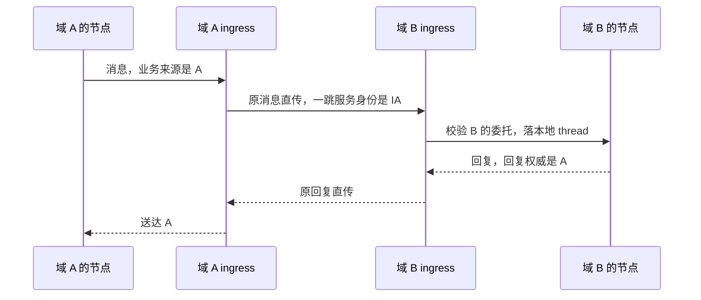
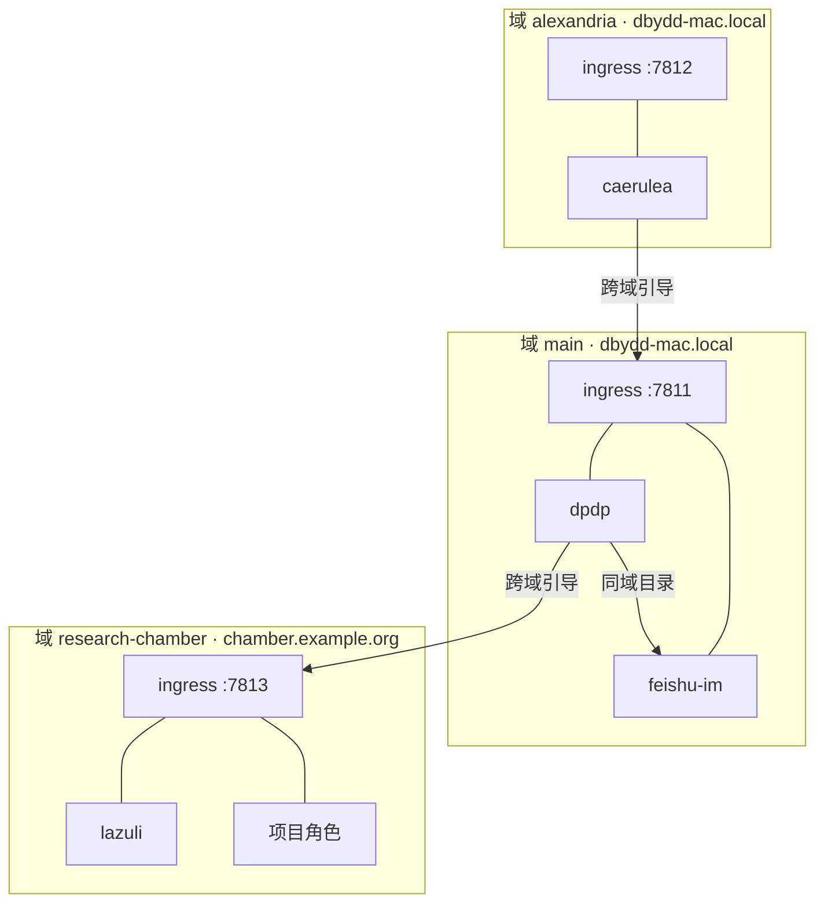

# RFC 0011：网络发现与自治域

状态：Draft。依赖：RFC 0001、0002、0007、0009、0010。

## 1. 发现回答什么

发现只回答三个问题：

| 问题 | 答案来自 |
|---|---|
| 这个身份现在去哪里 | 发现记录里的 `base_url` |
| 它提供什么能力 | 发现记录里的 `features` 与 `authentication` |
| 它是不是它声称的那个身份 | 发现记录的签名或本地固定指纹 |

发现 MUST NOT 回答「我能不能访问它」。成员资格、回复许可和资源授权是另外的事实，由 RFC 0002 和 RFC 0006 的规则决定。发现一个 endpoint 不授予任何权限。

协议不维护全局在线表，也不维护全网目录。一个节点只知道自己的配置、自己域内的公开条目和自己经手的记录。

## 2. 发现记录

发现记录是节点自描述的最小集合：

```json
{
  "node_id": "did:web:example.com:agent:lazuli",
  "base_url": "https://lazuli.example.com/onlyne/v3",
  "protocol": ["onlyne/3"],
  "features": ["threads", "messages", "events"],
  "authentication": ["bearer"],
  "limits": {"request_bytes": 1048576},
  "idempotency_max_seconds": 86400,
  "proof": {"scheme": "jcs-ed25519", "keyid": "did:web:example.com:agent:lazuli#key-1", "signature": ":BASE64:"}
}
```

`base_url` 是当前地址，可以变。`node_id` 是身份，不变。记录中不出现存活状态、会话状态、成员表或未授权资源清单。

`proof` 绑定 `node_id` 对应的验证方法。库 MUST 在采纳记录前验证签名。签名验证失败时，该记录不可用，不能降级为无签名接受。

## 3. 三条发现路径

发现有三条路径，按可靠性从低到高。库可以同时使用多条，命中后按下面的顺序取信。

| 路径 | 适用条件 | 取信方式 |
|---|---|---|
| 本地引导 | 任何 `node_id` | 本地配置文件固定 `node_id` 到 `base_url` 和认证指纹 |
| 标识解析 | `node_id` 可解析 | 按 scheme 的解析规则取记录并验签 |
| 域目录 | 目标在同一自治域 | 从域的目录条目取记录并验签 |

### 本地引导

本地引导是首版必备路径，不是降级路径。配置固定身份、地址和认证方式：

```json
{
  "nodes": [
    {
      "node_id": "urn:onlyne:agent:reviewer",
      "base_url": "http://127.0.0.1:8787/onlyne/v3",
      "authentication": ["bearer"],
      "fingerprint": "sha256:9f2b..."
    }
  ]
}
```

引导条目 MUST 固定认证材料的校验值。库连接时比对，不匹配则拒绝该条目。引导条目可以由操作者手工编写，也可以由 `onlyne` 的引导命令生成。

引导条目不随发现记录变化。记录中的 `base_url` 改变时，引导条目仍指向配置的地址，直到操作者更新。地址失效返回连接错误，不回退到别的地址。

### 标识解析

`node_id` 的 scheme 决定能否自动解析。库维护一张 scheme 解析表，首版包含：

| scheme | 解析方式 |
|---|---|
| `did:web` | 按 W3C did:web 规则取 DID 文档，读其中的服务端点 |
| `did:wba` | 按 ANP-03 取 DID 文档，读其中的服务端点 |
| `urn:onlyne:*` | 不可解析，只能用本地引导或域目录 |

库 MUST NOT 为未登记的 scheme 发明解析规则。`node_id` 不可解析时，库返回 `not_found` 并说明缺少引导条目，不猜地址、不试常见主机名。

DID 文档承载服务端点，不承载实时状态。身份与地址分离：DID 不变，文档里的端点可变。

### 域目录

域可以发布自己域内公开节点的目录：

```text
GET https://{domain}/.well-known/onlyne/nodes
```

```json
{
  "domain": "urn:onlyne:domain:example.com",
  "items": [
    {"node_id": "did:web:example.com:agent:lazuli", "base_url": "https://lazuli.example.com/onlyne/v3"}
  ],
  "next": null
}
```

目录只列域内被设为公开的节点。未列入目录的节点仍可经本地引导或直接配置访问。目录条目 MUST 带 `proof`，库验签后使用。目录不含成员表、在线状态或其他域的信息。

## 4. 服务描述

`GET /onlyne/v3/description` 在 RFC 0001 的字段之外，增加：

```json
{
  "node_id": "did:web:example.com:agent:lazuli",
  "base_url": "https://lazuli.example.com/onlyne/v3",
  "domain": "urn:onlyne:domain:example.com",
  "ingress": false,
  "protocol": ["onlyne/3"],
  "features": ["threads", "messages", "events"],
  "authentication": ["bearer"],
  "discovery": {"scheme": "did:web", "resolvable": true},
  "limits": {"request_bytes": 1048576},
  "idempotency_max_seconds": 86400,
  "proof": {"scheme": "jcs-ed25519", "keyid": "did:web:example.com:agent:lazuli#key-1", "signature": ":BASE64:"}
}
```

`domain` 是节点所属自治域，没有则为 null。`ingress` 为 true 表示这个 endpoint 同时作为域入口。`discovery.resolvable` 表示 `node_id` 是否可自动解析。

服务描述 MUST NOT 枚举未授权资源，MUST NOT 声明其他节点的地址。认证后可以读取补充能力，补充能力仍不授予权限。

## 5. 自治域

自治域是一组节点共用的命名与入口边界。域由一个运营者控制，域内节点共享一个公开地址和一套策略。

域持有：

| 域持有 | 内容 |
|---|---|
| 域身份 | 一个 `domain_id`，标识运营者 |
| 名字授权 | 谁能在这个域内发行 `node_id` |
| 入口 | 一个或多个 ingress 服务地址 |
| 策略 | 入站许可、配额、保留期限 |
| 目录 | 域内公开节点的条目 |

域 MUST NOT 持有：

- 全局账本或全网在线表。
- 其他域的消息副本。跨域消息由发起节点和接收节点各自保存。
- 其他域的策略决定权。
- 一个成员节点的业务权限。域的入站许可不替代 thread 成员资格。

域是命名和入口边界，不是路由权威。消息仍按 RFC 0003 的规则在节点间传递，域只决定「从哪个公开地址进」。

### 域身份与 node_id

`domain_id` 是绝对 URI，例如 `urn:onlyne:domain:example.com` 或一个 DID。域内节点的 `node_id` 由域的名字授权签发。库校验一个 `node_id` 属于某域时，只按字符串归属和该域声明的规则判断，不推断权限。

一个节点只属于一个域。改变所属域等于换 `node_id`，旧身份的记录不继承到新身份。

## 6. 域入口与服务授权委托

域的 ingress 是域对外的服务端点。多个成员节点共用一个公开地址，ingress 按请求里的目标身份分派。

成员节点要把自己的服务能力委托给 ingress，必须显式委托：

```json
{
  "delegation": {
    "delegate": "urn:onlyne:domain:example.com",
    "node_id": "did:web:example.com:agent:lazuli",
    "scope": ["receive_messages", "serve_threads"],
    "since": "2026-10-23T02:00:00Z",
    "until": null,
    "proof": {"scheme": "jcs-ed25519", "keyid": "did:web:example.com:agent:lazuli#key-1", "signature": ":BASE64:"}
  }
}
```

- 委托由节点自己签发，ingress 验签后保存。
- 委托列明范围。未列出的能力 ingress MUST NOT 代行。
- 委托可撤销。撤销后 ingress 拒绝该节点的新请求，已接纳的消息不受影响。
- ingress 收到目标 owner 不是自己的请求时，MUST 查找有效的委托记录。没有委托时返回 `forbidden`，不本地查找、不回退、不静默代行。

这一条扩展了 RFC 0002 的 owner 校验：权威服务接受的 `thread_ref.owner` 是它自己，或一个已把服务权委托给它、且委托仍然有效的节点。

ingress 转发时保留业务来源，不重铸 `message_id`。ingress 记录自己作为一跳服务身份，业务来源仍是原节点。回复权威按 RFC 0003 记录，普通直连时是认证来源节点，ingress 转发时由转发授权指定。

## 7. 跨域

跨域通信经过双方的 ingress，或直接到达对端节点。原始业务消息保持原样，不包装成新的中继方法。



- 跨域时库 MUST 保留 `node_id` 与 `base_url` 的分离。域 B 只知道 A 的身份和可达地址，不持有 A 的内部结构。
- 中间服务 MUST NOT 重铸消息身份、修改关系或改写 `meta.data`。
- 跨域不改变保证等级。A 侧记录的保证按 B 实际出具的证据，ingress 的转发不提升保证。
- 域 B 的入站策略拒绝时，A 得到结构化错误，拒绝记录按 RFC 0003 保存。

Thread 跨域是常规情况，不是特例。thread 的 owner 在自己的域里持有列表，成员可以来自任何域。投递、读取、回复和交接都按成员表、回复许可和资源授权判断，不按域判断。域只决定入口地址和命名归属。

跨域回复沿回复权威送达。回复权威在接纳时记录，跨域转发不改变它。对端不可达时回复排队，等待按本地策略处理，协议不把跨域不可达写成业务失败。

### 跨域入站许可

域的入站策略可以整体拒绝来自某域的投递，也可以在成员表已授权的情况下放行。策略 MUST 在成员表之前检查，拒绝时返回结构化错误。策略放行不替代成员表校验，成员表拒绝时仍返回 `not_a_member`。

默认情况下域不得仅因来源域不同而拒绝。需要封闭域的部署显式声明来源域白名单。

## 8. 与外部协议的关系

A2A 用 AgentCard 加 `.well-known/agent-card.json` 提供发现，用 `supportedInterfaces` 声明多接口和 `tenant` 路由。ANP 用 DID 文档承载 `ANPMessageService`，用 `.well-known/agent-descriptions` 提供域级目录。

Onlyne 的发现记录与这两者对应：

| Onlyne | A2A | ANP |
|---|---|---|
| 发现记录 | AgentCard | DID 文档的服务端点加 ADP 描述 |
| 标识解析 | 无，靠 well-known 或目录 | DID 解析 |
| 域目录 | 注册目录 | `.well-known/agent-descriptions` |
| 域入口 | `tenant` 路由 | `serviceDid` 一跳服务身份 |

复用上游形状，不重新发明身份和传输层。`tenant` 与 `serviceDid` 都是不透明服务标识，Onlyne MUST NOT 从它们推断业务身份或权限。

## 9. 验收

- `urn:onlyne:*` 身份在无引导条目时返回 `not_found` 并说明原因，不猜地址。
- `did:web` 身份能从 DID 文档取到端点，DID 文档改动后取到新端点，身份不变。
- 发现记录签名验证失败时该记录不可用，不降级接受。
- 引导条目的认证指纹不匹配时拒绝该条目，连接失败不回退到其他地址。
- 目录只列域内公开节点，不含成员表和在线状态。
- ingress 无有效委托时拒绝目标不是自己的请求，不代行、不回退。
- 委托撤销后新请求被拒，已接纳消息不受影响。
- 跨域消息的 `message_id` 和关系不被中间服务改写。
- 发现成功后仍按成员资格和回复许可判定投递权，发现不授予权限。

## 10. 部署示例：三个域、两台机器

本节用一组真实集群说明发现路径如何取值。示例是设计说明，不是运行记录。

### 拓扑假设

| 域 | 机器 | 入口 | 成员节点 |
|---|---|---|---|
| `urn:onlyne:domain:main` | dbydd-mac.local | `dbydd-mac.local:7811` | dpdp、feishu-im、cyanea、_supervisor |
| `urn:onlyne:domain:alexandria` | dbydd-mac.local | `dbydd-mac.local:7812` | caerulea |
| `urn:onlyne:domain:research-chamber` | chamber.example.org | `chamber.example.org:7813` | lazuli 与九个项目角色 |

main 和 alexandria 在同一台机器上，用端口区分。域是命名和入口边界，不是机器边界。research-chamber 在另一台机器上，域名不变，机器可以更换。



### 三条发现路径在本例中的取值

| 跳 | 路径 | 具体做法 |
|---|---|---|
| dpdp → feishu-im | 域目录 | 向 main 的目录查 feishu-im 的条目 |
| dpdp → lazuli | 本地引导 | dpdp 侧固定 research-chamber 的入口地址与认证指纹 |
| caerulea → dpdp | 本地引导 | 固定 main 的入口地址与认证指纹 |
| lazuli → dpdp | 本地引导 | lazuli 侧固定 main 的入口地址与认证指纹 |

同域一跳走目录，跨域一走引导。引导条目由操作者写入或由引导命令生成，不随发现记录变化。

### Bonjour 在本例中的位置

Bonjour 提供主机名解析和服务浏览，位于传输层。`dbydd-mac.local` 回答「这台机器在哪」，一次 `_onlyne._tcp` 浏览回答「这条网络上有哪些 onlyne 服务实例、各在哪个端口」。

Bonjour 不回答三件事：这个实例是哪个节点、它属于哪个域、我能不能访问它。服务实例名是主机本地标签，不是稳定身份。

库可以这样组合：用 Bonjour 浏览得到本链路上的候选入口地址，再向该地址取发现记录并验签，或比对引导条目固定的认证指纹。地址由 Bonjour 提供，信任由签名或指纹提供。跳过验签直接采信 Bonjour 条目，会让同链路上的任意主机冒充入口。

远端域不在本链路，Bonjour 不覆盖。research-chamber 的入口靠引导条目或它自己发布的域目录。

### 需要决策的两处冲突

**lazuli 归 research-chamber。** lazuli 的 `node_id` 属于 research-chamber 域。它今天同时挂着 main 的 mount，那是同一身份接入两个集群的部署形态。改成单域后，lazuli 与 main 之间的往来按跨域处理：lazuli 在自己的域里持有 thread，main 侧持有自己那侧的记录。它与 main 的现有共享工作区需要拆成两侧各自的记录。

**Alexandria 今天没有 server。** 它的本地集群已退役，caerulea 和 cyanea 现在以中心集群角色运行。把 Alexandria 做成独立域需要新建它自己的节点，并把现有的 caerulea 中心角色迁移过去。这不是配置改动，是新增一个 endpoint。

**跨域在本例中的两跳。** dpdp 与 lazuli 的往来经 main 入口和 research-chamber 入口，消息在两侧各留一份记录。feishu-im 与 lazuli 的 IM 往来经 IM endpoint 推事件，assignee 在哪个域不影响事件归属，平台凭据留在 IM endpoint。

另需注意：当前所有地址都是 `127.0.0.1`，两个集群只靠 `cert_pin` 区分，`aggregate` 只是标注、不参与路由。本节示例中的主机名和端口是设计目标值，不是当前生效的配置。
