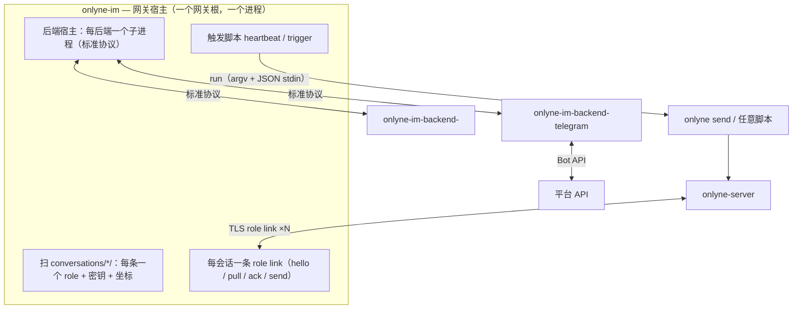

# v2.2 — IM gateway 规划

状态：身份模型已定。本文件是设计；`docs/v2.2-IM-GATEWAY-3B.md` 是落地细节。

## 0. 一句话

IM 网关把**每个 IM 会话（一个私聊 / 一个群）就是一条 role**：它在集群里以普通 role
的身份收发消息，把**入站**消息交给操作者配置的**脚本**（`heartbeat` / `trigger`），
把**出站**消息交给**平台后端**渲染。

## 1. 边界

做：

- IM ⇄ Onlyne 的双向桥
- 会话身份、路由、ACL 复用既有机制
- 触发脚本的入口契约
- 平台后端分包 + 一份标准协议
- 消息展示（卡片 / 富文本 / Markdown）独立分层

不做（沿用 `AGENTS.md` §1）：

- 大媒体传输、工作区文件同步
- 平台侧的调度、编排、重试策略
- 核心里的任何「发给谁」策略——那是脚本与 ACL 的事

## 2. 身份模型：一个会话 = 一条 role（已定）

**一条 role 只对应一个 IM 会话。一条 role 不承载多个会话。** 这是硬约束：
一条 role 的收件箱是它自己那个会话，路由按 role 名写、看得懂、不歧义。

- 一个私聊、一个群，各自是一条 `[[client]]`，例如 `role = "tg-12345"` /
  `role = "tg-group-7788"`。它有自己的一把密钥、自己的 ACL 行、自己的收件箱。
- 一条 role **一个** session（`max_sessions = 1` 是默认；这类 role 不需要并发会话）。
- role 名由操作者/`generate` 决定；网关**不**动态派生 role，也不新造寻址方式。

### 2.1 为什么是「role」而不是「principal」

`Principal::Gateway { … }` 与 `Principal::Cluster` 每次都要特判：`relay::send` 有一段
只给 gateway 的特例，`check_acl` 有 gateway 分支，store 的收件人判定要认 `$.gateway.*`。
只要 IM 会话就是 role，这些特例一条都不用——**入站、出站、ACL、路由、ledger、会话表、
TUI/web 全部走 role 的既有路径**。

### 2.2 网关进程 ≠ 一条 client

- **每个 IM 会话一条 role 的 `[[client]]`**（spec 里看得见，ACL 按名字写）。
- **网关是一个宿主进程，托管多个后端与多条会话**：它读一个网关根下的会话目录，替每条会话
  各持一条 role link（与「一个 DSH 服务多个 role」的 `placement = external` 形态同一件事，
  见 `AGENTS.md` §11）。网关自己不是一条 role，也不占 `[[client]]`。
- **后端（bot 连接）多是网关级的**：一个 Telegram bot 服务它被拉进的每个群，一个 Slack app
  服务它的每个频道。所以「有几个后端」挂在网关根上，不挂在会话上；一条会话只归属其中一个
  后端（`gateway` id）。一条 role 仍然只有一个平台坐标。
- 出站：某个 agent 发一条 `to = { role = "tg-group-7788" }` 的普通 envelope；server 按
  role 投递，网关**替那条 role** 拉取并渲染。一条 role 一个会话、一个收件箱。
- 入站：平台来一条消息 → 网关按会话找到对应 role → 以**该 role** 的身份组 envelope
  （`from = Principal::role("tg-group-7788")`）→ 交给脚本（触发）或直接入集群。

### 2.4 会话的平台坐标

一条会话的坐标是 `gateway`（哪个后端进程）+ `conversation`（那个平台上的哪个会话）。
`platform` 不在配置里写第二遍：后端的 `hello` 就是它，入站事件自带它。

### 2.3 平台元数据

会话的平台坐标（gateway id / platform / channel / conversation）**不住在 envelope 里**
（那是 §2.1 的特例来源），住在**那条会话自己的工作区**里：

```toml
# conversations/<role>/.onlyne/config.toml
[[chat]]
gateway = "tg1"
conversation = "-1007788"
```

**目录名就是 role**，所以这份文件不写 `role`：一条会话目录背着它自己的坐标与密钥，网关扫
`conversations/*/` 就得到「哪些 role 由我承载」。网关按 `gateway + conversation` 反查会话，
知道往哪个平台会话发、从哪个平台会话收。没有 `[[link]]` 表——密钥路径固定为
`conversations/<role>/.onlyne/keys/role.key`，于是「一个会话目录」就是完整的、可搬的单位。
`Principal` 保持 role-only，平台坐标不进 wire。

## 3. 分层



| 层 | 职责 | 依赖 |
|---|---|---|
| `onlyne-im` | 宿主：扫会话目录、N 条 role link、N 个后端宿主、入站→脚本、出站→后端 | `onlyne-wire`, `onlyne-net`, `onlyne-proto`, `onlyne-config` |
| `onlyne-im-backend` | 标准帧 + 标准 payload 类型 | `onlyne-proto`（仅类型，无 tokio） |
| `onlyne-im-backend-<platform>` | 连平台、收事件、发消息、**展示** | `onlyne-im-backend` + 平台 SDK |

规则：

- 平台 SDK 永不进入 `onlyne-server` / `onlyne-client` / `onlyne-im`
  （沿用 §16「binary firewall」）。
- 后端是**独立进程**，与网关讲标准协议（§6）。平台依赖重、生命周期独立，
  「分包」要能在不重编核心的前提下增删一个平台。一个后端进程服务它所有的会话；
  网关按 `[[im.backend]]` 的 `gateway` id 把它的事件分派给对应会话。
- 网关复用 `onlyne-wire` 的连接实现（§6 规定这条连接全仓只有一份），
  因此它**不依赖 `onlyne-client`**，也不会把 client 的 runloop 拖进来。

## 4. 推送（入站触发）

推送 = **入站方向**：IM 来一条消息（或一次心跳），怎么进 Onlyne。网关**不做路由**——
它只触发操作者配置的**脚本**；发到哪个 role 由脚本决定（通常 supervisor，也可任意 role
或做别的事）。这正是「一个 chat 一条 role」下脚本仍保持零侵入的原因：脚本自己选收件人。

### 4.1 两个模式

| 模式 | 触发时机 | 语义 |
|---|---|---|
| `trigger` | 平台后端报来一个事件（新消息、按钮回调） | 每事件一次，**至少一次** |
| `heartbeat` | 固定周期 | 一个节拍，**不是队列**：进程不在就不补 |

### 4.2 配置

配置里只写**怎么跑脚本**，不写「脚本怎么发」——后者是脚本的自由。
推送脚本是**网关级的**（跟 `[[hook]]` 一样是操作者策略，不属于某条会话），
但每个脚本都拿到这条会话的 `role` 与工作区路径。

```toml
# <gateway-root>/.onlyne/config.toml

[[im.backend]]                # 后端进程：一个 bot 连接服务它所有的会话
gateway = "tg1"
run = ["onlyne-im-backend-telegram", "--gateway", "tg1"]

[[im.push]]                   # 入站脚本，网关级
mode = "trigger"
run = ["/abs/path/im-in.sh"]
timeout = "10s"

[[im.push]]
mode = "heartbeat"
every = "5m"
run = ["/abs/path/im-beat.sh"]
timeout = "10s"
```

- `run` 是 argv，不是一条 shell 行（沿用 `[[hook]].run` 的读法；值里的空格不被重切）。
- `every` 是时长（`30s`/`5m`/`1h`），只对 `heartbeat` 有效；两模式的键互斥，写错按名字拒收。
- 同一条脚本可以两种模式各挂一条。
- 没有 `push_cmd` 这类「内插命令字符串」的东西：核心不认识目标，只把事件交给脚本。
- `[[im.backend]]` 的 `run` 是同一读法；每个后端一个子进程，`gateway` id 是它的事件归属。

### 4.3 入口契约

脚本被 spawn 时拿到三样东西，核心的其他细节都不传：

**argv**

```
argv[1] = "trigger" | "heartbeat"      # 模式
argv[2..] = run[1..]                   # 操作者自己的参数，原样透传
```

**stdin** —— 一个 JSON 对象，一行，然后关闭（与 `[[hook]]` 的事件同一读法）：

```jsonc
// mode = "trigger"
{
  "mode": "trigger",
  "role": "tg-group-7788",          // 这条会话在集群里的 role
  "gateway": "tg1",
  "platform": "telegram",
  "conversation": "-1007788",
  "event": {
    "kind": "message",              // message | action
    "id": "…平台消息 id…",           // 去重键
    "from": { "id": "…", "name": "…" },
    "text": "…",
    "attachments": [ { "kind": "image", "path": "/abs/x.png", "alt": "…" } ],
    "action": "approve"             // 仅 kind = "action"
  },
  "at": "2026-10-10T12:00:00Z"
}

// mode = "heartbeat"
{
  "mode": "heartbeat",
  "role": "tg-group-7788",
  "gateway": "tg1",
  "platform": "telegram",
  "at": "2026-10-10T12:00:00Z"
}
```

**env**

- `ONLYNE_SOCKET` = 已服务 socket 的路径（与 `[[hook]]` 同义），脚本因此可以直接跑
  `onlyne send --from <role> --to …`，无需自行发现 socket。
- `ONLYNE_IM_WORKSPACE` = 这条会话自己的工作区目录（`conversations/<role>/`），脚本要读
  聊天记录或写附件时用它，不必从 role 名拼路径。
- `ONLYNE_IM_MEDIA` = 该会话的附件目录（`<workspace>/media/`）。
- 其余环境继承网关进程。

**退出码**

- `0` = 已处理。
- 非 0 或超时 = 落 fault（kind `im_push_failed`），事件**不丢**：按 `event.id`
  至少一次重投，脚本按 `event.id` 去重（与 hook 按 `seq` 去重同一套纪律）。

### 4.4 举例

```sh
#!/bin/sh
# im-in.sh：把 IM 消息推给 supervisor，发件 role 是这条会话自己的 role
set -eu
msg=$(cat)
text=$(printf '%s' "$msg" | jq -r '.event.text')
role=$(printf '%s' "$msg" | jq -r '.role')
onlyne send --from "$role" --to _supervisor --text "$text"
```

## 5. 出站渲染

出站 = **Onlyne → IM**：某条 role 收到一条普通 envelope（`to` 是它自己，即这条 role），
网关替它拉取后交给后端渲染。core 与后端之间传**标准 payload**，与平台 UI 无关：

```jsonc
{
  "text": "…",
  "format": "plain" | "markdown",
  "attachments": [ { "kind": "image", "path": "/abs/x.png", "alt": "…" } ],
  "actions": [ { "id": "approve", "label": "Allow", "style": "primary" } ],
  "reply_to": "…平台消息 id…"
}
```

后端翻成平台 UI：TG inline keyboard、飞书卡片、QQ 富文本。**展示代码住后端**，
core 只搬 `text` / `attachments` / `actions`。按钮回调走**入站**：
用户点 `approve` → 后端报 `event.kind = "action", action = "approve"` → 触发 `trigger` 脚本。

**附件的落点。** 两侧的文件都落在**该会话自己的工作区**里，不进 `std::env::temp_dir()`：

- **出站**：投递携带的内联图片由网关解码，写到
  `conversations/<role>/media/out-<op_id>.<ext>`，payload 的 `attachments[].path` 指它。
  后端只读这个绝对路径，网关不清理——同一 `op_id` 重投时覆写同一路径。
- **入站**：平台报来的媒体由后端按自己的能力取回（Telegram 是 `getFile` + 下载），写到
  `conversations/<role>/media/in-<event.id>.<ext>`；事件 `attachments[].path` 因此是**真实
  可读的绝对路径**，脚本可以直接打开。后端取不到时 `path` 留空并保留平台 file id 于 `alt`，
  事件照样触发（脚本自己决定要不要）。
- **聊天记录**：`conversations/<role>/chat.jsonl` 追加一行一个事件（入站）与一行一条出站
  payload，字段与 §4.3 事件、§5 payload 同构，人可以直接读、脚本可以直接 tail。

## 6. 后端标准协议

后端是独立进程，与网关讲长度前缀 JSON 帧（复用 `onlyne-wire` 的 codec），走 **stdio**
（网关 spawn 后端）——与 `onlyne mcp`、`onlyne-acp` 同一种进程关系。需要独立生存的后端
可换 `onlyne-wire` 的本地 socket，帧格式不变。

```jsonc
// 后端 → 网关
{"op":"hello","args":{"platform":"telegram","version":"…","capabilities":["message","action","typing"]}}
{"op":"event","args":{"conversation":"-1007788", …}}    // 见 §4.3 的 event；无 role，网关按 gateway+conversation 反查
{"op":"health","args":{"state":"online","detail":null,"uptime_s":12}}
// 网关 → 后端
{"op":"send","args":{"conversation":"-1007788","payload":{ …§5… }}}
{"op":"stop","args":{"reason":"operator"}}
```

`onlyne-im-backend` 提供 `Backend` trait（`hello`、`next_event`、`send`、`health`、`stop`）
与 payload 类型；平台 crate 实现它，只用平台 SDK。

## 7. 配置

网关根是一个目录树，服务端 spec 是另一棵树，两者由一个 role 名对齐：

```text
<gateway-root>/
  .onlyne/
    config.toml            # [server] + [[im.backend]] + [[im.push]]
    credentials/           # 按 gateway id：telegram-<gateway>.token 等，0600
    logs/gateway.log
  conversations/
    tg-group-7788/         # 目录名 = role = 集群里的 [[client]] role
      .onlyne/
        config.toml        # 只有 [[chat]]：gateway + conversation
        keys/role.key      # 固定路径，没有 [[link]] 表来指它
      chat.jsonl           # 聊天记录（追加写，人可读）
      media/               # 附件：入站下载落这里，出站待发也从这里读
```

| 文件 | 键 | 作用 |
|---|---|---|
| `spec.toml` | `[[client]] role = "tg-group-7788"` | **每个会话一条 role**（§2） |
| `spec.toml` | `[[client]].allowed_targets/_senders` | 这条会话 role 与集群谁互通 |
| 网关根 `config.toml` | `[server] endpoint/cert_pin` | 这条网关连哪个集群 |
| 网关根 `config.toml` | `[[im.backend]] gateway/run` | 起哪几个后端进程（§6） |
| 网关根 `config.toml` | `[[im.push]] mode/run/timeout/every` | 触发脚本（§4） |
| 网关根 `credentials/<gateway>.*` | 平台凭据 | 后端子进程从文件读（§登录） |
| 会话 `config.toml` | `[[chat]] gateway/conversation` | 这条会话在平台上的坐标（§2.3） |

`[[im.backend]]` 的 `gateway` id 与某条会话 `[[chat]].gateway` 相等，就是「这条会话归这个
后端」。一个 `gateway` id 被两条 `[[im.backend]]` 用是加载期拒绝；一条会话的 `gateway`
没有任何 `[[im.backend]]` 命名，也是加载期拒绝——网关重声明了一个连不上的后端。

### 7.1 命令与生成

`onlyne-im` 是独立 CLI，**不进 `onlyne` 的 verb 表**（与 `onlyne-web` 同一种独立可选模块的
地位）。它不读模板、不渲染工作区——一套模板机制对「一条会话 = 一份小配置」是杀鸡用牛刀。

```text
onlyne-im init      --root <dir> [--server <endpoint> --cert-pin <sha256/…>]
onlyne-im generate  --root <dir> --gateway <id> --conversation <id> [--role <name>]
onlyne-im login     --root <dir> --gateway <id> --token <…>       # 凭据落 credentials/
onlyne-im run       --root <dir> [--socket <path>]
onlyne-im check     --root <dir>
```

- `generate` 是这条会话的**唯一**生成步骤：定 role 名（默认从后端 id 与会话 id 派，如
  `tg-group-7788`；`--role` 可覆盖）、建 `conversations/<role>/`、生成并写入
  `keys/role.key`（`0600`）、写会话 `config.toml`。
- **它同时把集群那半边写上**：向 server root 的 `spec.toml` 追加该 role 的 `[[client]]`
  （`key` 用刚生成公钥），并补全 `allowed_targets` 与对端的 `allowed_senders`（两个 list
  一起补，避免 `docs/v2-CONTRACT.md` slice 6 里「欠了却到不了」的半配状态）。这一步走
  server 的 admin socket 的 `SpecApply`（`upsert_role` + `set_targets` + `set_senders`），
  复用 `toml_edit` 保留操作者注释，**不经过模板**。server 不在线时 `generate` 明确报错并
  给出补救（先起 server、或用手写的 spec 片段），而不是写一半。
- `--server`/`--cert-pin` 省略时从 server root 的 `spec.toml` 读（与 `onlyne-client init`
  同一来源）；网关根与 server 根可以在不同机器上，此时两个值必须显式给。

## 8. 失败、存活、去重

- **脚本**：非 0/超时 → fault `im_push_failed`，事件按 `event.id` 至少一次重投；
  重投有上限与退避，耗尽落 fault 并留待操作者（与 `[[hook]]` 同）。
- **后端**：崩溃/静默 → 网关按健康判定记 fault，重启后从平台自己的游标续
  （能续多少由平台决定，网关不猜）。
- **出站**：行是普通 role 投递行，挂在网关未 ack 之前；网关离线则留 `queued`
  （既有 ledger 语义，不新加策略）。
- **去重**：入站按 `event.id`；出站按 `op_id`（既有）。

## 9. v1 复用

`frozen/gateway-v1`（tag）：

| 资产 | 处理 |
|---|---|
| `crates/onlyne-gateway/src/kit/{markdown,media,error,onboarding}.rs` | 改造成 `onlyne-im-backend` 的**展示**模块 |
| 四平台插件的 API 调用与卡片构造 | 搬进对应后端 crate 的展示层 |
| `crates/onlyne-gateway/src/host.rs` | **不搬**：旧传输（adapter gateway mount），被 §2.2 的 role-link 宿主取代 |
| `onlyne-testkit/src/bin/onlyne-gateway-fake.rs` | 改写为「假后端」，钉住标准协议与触发脚本 |

搬运时按 §"上下文污染控制"删旧文件，不留双读路径。

## 10. 落地顺序与验收

1. **`onlyne-im-backend`**：标准帧 + payload 类型 + `Backend` trait + stdio 宿主环
   （`serve`/`serve_with`）。**已落地**（2 + 5 测试）。
2. **`onlyne-im` 网关宿主**：每会话一条 link（hello/pull/ack/send）+ 触发脚本
   （`trigger` 与 `heartbeat` 都实现）+ 后端宿主。**已落地**；
   端到端测试：假后端报一条事件，触发脚本收到 §4.3 的 JSON。
3. **出站投递**：会话是 role，走普通 role 投递行，**零 server 改动**（§3）。
   网关 `pull` → 渲染 → `ack`。
4. **`onlyne-im-backend-telegram`**：Bot API 客户端 + `update`/`render` 两层
   （14 测试）。真机收发（一条消息、一次按钮回调）待有 token 时手测。
5. 其余平台按需，只做展示层移植。

### 10.1 v2.2 重做（本次，取代第 2 项的单文件 config）

第 2 项的宿主是「一个 config.toml 里三张按 role 索引的表」。身份模型没变，但**布局与 CLI
已重做成一个网关根、每会话一个工作区子目录、自己的 `init/generate/login`。**W1–W6 全部落地**
（`crates/onlyne-im/src/{config,runloop,link,chatlog,trigger,backend_host}.rs`、
`crates/onlyne-im/src/workspace.rs`、`crates/onlyne-im/src/main.rs`），`cargo test -p onlyne-im`
绿；端到端由 `crates/onlyne-im/tests/gateway.rs` 钉住，并已对真 server 手测
（init → generate 写 spec 双边 ACL → login 0600 → run 触发脚本 + 写 `chat.jsonl`）：

| 片 | 内容 | 验收 |
|---|---|---|
| W1 | 网关根布局：`ImConfig` 拆成「网关根」与「会话目录」两层；扫 `conversations/*/`，每条读 `.onlyne/config.toml` 的 `[[chat]]` 与固定的 `keys/role.key` | `onlyne-im check` 打印它承载的 role 与其坐标；缺密钥 / 坐标重复 / 后端 id 无主都在加载期按名字拒收 |
| W2 | 多后端：`[[im.backend]] gateway/run`，每后端一个 `BackendHost`，事件按 `gateway` id 分派到该后端的会话；一个后端进程服务它所有的会话 | 假后端报两条不同 `gateway` 的事件，落在各自会话的脚本上 |
| W3 | `onlyne-im init/generate/login`：建根、铸一条会话（目录+密钥+会话 config）、写根凭据 | `generate` 后 `check` 通过；重复 `generate` 同名 role 被拒；`login` 写 `credentials/` 为 `0600` |
| W4 | `generate` 写集群半边：admin socket 的 `SpecApply`（upsert_role + set_targets + set_senders） | server 在线时新增 role 出现在 `onlyne roles`，且两个 list 都补全；server 不在线时明确报错且不写半份 |
| W5 | 附件与聊天记录落会话工作区：入站媒体写 `media/`，`chat.jsonl` 追加；出站内联图片不再进 `temp_dir` | 测试断言写出的路径在会话工作区内，`temp_dir` 无残留 |
| W6 | 发布面：`release.yml` 的 BINS 加两个二进制、README 安装/架构图、`onlyne` skill 的「冻结」段落、`docs/STATUS.md`、`docs/v2-REMAINING.md`、CHANGELOG v2.2 条目 | `scripts/publish.py --dry-run` 列出 14 个 crate；仓库里再无「IM gateway crates are frozen」的句子 |

### 已落地的失败语义（§8）

- **脚本重投**：一次 `trigger`/`heartbeat` 在 `PushRetry`（3 次尝试、1s 起翻倍）内重投，
  stdin 里的 `event.id` 每次相同，脚本按它去重。耗尽后记 fault `im_push_failed`
  （带 `mode`、`event`、`script`），fault 挂在该会话自己的 role link 上。
- **推送不阻塞出站**：脚本在 spawn 的任务里跑，runloop 不等它，出站渲染因此不被入站脚本拖住。
- **link 重连**：dial / hello 失败按 `onlyne_net::Backoff` 重试；`unauthorized`、
  协议不匹配等 `AfterHuman` 的失败结束该 role 的 link。一条 link 失败只记错误（投递留在
  `queued`），全部 link 都没了才停整个网关。

### 尚未手测的部分

Telegram 的 HTTP 调用（`getUpdates`、`sendMessage`、`sendPhoto`/`sendDocument`）
需要真 token 才能端到端验证；`render` 与 `update` 两层是纯函数，已单测覆盖。

## 11. 未决问题

- **后端进程关系**：网关 spawn（stdio）还是后端独立常驻 + socket？本稿取 spawn。
- **`Heartbeat` 首拍**：启动后立即一次还是等满 `every`？本稿取等满。
- **已决**：多 role 宿主的密钥——扫描 `conversations/*/`，每个目录一个 role，密钥路径固定
  `keys/role.key`（§2.3）。显式 `[[link]]` 表已删除。
- **已决**：后端进程关系——一个 `[[im.backend]]` 一个 `BackendHost` 子进程（§6、§10.1 W2）。
- **已决**：会话目录名就是 role（§2.3），role 名不再由 `[[chat]].role` 写第二遍。
