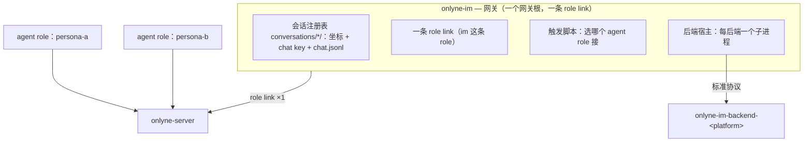

# v2.3 — 聊天寻址协议（应用层）

状态：**已落地**（§7 的六步都在树上，`crates/onlyne-im/` 是这份设计的实现，场景 22 是
它的验收）。上一份是 `docs/v2.2-IM-GATEWAY-PLAN.md`；本文件取代它的 §2（「一个会话 = 一条
role」是硬约束）与 `docs/v2.2-IM-GATEWAY-3B.md` §1 的身份模型。v2.2 生成的旧树按 §8 手工
迁移，没有 `migrate` 命令（`AGENTS.md` §8）。

## 0. 一句话

会话身份是一个**应用层令牌**（chat key），住在投递文本的第一行；core 只认 role，
永远不解析它。一个 agent role 服务任意多个会话，回信时把令牌原样带回，由网关校验。

## 1. 决策记录：为什么是「显式令牌」，不是「地址即会话」

v2.2 把一个 IM 会话做成一条 role。它换来了 ACL、路由、ledger、会话表、TUI 全部走既有
路径，代价在规模上：N 个会话 = N 条 `[[client]]`、N 把密钥、N 行 ACL，网关持 N 条 role
link；「一个人格服务多个会话」和「把整个集群抽象成单个会话视角里的一个 agent」都表达不
出来——会话被钉成了 endpoint。

v2.3 反过来：**一个 role 是一组聊天会话的综合**（人是社会关系的综合，role 同构）。会话
不再上 wire，wire 上只有 role；会话身份放进载荷，由应用层协议管。取舍：

| | v2.2（会话 = role） | v2.3（会话 = 令牌） |
|---|---|---|
| 会话在 wire 上的位置 | role 名，第一类地址 | 文本第一行，应用层数据 |
| 新增一个会话的成本 | 一条 `[[client]]` + 密钥 + ACL 双边 + 一条 role link | 网关注册表里一行 |
| ACL | 按会话可分辨 | 会话盲：一条 role 触达它名下全部会话 |
| 人格 / 区别对待 | 每条会话一条 role，人格即 role | 角色即人格，服务多个会话 |
| 会话→session 亲和 | 无（一条 role 一个 session 恰好够） | 无，需要时由 app 自己管 |
| 观测 | ledger / presence 按会话 | app 自建（`chat.jsonl` 那层） |
| core 改动 | — | **零** |

选它的理由就一条：会话寻址从此是**应用层**的事，core 不需要第二个身份概念
（`AGENTS.md` §1：prompt 管理之外不接管语义）。代价也写在这里：会话盲 ACL、观测下沉、
令牌的畸形处置全落在应用层——本文件 §6 就是这些代价的账单。

## 2. 身份链：三跳，各有其主

| 跳 | 身份 | 归谁 | 上 wire？ |
|---|---|---|---|
| 1 | 平台坐标 `(gateway, conversation)` | app：网关根的注册表 | 不上 |
| 2 | 集群地址 = role 名 | app 选名，server 路由 | 上，唯一 |
| 3 | 会话令牌 chat key | app：网关铸、模型回带 | 上，in-band，core 不解析 |

跳 1↔2 的映射住在网关根的文件里（`conversations/<slug>/.onlyne/config.toml`），跳 2↔3
的映射住在投递文本里。`Principal` 保持 role-only——这是 v2.2 §2.1 用一整节换来的结论，
不回退。

## 3. 架构变化



- 网关在集群里是**一条** `[[client]]`（名字由操作者定，例如 `im` 或 `tg`），一条 role
  link，服务它注册表里的全部会话。
- `conversations/<slug>/` 的目录名**不再是 role**（v2.2 §2.3 作废）：slug 任意，目录里
  只放坐标、chat key 的归属、`chat.jsonl`、`media/`。没有 per-conversation 密钥，没有
  per-conversation role link。
- ACL 从 N×M 塌成两组：每个 agent role 的 `allowed_targets` 写 `im`（外加它本来要通信的
  role），`im` 的 `allowed_targets` 写它服务的 agent role。发送方 `im` 与接收方 agent
  role 的双边规则照旧，`generate` 仍走 admin socket 的 `SpecApply`。
- 路由策略仍是脚本的：入站事件进 `[[im.push]]` 脚本，脚本决定这条会话归哪个 agent role
  （`docs/v2.2-IM-GATEWAY-PLAN.md` §4 不变）。网关不路由。

## 4. 会话令牌

### 4.1 形状

```
<chat:7f3a9c2e1b04d5a6f8c1e3b7a9d2f4c6>
```

- 一对尖括号包一个不透明串；`chat:` 前缀让它可 grep、可被模型认出、可被提取规则与文本里
  其它尖括号内容区分。串长 ≤64，内容 `[A-Za-z0-9_-]`。
- 铸法：uuid4 去掉连字符（32 字符），或网关自己数的序号；**唯一性在铸时检查**，撞了重铸。
- 为什么是尖括号：JWZ 1997 年那篇的唯一实证结论——22,950 个 `In-Reply-To` 里 4,554 个连
  尖括号都没有，能从自由文本里稳定抠出 id 的办法只有「取第一个 `<...>`」。四十年后 Nostr
  的 `e` 标签、ATProto 的 `reply{root,parent}` 仍然各自带一个显式根引用，只有尖括号这套
  在真实畸形数据上活下来了。

### 4.2 唯一性域

**域 = 网关根**。跨网关根的令牌互不认识，跨根引用一律拒绝（§6）。这是 XMPP `<thread/>`
故意含糊的唯一域（"either between the conversation partners or more generally"）在我们这里
的收窄：一个网关根是一个信任域，一个注册表是一个命名空间。

### 4.3 铸者：生成时铸，不是 agent

XEP-0359 的教训：客户端铸的 id 可伪造（`origin-id` spoofable），权威 id 由服务端铸
（`stanza-id` 有 `by`），回复指向权威那个。A2A v1.0 的规则更硬：不接受客户端给的
`contextId` 就必须报错，**禁止悄悄新铸一个**。

本协议照此办理：

- 令牌在 `onlyne-im generate` 时为这条会话铸一次，写进
  `conversations/<slug>/.onlyne/chat.key`；网关启动时读它，绝不运行期新铸。
- 网关只认注册表里的令牌：发往网关 role 的投递，第一行令牌不在注册表里就拒。
- agent 从不铸令牌；它只回带入站时收到的那一个。

### 4.4 core 不知道令牌的存在

`Principal` 没有会话字段，`Envelope` 没有，schema 没有，投递模板 §12 没有新增块。令牌
只是 body 的第一行。core 的零改动是本协议的验收条件之一。

## 5. 消息格式

### 5.1 入站（网关 → agent role）

`[[im.push]]` 脚本拿到的 stdin JSON（`PushInput::Trigger`）加一个字段 `chat`，值为注册表
里这个会话的令牌。脚本发出的投递文本第一行回写它：

```text
From im:

<chat:7f3a9c2e1b04d5a6f8c1e3b7a9d2f4c6>

群友张三: 在吗
```

第一行是令牌，空行，然后人类原话逐字节。附件块照 §12。一个 `onlyne send` 带一个令牌。

### 5.2 回信（agent role → 网关）

模型回信文本第一行回带同一令牌：

```text
<chat:7f3a9c2e1b04d5a6f8c1e3b7a9d2f4c6>

在的，说
```

回带是**应用层规则**，不是 core 规则：`onlyne_send` / `onlyne complete` 不带任何令牌参数，
`complete` 的收件人是 origin（集群内部路径，没有会话概念，也不该有）。

第二行**可选**，形状 `<msg:PLATFORM_EVENT_ID>`，指名这条回复回答平台上的哪条消息：

```text
<chat:7f3a9c2e1b04d5a6f8c1e3b7a9d2f4c6>
<msg:ROBOT1.0_AdAXNfweQphbaqbUBNpaYFkjt…>

在的，说
```

不给的时候，网关把它填成**该会话最后一条入站事件**的 id——`chat.jsonl` 里本来就记着它，
也就是"回复你刚收到的那条"。这不是线程（§5.4 仍然成立：回复是新消息），而是平台协议
要求回复必须声明它在回哪一条的场合：QQ 的群发送带 `msg_id` 是**被动消息**，不带是**主动
消息**，而主动消息需要群主在群设置里额外授权，否则 `40034105 主动消息失败, 无权限`。飞书
和 Telegram 用不到这个字段，那两家的后端忽略它。

越过令牌与这一行之后的**每一个字节**都是正文，第一行仍是唯一的硬约定（§6）。

### 5.3 出站（agent role → 网关 → 平台）

- 网关收到发往 `im` 的投递：提取第一行令牌 → 校验（§4.3）→ 查注册表拿平台坐标 → 交给
  对应后端渲染（`SendArgs.conversation` 就是那条平台会话）→ `chat.jsonl` 记一行，行上带
  令牌。
- 提取规则：body 的第一行整行匹配 `^<chat:([A-Za-z0-9_-]{1,64})>$`。匹配不上走 §6。
- `ImPayload` 不加字段：后端要的平台坐标本来就在 `SendArgs` 里，令牌是网关自己的账。

### 5.4 平台内的回复线程：不做令牌，做新消息（2026-10-14 定）

Slack 的 `thread_ts`、Telegram 的 `reply_to_message_id` 这类**平台内**的回复归属，本协议**不
建模**。理由：一个平台会话（群）内的线程是平台的内部结构，而本协议的会话令牌已经在它之上
——一个 chat key 对应一个平台会话，线程在这个会话里面。

做法学 GitHub 邮件列表：**每次回复都新起一条平台消息**，把前文引用在正文里（gateway 或后端
在渲染时决定引用格式——quote、摘要、或平台自己的 reply 语法）。代价是平台上看起来是平铺的
一串消息而不是一棵线程树；换来的是协议这一侧零新增概念、零新令牌、零畸形处置。

如果哪天某个平台必须用原生线程（Slack 的 thread 视图是刚需），正确做法是**后端自己的能力**
——`onlyne-im-backend-telegram` 自己在渲染时挑一条最近的消息做 `reply_to`，标准协议仍不添
字段。协议不替平台决定它的 UI。

### 5.5 认证：谁持凭据，谁能验证它（2026-10-14 落地）

一个平台后端跑起来需要它的凭据，而凭据的形状每家不同（Telegram 一个 token；飞书与 QQ 是
`app_id:app_secret` 一对）。规则四条，全在后端协议这一层：

1. **凭据不进 argv、不进 spec，住网关根的一个文件里**：`<root>/.onlyne/credentials/<gateway>.token`，
   0600。网关把**路径**交给它 spawn 的后端（`ONLYNE_IM_CREDENTIAL`），不把秘密本身交给它。
2. **缺凭据是一个状态，不是一个错误**。后端的 `hello` 带 `authenticated` 与可选的
   `onboarding`（`ManualCode` 或 `Qr`，附一段操作者读的话）；网关据此在日志里给一句可执行的
   话，然后**照常运行**。后端在未被认证时不轮询平台（`serve` 里那一处 `polling` 门），否则
   Telegram 的第一个 `getUpdates` 就 404、飞书/QQ 的 websocket 连不上，后端进程一死，
   网关连那句 `hello` 都留不下。
3. **`login` 是一问一答的帧，不是启动参数**：core 发 `Login{gateway, credential}`，后端**先向平台
   验证**（Telegram `getMe`、飞书取 tenant token、QQ 取 app access token），成功才换入并答
   `{ok, identity}`；被拒就答 `{ok:false, reason}`，进程不死、别的会话不受影响。
4. **driver 层**：`onlyne-im login --token`（写文件，不打印）、`onlyne-im login --interactive`
   与 `onlyne-im setup`（起后端 → 读它的 `onboarding` → 问操作者 → 写文件 → **用 `login` 帧
   验证** → 只在通过后留档）。

`setup` 是这一节的完整路径：选后端 → 认证并验证 → 让后端列会话（`ListConversations`，没有
列表能力的平台返回空，操作者手填 id）→ 每条会话跑一次 `generate`（工作区 + 令牌 + 集群 ACL）。
它和 `generate` 共用同一段写盘代码，因为这两件事本来就是一件：一个会话在集群里可寻址，就
等于它有工作区、有令牌、有双边 ACL。

每个平台后端的 family 活在自己的 crate 里（`onlyne-im-backend-{telegram,feishu,qqbot}`），
平台 SDK（`reqwest`、`openlark`、`tokio-tungstenite`）从不进 `onlyne-server` 或
`onlyne-client`（`AGENTS.md` §16 的二进制防火墙）。`onlyne-im-backend-fake` 是同一 trait 上
的第四家：不需要任何凭据，`smoke`、e2e 与干跑都用它。

## 6. 畸形处置（写死，因为 client 是模型不是程序）

| 情况 | 处置 | 依据 |
|---|---|---|
| 一个令牌都没有 | 拒绝，理由点名「this delivery names no chat key」 | 猜一个就会投错人；网关不是投递的判官，但一条无会话的回复也无处可去 |
| 第一行是令牌但不在注册表 | 拒绝，理由点名那个令牌 | A2A：不一致必须拒；错投进别人群里的代价高于失败 |
| 令牌在当前网关的注册表里 | 按它选会话渲染 | §5.3 |
| 第一行不是令牌但文本里别处有 | 拒绝，理由点名「not the body's first line」 | 防会话混淆：一条投递一个令牌 |
| 一个新会话 | 操作者先跑 `onlyne-im generate`：铸令牌、写坐标；入站消息带的就是那个令牌 | XMPP 的「缺失则由收方铸」在这里被收紧成「注册表是唯一的铸者」 |
| 人类改了会话坐标 / 群迁移 | 注册表里改坐标，令牌不变 | Matrix 换房、Telegram 群迁移的教训：连续性靠改指针，不靠换 id |
| 两个会话要合并 | app 层改注册表（一个令牌指向两个平台会话，或反之），core 无感 | JMAP 合并 = 删+重插；我们更便宜，因为令牌不参与任何 core 结构 |

没有一条是「猜」。畸形处置的全部哲学来自 email 那份实证：客户端会写坏 id，所以处置规则
必须在协议层写死，而不是留给实现各自容错。

## 7. 落地记录

| 件 | 在哪 |
|---|---|
| 令牌模块：铸、形状校验、第一行提取、错位拒绝 | `crates/onlyne-im/src/chatkey.rs` |
| 注册表：`conversations/<slug>/`，坐标为 `[chat]`、身份为 `.onlyne/chat.key`；「目录名即 role」换成「目录名即 slug」；v2.2 的 `role` 键按名字拒收并给出迁移指引 | `crates/onlyne-im/src/config.rs` |
| 入站：`PushInput::{Trigger,Heartbeat}` 带 `chat`；`chat.jsonl` 每行带令牌 | `crates/onlyne-im/src/trigger.rs`、`chatlog.rs` |
| 出站：网关的**一条** link 提取第一行令牌、查注册表、渲染到那条会话的后端；四种畸形各拒一次并记 `im_unplaced_delivery` | `crates/onlyne-im/src/link.rs` |
| 集群半边：`generate` 铸令牌、声明网关 role 一次、写双边 ACL；`init` 写 `[gateway].role` | `crates/onlyne-im/src/workspace.rs`、`main.rs` |
| 验收：一条网关、两条会话，按令牌分流；未知令牌与错位令牌各被拒并记 fault | `crates/onlyne-testkit/tests/scenarios.rs` 场景 22 |
| 认证：`hello` 报 `authenticated`/`onboarding`，`login` 一问一答并在平台侧验证，凭据住网关根的 0600 文件 | `crates/onlyne-im-backend/src/{frame,credential,serve}.rs`、各后端 crate |
| driver：`login`（含 `--interactive`）与 `setup` 的引导路径 | `crates/onlyne-im/src/{main,setup}.rs` |
| 四家后端（telegram / feishu / qqbot / fake）与一个不需要凭据的往返 | `crates/onlyne-im-backend-{telegram,feishu,qqbot,fake}/`、`examples/im-gateway/` |

顺带修的一处服务端竞态：发往在线 role 的投递由发送方先标 in-flight，而 pull 可能在同一
瞬间从只读连接读到它仍是 queued，于是 pull 的标记撞上 `in_flight -> in_flight` 并报错
断链（`relay.rs` `pull`）。现在 pull 对这一种迁移按 `requeue_role_rows` 的同款做法容忍：
行已经在飞，照常交给 puller。

## 8. 迁移

v2 没有 migrate（`AGENTS.md` §8）。已按 v2.2 生成的会话 role 树：把 N 条 `[[client]]`
合成网关根的一条 `im` role，坐标并进注册表，会话的 `chat.jsonl` 与 `media/` 搬进
`conversations/<slug>/`。手工，一次性，按本文件 §7.1 的形状。

## 9. 验收标准

- core 三处零改动：`Principal`、server/client schema、`crates/onlyne-client/src/delivery.rs`
  的模板（`render` 与 `from_label` 一行不动）。
- 一个 agent role 同时服务两个平台会话，回信落在正确会话；投递文本里两个令牌可被
  `^<chat:...>$` 分别提取。
- 缺令牌 / 坏令牌 / 跨根令牌三种畸形都被拒，且各产生一条 fault，没有任何一条静默投递。
- 会话坐标变更不换令牌，历史 `chat.jsonl` 继续可读。
