# Onlyne Wiki

**Message plumbing for coding-agent teams, running on your own machines.**  
**面向 Coding-Agent 团队的本地优先消息路由与会话传输层。**

Onlyne ties a fleet of coding agents into a durable, workspace-scoped cluster:
- **`onlyne-server`** routes envelopes between roles, enforces declarative ACLs, records every delivery in an append-only SQLite ledger (`state.db`), and streams durable events to subscribers and hooks.
- **`onlyne-client`** runs in each role workspace, manages that role's agent sessions across terminal hosts (`orca`, `zellij`, `tern`, `headless`, `external`) and drives (`plugin`, `acp`, `exec`), and enforces turn-end and completion obligations.
- **`onlyne-im`** (optional) connects chat platforms (Telegram, Feishu/Lark, QQ, Slack, Linear) as one cluster role, multiplexing conversations by a first-line `<chat:KEY>` token and threading replies via `<msg:PREFIX>`.
- **System-1 Decider Reflexes** (optional, powered by `POST /v1/systemone` / `magpie/group/decider`) add millisecond-level structured judgments (`noul`, `choice`, `score`) at five edge checkpoints without adding orchestration policy to the server.

---

## System Topology / 系统拓扑

```mermaid
flowchart TB
    subgraph Operator["Operator & Front Ends"]
        CLI["onlyne CLI\n(up / send / triage / repair / shutdown)"]
        TUI["onlyne tui\n(3-page terminal board)"]
        WEB["onlyne-web\n(graphical board)"]
    end

    subgraph Core["Onlyne Core"]
        SRV["onlyne-server\nLedger (state.db) + Router + Event Stream"]
        C1["onlyne-client (planner)\nSession Table (client.db)"]
        C2["onlyne-client (coder)\nSession Table (client.db)"]
    end

    subgraph Runtimes["Agent Runtimes & Placements"]
        R1["pi / ACP / exec\n(orca / tern / zellij / headless)"]
        R2["pi / ACP / exec\n(orca / tern / zellij / headless)"]
    end

    subgraph IM["Optional IM Gateway"]
        GW["onlyne-im\n(<chat:KEY> + <msg:PREFIX>)"]
        B1["onlyne-im-backend-*\n(telegram / feishu / qqbot / slack / linear)"]
    end

    subgraph S1["Optional System-1 Edge Reflexes"]
        DEC["SystemOneClient (POST /v1/systemone)\nmagpie/group/decider · TypeSafe Jev / Clef"]
    end

    CLI <-->|"Admin UDS\n/tmp/onlyne-<uid>/<digest>.sock"| SRV
    TUI <-->|"Subscribe + Snapshot"| SRV
    WEB <-->|"Subscribe + Snapshot"| SRV
    C1 <-->|"Pinned TLS 1.3 + Ed25519"| SRV
    C2 <-->|"Pinned TLS 1.3 + Ed25519"| SRV
    GW <-->|"Pinned TLS 1.3 + Ed25519"| SRV
    C1 <-->|"Adapter UDS / ACP stdio"| R1
    C2 <-->|"Adapter UDS / ACP stdio"| R2
    GW <-->|"Stdio Frame Protocol"| B1
    GW -.->|"1. Semantic Route & Thread"| DEC
    C1 -.->|"2. Complete Guard / 3. Nudge / 4. Thrash"| DEC
    CLI -.->|"5. Autonomic Fault Triage"| DEC
```

---

## Wiki Pages / 页面导航

| Page | English Summary | 中文简介 |
|---|---|---|
| **[Quickstart](Quickstart)** | Bootstrap a multi-role cluster and run it in the foreground in two commands (`onlyne server init --roles` + `onlyne up`). | 两条命令完成多角色集群初始化与前台拉起（`onlyne server init --roles` + `onlyne up`），涵盖热注册与任务派发。 |
| **[Architecture & Concepts](Architecture-and-Concepts)** | Roles, clients, runtimes, session scopes (`oneshot`, `task`, `role`), `drive × placement` matrix, and fact ownership. | 角色、客户端、运行时、三种会话作用域、驱动与放置矩阵，以及双轴状态机与数据所有权。 |
| **[CLI Reference](CLI-Reference)** | Complete verb table across `onlyne`, `onlyne-server`, `onlyne-client`, and `onlyne-im`, plus exit codes `0..127`. | 四大二进制的完整子命令速查、Supervisor 双旗标门禁、MCP 工具桥与退出码定义。 |
| **[IM Gateway](IM-Gateway)** | v2.3 `<chat:KEY>` addressing, v2.4 `<msg:PREFIX>` reply threads, and platform backend setup for Telegram, Feishu, QQ, Slack, and Linear. | v2.3 聊天键协议、v2.4 回复线程模型，以及五大聊天平台后端的凭据与触发器配置。 |
| **[System-One Decider](System-One-Decider)** | Millisecond-level edge reflexes using TypeSafe System One (`magpie/group/decider`): IM routing, completion guard, adaptive nudge, thrash detection, and `onlyne triage`. | 基于 System-1（`magpie/group/decider`）的五大边缘神经反射弧、环境变量与 `[[hook]]` 自动分诊配置。 |
| **[Operations & Troubleshooting](Operations-and-Troubleshooting)** | Running under `launchd` and `systemd`, ordered shutdown, socket discovery under `/tmp/onlyne-<uid>/`, and `repair` workflows. | `launchd` / `systemd` 生产托管、优雅排空停机、运行时目录诊断与 `repair` 故障恢复流程。 |
