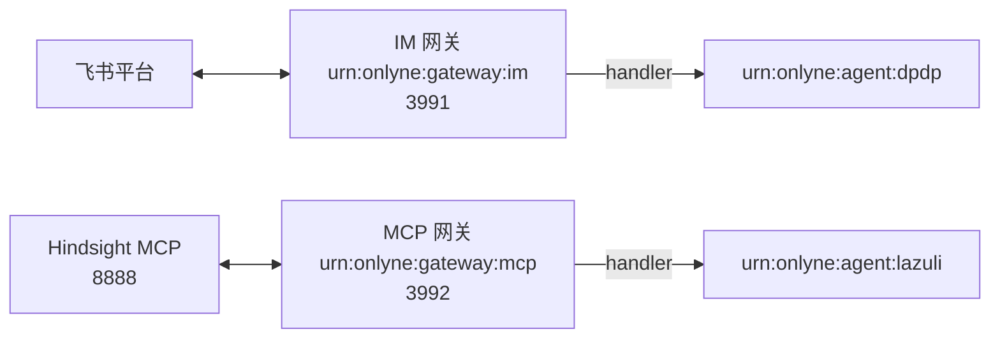

# 资源网关实验场景（dpdp + lazuli）

两个真实资源网关：飞书资源的 handler 是 `urn:onlyne:agent:dpdp`，MCP 资源的 handler 是 `urn:onlyne:agent:lazuli`。两个网关各自是一个 Onlyne 节点，独立启动，没有中心服务。



dpdp 与 lazuli 是 agent 节点，由 OMP 插件持有。在角色目录里跑 OMP，用 `/onlyne init` 建节点。同机运行的网关与 OMP 会自动发现彼此。用户在 `/onlyne` 里核对网关指纹并请求交换，在网关终端用 `accept <node-id>` 查看对端指纹，再输入终端显示的 `confirm <fingerprint>` 完成交换。信任状态会保留到下次启动。

## 目录

| 路径 | 内容 |
|---|---|
| `gateways/im.json` | IM 网关配置：飞书连接器，handler dpdp，不预设会话 |
| `gateways/mcp.json` | MCP 网关配置：Hindsight 服务、handler lazuli |
| `credentials/feishu` | 飞书凭据引用文件，内容是 `$FEISHU_CREDENTIAL` |
| `.env.example` | 凭据变量模板，复制成 `.env` 后填值 |
| `var/` | 运行时状态：存储、媒体文件、发现记录 |

`var/` 与 `.env` 已被 git 忽略。删掉 `var/` 会重置资源注册、事件日志和发现记录。

## 启动

凭据只从环境变量 `FEISHU_CREDENTIAL` 读取，脚本不 source 仓库里的任何凭据文件。可以直接在命令行传：

```sh
FEISHU_CREDENTIAL=cli_xxx:yyy examples/cluster/run-im.sh
```

想让脚本自己带上它，就在 `examples/cluster/` 下建一个本地 `.env`。值来自 open.feishu.cn/app → 你的应用 → 凭证与基础信息，App ID 与 App Secret 用一个英文冒号拼起来：

```sh
cp .env.example .env
# 编辑 .env，填 FEISHU_CREDENTIAL=cli_xxx:yyy
```

本地 `.env` 存在时由脚本 source，并把实际使用的文件打印在 stderr 的第一行；不存在时脚本只读环境变量。

Hindsight 的端点按本机实际改 `gateways/mcp.json` 里的 `servers[0].url`。它形如 `http://localhost:8888/mcp/<bank_id>/`。

两个网关分别启动。两个脚本都不依赖当前目录，它们会切到仓库根目录再启动，因为配置里的存储与媒体路径相对仓库根：

```sh
examples/cluster/run-im.sh
examples/cluster/run-mcp.sh
```

网关还没有打包成独立 CLI，脚本直接用 bun 跑包入口。前台运行时 `Ctrl-C` 会走到 `im.gateway.stopped` 与 `mcp.gateway.stopped`，两端都会关掉监听。

网关首次启动自动生成并保存自己的身份密钥。前台运行时它会占满终端，画出一张信任界面：

| 键 | 动作 |
|---|---|
| `↑` `↓` | 选择节点 |
| `t` | 请求交换；先显示对方指纹，按 `y` 才提交 |
| `a` | 接受对方发来的申请（仅 `待确认` 阶段可用） |
| `r` | 撤销信任 |
| `c` | 输入地址连接；接受 `host:port`、origin 或完整服务地址 |
| `q` | 退出界面，网关继续在后台运行并恢复打印 JSON 日志 |

节点行有两列状态，含义不同：**交换阶段**（`已认证` / `等对方` / `待确认` / `—`）说的是密钥是否配对，**投送**说的是这个网关当前有没有资源的绑定指向它——事件现在就发给它。两者互不推导：一个节点可以已认证却什么都不收，也可以是投送目标却没有配对（这时推送会一直失败）。

界面下半部分是最近日志，同一条消息连续重复会折叠成 `×N`；完整记录写在 `<storage 目录>/gateway.log`。跨网络节点用 `c` 输入地址，OMP 的 `/onlyne` 成员栏也提供同样的地址输入。设置 `ONLYNE_NO_TUI=1` 可以关掉界面，让 JSON 日志回到 stdout。

网关配置的顶层 `language` 可设为 `en` 或 `zh-CN`。省略时按 `ONLYNE_LANG`、`LC_ALL` 或 `LANG` 选择语言，默认使用英文。临时启动中文界面可运行 `ONLYNE_LANG=zh-CN examples/cluster/run-im.sh`。OMP 节点通过 `/onlyne language zh-CN` 切换并保存项目语言。

`run-im.sh` 在本地 `.env` 存在时 source 它，否则只读环境变量，并在两处可能踩空的地方打印提示：`FEISHU_CREDENTIAL` 未定义，以及 `conversation` 还是占位值。两条提示都不阻止启动，注册与读取照常可用。

IM 网关需要 `@onlyne/im-lark` 已安装，MCP 网关需要 Hindsight 服务在监听。凭据缺失时 IM 网关以 `The Lark credential is app_id:app_secret.` 退出；`$FEISHU_CREDENTIAL` 未定义会让凭据文件解析成字面量，得到同一条错误。

一个连接器服务它这条连接上的全部会话。机器人被拉进哪个群、谁私聊它，都是运行时事实：第一条事件到达时网关 adopt 那条会话，建资源与 thread，不需要重启，也不需要改配置。

资源 id 从平台坐标派生，`lark-<坐标>`。`gateways/im.json` 因此不写 `conversation`，也不写 `resource_ref`。要预绑定某条会话时，在连接器里加 `"conversation": "oc_xxx"`，它在启动时就建好资源。

交接以会话为最小单位：把一条群转给别的 agent，其他群的绑定与游标不受影响。

## 验证结果

两个网关在本机启动过，注册与授权边界按预期工作：

| 检查 | 结果 |
|---|---|
| 入站 adopt | 第一条事件到达即建资源，`binding.handler` 是 `urn:onlyne:agent:dpdp`，`log_readers` 是网关自身 |
| MCP 资源注册 | `binding.handler` 是 `urn:onlyne:agent:lazuli`，36 个工具进入 `operations` |
| 非 handler 读 IM 资源 | 404 `not_found` |
| 非 handler 调 MCP 工具 | 404 `not_found` |
| lazuli 调 Hindsight `recall` | `committed`，返回 5 条结果 |

MCP 侧调用通过，说明连接层、handler 判定与操作路径都通。

飞书侧未做实机收发：本机没有把机器人拉进任何群，也没有可用的单聊 open_id。多会话行为由离线测试覆盖（同一连接器两个坐标落两个资源、并发首触一个资源、交接粒度、发送寻址），见 RFC 0012 §10。

平台结果不明时记 `unknown` 而不是 `aborted`，与 RFC 0015 的三态一致：无法断定没有副作用的失败不能写成已中止。

## 交接

每条会话的资源都声明了 `handover`。dpdp 或 lazuli 通过 `POST /resources/{owner}/{id}/operations` 提交 `operation: 'handover'`，数据是 `{ target, handover_deadline, metadata }`。资源网关随即冻结推送，向目标发签名探测，目标答复后切换绑定。

一次交接只改一条会话的绑定。同连接器其他会话的 handler 与游标不变。

探测由网关签发，不由发起交接的 agent 签发，所以**网关自己必须与目标完成密钥交换**——只让发起方（比如 dpdp）和目标互为可信节点不够。缺少这段配对时请求根本发不出去，交接返回 `aborted`、`data.reason` 为 `untrusted_target`，`error.details.required_action` 指明该由哪一方发起交换。把 `target` 写成网关已经信任的节点（例如发起方自己）能提交，是因为那一对确实存在配对。
