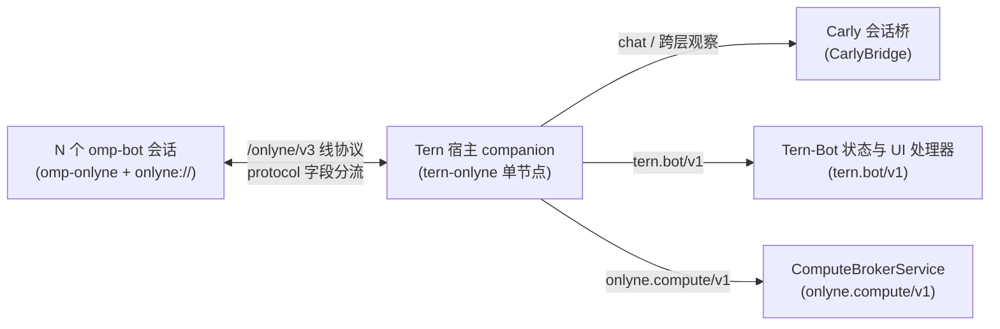

# Onlyne 应用层协议显式分流与 Tern-Bot 统一承载需求规范

## 一、目标与总体结论

单个 Onlyne 协议节点需要在同一身份、同一存储、同一套信任表与同一传输层之上同时承载多个应用层协议（自然语言会话协议、OECP 算力租约协议 `onlyne.compute/v1`、Tern-Bot 编排与工作台状态协议 `tern.bot/v1`、握手协议 `onlyne.trust/v1`）。

当前 `@onlyne/lib`、`packages/omp-onlyne` 与 `external-integrations/tern-onlyne` 将所有入站条目无差别送入单一宿主 `Runtime.inject`，将所有出站调用强制送入 LLM `plugins.decide`，并将所有可变外部对象限制在追加式事件日志资源模型内。本文档定义 `tern-bot` 复用 `tern-onlyne` 伴侣节点与 `omp-onlyne` 内部路径 `onlyne://` 所需的 7 项协议与宿主能力、精确代码位置、建议接口与验收判据。



---

## 二、现状代码证据总表

| 编号 | 阻塞点 | 现状位置 | 观测到的行为 | 对 Tern-Bot 复用 `tern-onlyne` / `omp-onlyne` 的直接影响 |
| :--- | :--- | :--- | :--- | :--- |
| R1 | 线协议缺少一级应用层协议字段 | `packages/lib/src/types.ts:43-56`<br/>`packages/lib/src/routes/shared.ts:43-49, 102-125` | `Message` 仅接受 `id, sender, delivery_kind, msg, meta`；`Message.meta` 仅接受 `thread, in_reply_to, relation, mentions, parts, data`。`shape()` 对任何额外字段直接抛出 `invalid_request`。同时 `delivery_kind` 在 `omp-onlyne/src/tool-text.ts:41` 被用作给 Judge 阅读的自然语言意图字符串。 | 机器协议标识符与自然语言意图共用 `delivery_kind` 字段，接收端无法无歧义地按协议精确分流。 |
| R2 | 入站消费无多协议分发器，高频机器消息会灌爆 Carly 与 OMP 未读队列 | `packages/lib/src/client.ts:1152-1179`<br/>`external-integrations/tern-onlyne/server/bridge.ts:112-165`<br/>`packages/omp-onlyne/src/runtime.ts:667-738` | `OnlyneClient.#consume` 将每条入站消息交给唯一的 `runtime.inject(entry, ...)`。`CarlyBridge.inject` 将所有非 `trust` 条目排入 `#pending` 等待 `cx:ask_carly` 唤醒 Carly 模型；`omp-onlyne` 将所有未注入条目计入 `alerts` 与 `unread`。 | `omp-bot` 上报 Worker 状态或续租算力时，每条心跳与状态帧都会触发 Carly 说话或污染会话收件箱。 |
| R3 | Carlys 旁路观察与按需介入缺少只读观察通道 | `external-integrations/tern-onlyne/server/bridge.ts:94-116`<br/>`external-integrations/tern-onlyne/server/main.ts:583-588` | 一条消息要么进入 `CarlyBridge.#pending` 要求 Carly 消费并回复（`consumed: false, outcome: "queued"`），要么被上层吞掉后对 Carly 完全不可见。 | 无法同时满足「算力申请/状态同步自动由机器 handler 消费结清，不打断 Carly」与「Carly 能实时看到申请流水并在需要时主动介入审批或接管」。 |
| R4 | 确定性应用协议发包被迫经过 LLM Judge，且 `tern-onlyne` 禁用了 `await` RPC | `packages/lib/src/client.ts:659, 763-783, 789-794`<br/>`external-integrations/tern-onlyne/server/bridge.ts:101-103` | `client.msg()` 每次调用必走 `plugins.decide(input)` 请求 SystemOne 模型。`CarlyBridge.supports` 写死 `plan.response !== "await"`，导致任何向 `tern-onlyne` 发起的 `{ response: "await" }` 请求在发送前被 `#ensureAwaitable` 拒绝（或在对端 `admit` 阶段因 `runtime.supports` 返回 `false` 被拒，见 `packages/lib/src/messages.ts:83-88`）。 | `omp-bot` 申请沙箱租约（`acquire` 需同步拿到 `SandboxDescriptor`）或同步状态时，既不能免模型确定性发包，也不能向 `tern-onlyne` 发起 `response: "await"` 的请求-响应调用。 |
| R5 | HTTP 入站 `admit` 未唤醒维护循环，导致机器消息最多滞留 30 秒 | `packages/lib/src/messages.ts:41, 279-297`<br/>`packages/lib/src/client.ts:49, 97-101, 636-652` | `OnlyneClient.IDLE_INTERVAL_MS` 为 `30_000` 毫秒。对端通过 `POST /onlyne/v3/messages` 投递消息时，`messages.admit` 写入 `inbox/<obligation_id>` 后未调用 `client.wakeLoop()`（仅 `keys.ts:383` 绑定了 `waker`）。 | 节点处于空闲周期时，`omp-bot` 发出的状态更新在服务端落库后最多延迟 30 秒才会触发入站处理器，UI 面板无法实时刷新。 |
| R6 | `Resource` 模型缺少可变状态快照更新（State Patch）与跨本地会话公开只读能力 | `packages/lib/src/resources.ts:104-112, 527-561`<br/>`packages/omp-onlyne/src/urls.ts:54-90` | `Resource` 注册后若再次调用 `register` 传入新 `data` 会因 `!same(stored, resource)` 抛出 `id_conflict`（`resources.ts:540`）；`mayRead` 仅允许 `handler` 或显式列在 `log_readers` 中的节点读取（`resources.ts:104-106`）；`onlyne://` 虚拟文件系统注册为 `immutable: true`（`omp-onlyne/src/urls.ts:56`）。 | 把 Bot 工作台、Worker 状态机与沙箱租约映射为 `onlyne://resources/<tern-node>/bot/<botId>` 时，既不能原子更新资源的当前 `data` 快照（驱动 `revision` 递增），也不能让同机新启动的 `omp-bot` 节点免逐个授权读取面板资源，还无法通过 `write("onlyne://...")` 直接提交协议动作。 |
| R7 | `tern-onlyne` 伴侣进程缺少面向其它 Tern 插件（如 `tern-bot` UI 面板）的协议扩展挂载面 | `external-integrations/tern-onlyne/server/main.ts:559-660`<br/>`external-integrations/tern-onlyne/host.luau:32-51` | `tern-onlyne` 将 `{ port, token, pid }` 写入私有 `tern.plugin.data .. "/server.json"`，且 `/admin/*` 仅提供面向 Carly 的 `/admin/pending`、`/admin/threads`、`/admin/msg` 等固定路由。 | `tern-bot` 的窗口插件（绘制右侧五段式伴侣面板、触发原生 PiP 小窗、点按「请求介入」）无法直接从 `tern-onlyne` 订阅或查询 `tern.bot/v1` 与 `onlyne.compute/v1` 的聚合视图和下发控制指令。 |

---

## 三、分项功能需求与设计建议

### 需求 1：一级应用层协议标识字段 `protocol`（Wire Schema 级分流）

1. **线协议字段定义**：
   在 `Message`（`packages/lib/src/types.ts:43-56`）与 `routes/shared.ts:116-125` 的白名单中新增顶层可选（或带默认值 `"onlyne.chat/v1"`）字段：
   ```ts
   export interface Message {
     id: string;
     sender: NodeId;
     /** 应用层协议标识，格式 `<namespace>/<version>`，缺省为 `"onlyne.chat/v1"` */
     protocol?: string;
     /** 该应用层协议内的动作名或自然语言投递意图 */
     delivery_kind: string;
     msg: string;
     meta?: {
       thread?: ThreadRef;
       in_reply_to?: MessageRef;
       relation?: 'reply' | 'followup';
       mentions?: string[];
       parts?: Json[];
       data?: { [key: string]: Json };
       /** 可选 payload schema 标识，供协议处理器做静态校验 */
       schema?: string;
     };
   }
   ```
2. **命名空间约定**：
   - `"onlyne.chat/v1"`（默认）：自然语言会话，走原有的 Carly / OMP Agent 对话注入与 SystemOne 判定。
   - `"onlyne.trust/v1"`：密钥交换与信任握手。
   - `"onlyne.compute/v1"`：OECP 算力租约控制面（`acquire` / `renew` / `release` / `destroy` / `status`）。
   - `"tern.bot/v1"`：Tern-Bot 编排与伴侣面板协议（`bot.register`、`bot.sync`、`worker.update`、`review.observation`、`human.intervene`、`pip.open`）。
3. **查询与过滤**：
   `MessageQuery`（`packages/lib/src/types.ts:123`）、`HistoryQuery` 与 `messages.inbox` / `messages.list` 支持 `protocol?: string | string[]` 与 `exclude_protocol?: string[]` 过滤参数，使对话视图默认排除高频机器协议帧，协议视图精确拉取所属协议条目。

---

### 需求 2：多协议入站路由器（Protocol Handler Registry）与按协议能力协商

1. **按协议注册确定性 Handler**：
   在 `OnlyneNode` / `node-host` 层提供协议分发注册表（位于单一 `Runtime.inject` 之前）：
   ```ts
   export interface ApplicationProtocolHandler {
     readonly protocol: string; // 支持精确匹配如 "tern.bot/v1" 或前缀如 "tern.bot/*"
     supports(plan: DeliveryPlan, message: Message): Promise<boolean> | boolean;
     handle(ctx: {
       entry: Entry;
       plan?: DeliveryPlan;
       reply: (body: { delivery_kind: string; msg: string; data?: Record<string, Json> }) => Promise<Receipt>;
     }): Promise<{
       outcome: 'consumed' | 'delegate_to_runtime';
       /** 是否同时投递到宿主旁路观察流（供 Carly 实时旁观） */
       tap?: { summary: string; actionable_by_agent?: boolean };
     }>;
   }
   ```
2. **解决 `response: "await"` 在 `tern-onlyne` 被拒的问题**：
   `packages/lib/src/messages.ts:83-88` 检查 `runtime.supports(request.plan, message)` 时，先路由到匹配 `message.protocol` 的 `ApplicationProtocolHandler.supports`。即使 `CarlyBridge` 本身不支持对自然语言聊天做 `await`，`onlyne.compute/v1` 与 `tern.bot/v1` 的机器 Handler 可以声明 `supports({ response: "await", execution: "existing" }) === true`，并在 `handle()` 内直接调用 `ctx.reply(...)` 同步写回回复条目，从而完整跑通跨进程 `await` RPC！
3. **隔离收件箱噪声**：
   当 `ApplicationProtocolHandler.handle` 返回 `{ outcome: "consumed" }` 时，`OnlyneClient.#consume` 直接调用 `confirmConsumption` 结清该 `LocalAttention`，不进入 `CarlyBridge.#pending`，也不计入 `omp-onlyne` 状态栏的 `alerts` / `unread`。

---

### 需求 3：Carly 旁路观察流（ Tap / Escalation Feed ）

对应你的设想——**「不用担心消息串到 Carly 这，而 Carly 也能看到实时的申请消息偶尔帮忙做处理」**：

1. **只读事件流（Ambient Activity Tap）**：
   当 `onlyne.compute/v1`（例如某个 Bot 申请带 GPU 或宿主机目录挂载的容器）或 `tern.bot/v1`（例如某个 Worker 请求人工/上级介入，或连续审阅失败）在 `tern-onlyne` 被机器 Handler 处理时，Handler 可附带返回 `tap: { summary, actionable_by_agent }`：
   - `actionable_by_agent: false`（常规申请/心跳）：写入 `tern-onlyne` 的协议活动环形缓冲区（通过 `onlyne://activity?protocol=...` 或 `/admin/activity` 可读），Carly 被用户问起「现在有几个 Bot 在跑沙箱？」时随时能查到实时真值，平时绝不主动唤醒 Carly 的回合。
   - `actionable_by_agent: true`（策略越界审批，如配额超限、未知镜像审批、Worker 升级求助）：将条目升级转入 `CarlyBridge` 待办队列（带结构化审批卡片元数据，与 `TrustPending` 同构），Carly 即可直接调用工具批准、驳回或代为回复。

---

### 需求 4：免 LLM Judge 的确定性协议发包通道（Typed Protocol Send / RPC）

1. **库层与 `omp-onlyne` 层直通 API**：
   在 `OnlyneClient` 与 `omp-onlyne` 暴露一个确定性协议调用入口（或在 `MsgInput` 中当 `protocol` 存在且不为 `"onlyne.chat/v1"`、且 `meta.to` 已显式给出时自动旁路 SystemOne `decide`）：
   ```ts
   client.sendProtocol({
     to: NodeId,
     protocol: "onlyne.compute/v1" | "tern.bot/v1" | string,
     delivery_kind: string, // 如 "acquire" | "bot.sync" | "worker.update"
     msg: string,
     data: Record<string, Json>,
     thread?: ThreadRef,
     in_reply_to?: MessageRef,
     response?: "none" | "async" | "await",
   }, options?: SendOptions)
   ```
2. **对 `omp-bot` 扩展的价值**：
   `omp-bot` 进程内的工具（`bdfl_dispatch`、`bdfl_review`、`sandbox_browser`、`bdfl_accept`）可以直接复用宿主 OMP 已加载的 `omp-onlyne` 运行时实例（例如通过全局符号或扩展 API `getOnlyneRuntime()` 拿到 `node.client`），零配置、零额外端口、零 Judge Token 消耗地向本机 `tern-onlyne` 节点发送 `onlyne.compute/v1` 与 `tern.bot/v1` 请求。
3. **子代理（Subagent）策略细化**：
   `packages/omp-onlyne/src/guard.ts` 当前拦截子代理的一切写操作。建议允许子代理在白名单协议（如上报自身进度的 `tern.bot/v1` 状态帧）或只读挂载路径下工作，而对自然语言会话继续保持主会话发送门禁。

---

### 需求 5：`messages.admit` 实时唤醒维护循环（消除 30 秒空闲延迟）

1. **修复位置**：
   在 `packages/lib/src/node.ts:31-62` 构造 `MessageService` 后，仿照 `this.trust.bindLoop(this.client)`（`node.ts:57`），为 `this.messages` 绑定 `this.client.wakeLoop()`。
2. **触发条件**：
   当 `messages.admit`（`packages/lib/src/messages.ts:285-290`）向本节点的 `inbox/<obligation_id>` 写入了一条新的未注入 `LocalAttention` 时，在事务提交后立即触发一次微任务级 `wakeLoop()`（甚至对已注册同步内存 `ApplicationProtocolHandler` 的协议直接在当前 tick 执行消费），保证端到端延迟 `< 20ms`。

---

### 需求 6：可变状态资源（Stateful Resource Snapshot）与 `onlyne://` 挂载增强

为了让「Bot 注册表、Worker 列表、沙箱租约与实时画面地址」直接作为一等公民挂载到 OMP 的 `onlyne://` internal path 上：

1. **Resource 状态快照原子更新（`resources.patch` / `updateData`）**：
   当前 `Resource.data` 只能在 `register` 时写入一次（`packages/lib/src/resources.ts:538-545`）。新增端点级方法 `resources.update(auth, ref, { data, log_readers?, expected_revision? })`：
   - 原子更新 `resource.data`（例如 `urn:onlyne:tern` 上的资源 `tern-bot/bots/<botId>` 或 `compute/leases/<leaseId>`），自动递增 `resource.revision`，并可选向该资源的 append-only `log` 追加一条变更事件。
2. **域内 / 同机通配读取授权（`log_readers: ["*"]` 或 `domain` 级可见性）**：
   当前 `mayRead`（`resources.ts:104-106`）要求把每个读者 `NodeId` 逐一写死在 `log_readers` 数组里。每新开一个 `omp-bot` 会话都有新的 `NodeId`，建议支持 `log_readers: ["*"]`（对所有已认证/同信任域对端可读），使任何 `omp-bot` 会话都能直接 `read onlyne://resources/<tern-node>/tern-bot/bots` 与 `read onlyne://resources/<tern-node>/compute/leases`。
3. **`omp-onlyne` 内部路径 `onlyne://` 协议视图与可变标记**：
   - 注意 `packages/omp-onlyne/src/urls.ts:56` 当前声明了 `immutable: true`——OMP 对 `immutable: true` 的虚拟资源可能会在会话内缓存读取结果！对于状态随时间变化的 `onlyne://resources/...`、`onlyne://inbox`、`onlyne://threads`，应返回 `immutable: false`，确保每次 `read` 拿到最新快照。
   - 新增按协议过滤的便捷路径：`onlyne://protocols/<protocol>/threads`、`onlyne://protocols/<protocol>/inbox`，或者在现有 `onlyne://threads?protocol=tern.bot/v1` 上支持查询参数过滤。
   - 暴露 `omp-onlyne` 进程内扩展桥（例如 `globalThis.__ompOnlyneRuntime` 或 `@onlyne/omp-onlyne/runtime` 公开导出 `getRuntime()`），允许同一 OMP 进程内的其它扩展（如 `tern-bot` 扩展）直接复用该会话已经建立好的 `OnlyneNode` 与身份密钥，无需再建第二个节点！

---

### 需求 7：`tern-onlyne` 伴侣宿主挂载內建服务与跨插件桥接

为了彻底消灭第二个守护进程，让 `tern-onlyne` 直接充当工作站上的唯一权威节点：

1. **在 `tern-onlyne` 内挂载 `ComputeBrokerService`（`onlyne.compute/v1`）与协议状态投影（`tern.bot/v1`）**：
   `tern-onlyne/server/main.ts` 本身就是由 Tern `host.luau` 守护的常驻 Bun 进程，且自带 SQLite 持久化（`SqliteStorage`）。在其中注册：
   - `onlyne.compute/v1` Handler：底层直接驱动 `@onlyne/compute-gateway` 的 `ComputeBrokerService` + `DockerSandboxDriver`（含定时 `sweep()` 租约到期回收），把每张沙箱租约发布为本节点 `Resource`（`kind: "compute.sandbox"`，含 `desktop` noVNC URL、`cdp` 端点、`http` 端点）。
   - `tern.bot/v1` Handler：维护权威的 Bot / Workspace / Worker / Human-Intervention 状态表，并发布为本节点 `Resource`（`kind: "tern.bot"`）。
2. **跨 Tern 插件只读/控制暴露（供 `tern-bot` 窗口 Luau 面板零配置消费）**：
   `tern-onlyne/host.luau` 将连接凭证写在私有 `tern.plugin.data .. "/server.json"` 中，其它 Tern 插件（如负责右侧伴侣 UI、24% 比例分栏与原生浮动 PiP 的 `tern-bot` Luau 插件）默认拿不到它的随机端口和 `adminToken`。建议在 `tern-onlyne` 中提供以下任一标准桥接：
   - **方案 A（推荐，最干净）**：`tern-onlyne/host.luau` 在 companion 就绪后，将公开网关发现信息 `{ endpoint, node_id }` 及面向同进程受信插件的桥接方法通过 `tern.kv.set("onlyne.gateway", ...)` 或 `window.luau` 的 `export` 表（如同已有的 Carly exports）暴露：`onlyne.send_protocol(protocol, kind, data)`、`onlyne.query_resource(id)`、`onlyne.subscribe_protocol(protocol, fn)`。
   - **方案 B**：在 `/admin/protocols/<protocol>/state` 与 `/admin/protocols/<protocol>/dispatch` 提供通用协议状态查询与动作派发路由，并将只读/插件级句柄写入共享键。

---

## 四、大一统后的端到端工作流核验（Tern + tern-onlyne + omp-onlyne + tern-bot）

上述 7 项落地后，整套系统不再有任何私设端口、重复守护进程或跨层串扰：

1. **单点常驻**：Tern 启动 `tern-onlyne` companion（唯一节点，SQLite 持久化，内建 `ComputeBrokerService` 与 `tern.bot/v1` 状态机）。
2. **Tern 创建 Bot 视图**：用户在 Tern 执行 `Tern Bot: Create Bot…` -> 输入工作区路径 -> `tern-bot` UI 插件通过 `tern-onlyne` 写入 `tern.bot/v1` 的 `bot.register` 资源 -> 用 `cx.layout:tab` 按 `0.76 : 0.24` 比例一次性拉起主栏 `omp`（加载了 `omp-onlyne` + `tern-bot` 扩展）与右侧五段式伴侣面板。
3. **OMP 会话零配置接入**：主栏 `omp` 启动后，直接复用自身 `omp-onlyne` 节点身份，通过 `protocol: "onlyne.compute/v1"` + `response: "await"` 向 `tern-onlyne` 申请 Worker/Review 沙箱容器，通过 `protocol: "tern.bot/v1"` 实时同步 Worker 进度；所有状态在 OMP 内可直接用 `read onlyne://resources/...` 查看。
4. **Carly 静默旁观 + 按需协管**：所有 `onlyne.compute/v1` 与 `tern.bot/v1` 流量在 `tern-onlyne` 入口即被对应协议 Handler 毫秒级消费，绝不刷屏 Carly；Carly 通过 `tap` 视图对全站算力租约与各 Bot 进度一目了然，遇到越界算力请求或人工升级信号时可随时插手审批。
5. **原生 PiP 与人工介入**：右侧 24% 伴侣面板从 `tern-onlyne` 读取 `tern.bot/v1` 资源，渲染「居中大头像 + 一级菜单 + 二级按钮框 + 常驻 Workers 列表 + 底部选中 Worker 详情卡」；点击左下 `[PiP]` 直接读取该 Worker 关联 `compute.sandbox` 资源的 `portal_urls.desktop` 弹出 Tern 右下角原生悬浮浏览器小窗；点击右下 `[请求介入]` 发送 `protocol: "tern.bot/v1", delivery_kind: "human.intervene"` 帧并切换可交互 VNC。

---

## 五、验收判据

1. **线协议兼容性与分流隔离**：发送 `protocol: "tern.bot/v1"` 与 `protocol: "onlyne.compute/v1"` 消息各 50 条后，`CarlyBridge.pending()` 长度为 `0`，`omp-onlyne` 对话 `unread` / `alerts` 计数为 `0`，同时协议 Handler 状态表准确反映全部 100 条更新；不带 `protocol` 的旧消息默认归入 `"onlyne.chat/v1"`，现有 `packages/lib/tests/verify.ts` 全绿。
2. **同步 `await` 协议调用延迟**：从 `omp-onlyne` 节点向 `tern-onlyne` 发送 `{ protocol: "tern.bot/v1", delivery_kind: "ping", response: "await" }`，不调用 SystemOne 模型，端到端往返延迟 `< 30ms`。
3. **Carly 旁路可观测与升级介入**：当 `onlyne.compute/v1` Handler 标记某次请求 `tap: { actionable_by_agent: false }` 时，Carly 不自动开回合但可在活动流读到该租约；标记 `actionable_by_agent: true` 时，`CarlyBridge.pending()` 收到一条带审批元数据的待办项。
4. **`onlyne://` 资源实时直读**：更新 `tern.bot/v1` 资源 `data` 后，任意同机 `omp` 会话连续两次执行 `read onlyne://resources/<tern-node>/tern-bot/bots/<botId>`，第二次立即读到更新后的 `revision` 与最新 Worker 状态（无 `immutable` 旧缓存残留）。
